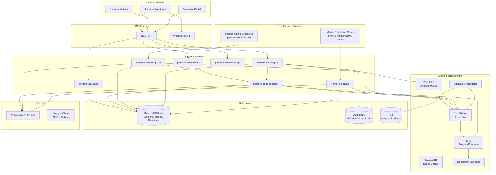
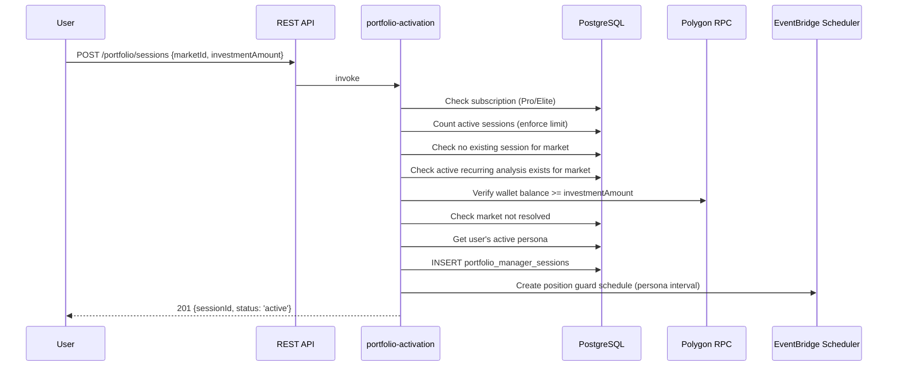
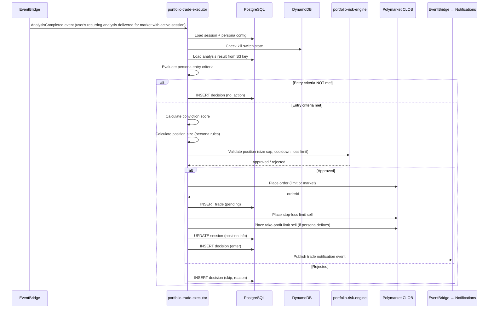
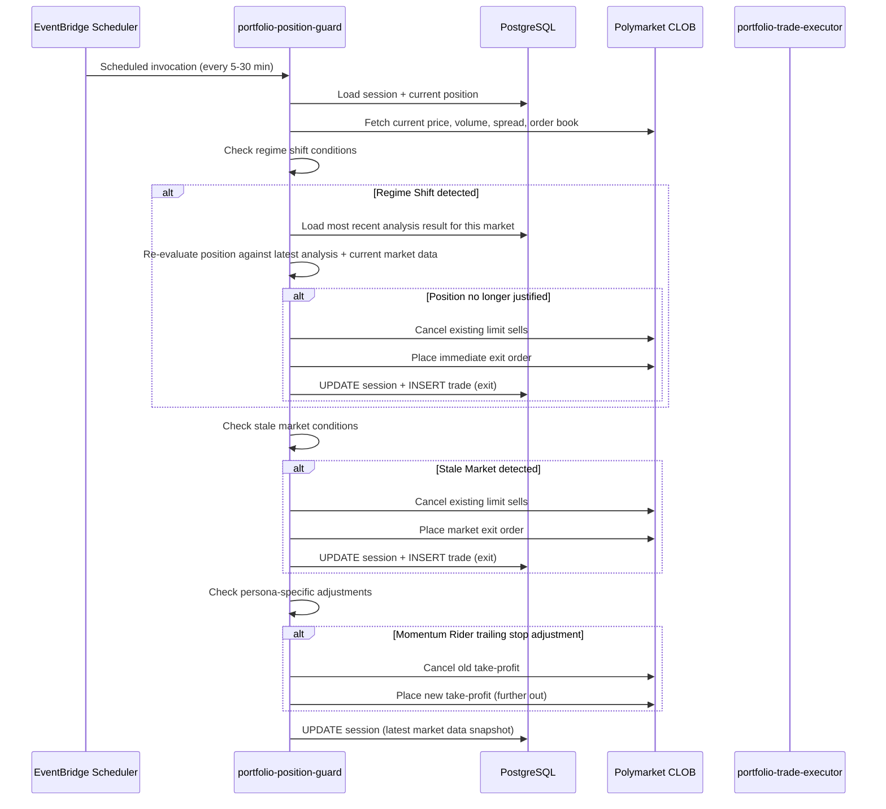
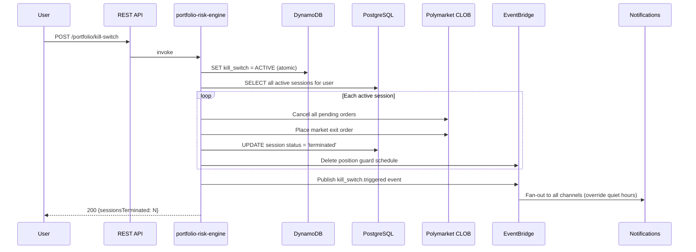

# Design Document: Autonomous Portfolio Manager

## Overview

The Autonomous Portfolio Manager extends TradeWizard's existing analysis pipeline into a fully autonomous trading system. Users activate a Portfolio Manager on a specific Polymarket market with a USDC.e investment amount, and the system autonomously executes trades, monitors positions, and manages exits based on the user's selected trading persona.

The system integrates with the existing 11-stage analysis workflow as its intelligence source, using EventBridge Scheduler for periodic monitoring (no always-on compute), and the Polymarket CLOB API for order placement. It reuses the existing WebSocket infrastructure for real-time dashboard updates and the notification fan-out system for trade alerts.

**Key Design Decisions:**
- **EventBridge Scheduler over polling loops**: Each active session gets a persona-specific EventBridge schedule for position monitoring, keeping costs near-zero when idle.
- **Lambda-based execution**: All portfolio manager logic runs in Lambda functions triggered by schedules or events - no long-running containers.
- **Piggybacks on user's recurring analysis**: The portfolio manager does NOT trigger its own analysis runs. It requires the user to have an active recurring analysis subscription on the market and consumes those results as they arrive via EventBridge events. This keeps analysis costs transparent and user-controlled.
- **Single persona per user**: Simplifies the decision engine - one set of rules governs all of a user's activations.
- **Session-scoped capital**: Each activation has its own Investment_Amount, preventing cross-market capital conflicts.

## Architecture

### High-Level System Architecture



### Component Integration with Existing Infrastructure

The portfolio manager plugs into the existing system at these integration points:

1. **Analysis Pipeline** → The portfolio manager does NOT trigger its own analysis. Instead, it subscribes to analysis completion events for markets where it has active sessions. The user must have an active recurring analysis subscription on the market. When the user's recurring analysis delivers a result via the existing EventBridge → SNS fan-out, the Trade Executor Lambda receives it and acts on it.

2. **Deduplication** → When multiple portfolio managers (or manual users) watch the same market, the existing DynamoDB dedup cache prevents redundant Bedrock executions. The portfolio manager's analysis requests go through the same `analysis-request` handler.

3. **WebSocket** → Dashboard updates push through the existing WebSocket API and DynamoDB connections table. The portfolio manager publishes state changes to EventBridge, which routes to the existing `analysis-delivery` Lambda for WebSocket push.

4. **Notifications** → Trade notifications use the existing SNS → multi-channel delivery fan-out (email, push, webhook, in-app).

5. **Authentication** → All portfolio manager REST endpoints use the existing Cognito authorizer.

## Components and Interfaces

### Lambda Functions

| Function | Trigger | Purpose | Timeout |
|----------|---------|---------|---------|
| `portfolio-activation` | REST API | Create/validate sessions, verify recurring analysis exists, set up position guard schedule | 30s |
| `portfolio-trade-executor` | EventBridge (analysis complete for markets with active sessions) + direct invoke | Evaluate analysis, size positions, place orders | 60s |
| `portfolio-position-guard` | EventBridge Scheduler (per-session) | Monitor positions, detect regime shifts, trigger exits | 30s |
| `portfolio-risk-engine` | EventBridge (trade events) + REST API (kill switch) | Enforce loss limits, position caps, cooldowns | 15s |
| `portfolio-lifecycle` | EventBridge Scheduler + REST API | Market resolution, session termination, daily summaries | 30s |
| `portfolio-investment` | REST API | Increase/decrease investment amounts | 15s |
| `portfolio-dashboard-api` | REST API | Session list, trade history, aggregate stats | 15s |

### REST API Endpoints

```
POST   /portfolio/sessions                    # Activate portfolio manager
GET    /portfolio/sessions                    # List user's sessions
GET    /portfolio/sessions/{sessionId}        # Session detail
PUT    /portfolio/sessions/{sessionId}/pause  # Pause session
PUT    /portfolio/sessions/{sessionId}/resume # Resume session
DELETE /portfolio/sessions/{sessionId}        # Stop session (exit positions)
PUT    /portfolio/sessions/{sessionId}/investment  # Update investment amount
GET    /portfolio/sessions/{sessionId}/trades # Trade history (paginated)
GET    /portfolio/sessions/{sessionId}/decisions # Decision log (paginated)
GET    /portfolio/stats                       # Aggregate portfolio stats
PUT    /portfolio/settings/persona            # Update persona selection
GET    /portfolio/settings/persona            # Get current persona config
POST   /portfolio/kill-switch                 # Trigger global kill switch
DELETE /portfolio/kill-switch                 # Reset kill switch
```

### WebSocket Events (pushed to client)

```typescript
// Session state changes
{ type: 'portfolio.session.updated', sessionId, status, unrealizedPnl, realizedPnl }

// Trade executed
{ type: 'portfolio.trade.executed', sessionId, trade: { direction, orderType, size, price, reasoning } }

// Position exited
{ type: 'portfolio.position.exited', sessionId, exitReason, pnl, holdDuration }

// Risk alert
{ type: 'portfolio.risk.alert', level: 'warning' | 'critical', message, sessionsAffected }

// Kill switch triggered
{ type: 'portfolio.kill_switch.triggered', reason, sessionsAffected }
```

### Key Interfaces

```typescript
// Persona definition
interface Persona {
  id: string;
  name: string;
  riskLevel: 'conservative' | 'moderate' | 'aggressive';
  entryRules: {
    minEdge: number;           // minimum edge % to enter
    minSignalAlignment: number; // minimum signal alignment 0-1
    minConvictionScore: number; // minimum conviction score 0-1
    additionalCriteria?: Record<string, any>; // persona-specific (e.g., spread for Scalper)
  };
  sizingRules: {
    minAllocationPct: number;  // min % of available investment
    maxAllocationPct: number;  // max % of available investment
    scalingFactor: number;     // how conviction maps to size within range
  };
  exitRules: {
    stopLossPct: number;       // % below entry to place stop
    takeProfitPct?: number;    // % above entry for take-profit (null = dynamic)
    patienceWindowMinutes: number; // how long to wait for limit fill
  };
  monitoringRules: {
    analysisIntervalMinutes: number;
    positionGuardIntervalMinutes: number;
  };
}

// Session state
interface PortfolioSession {
  id: string;
  userId: string;
  marketId: string;           // Polymarket condition ID
  personaId: string;
  personaConfig: Persona;     // snapshot at activation time
  investmentAmount: number;   // total USDC.e allocated
  status: 'active' | 'paused' | 'exiting' | 'completed' | 'terminated';
  currentPosition?: {
    direction: 'YES' | 'NO';
    size: number;             // shares held
    entryPrice: number;
    entryTimestamp: string;
    stopLossOrderId?: string;
    takeProfitOrderId?: string;
  };
  stats: {
    totalTrades: number;
    winningTrades: number;
    realizedPnl: number;
    unrealizedPnl: number;
    avgHoldDurationMinutes: number;
  };
  schedules: {
    positionGuardScheduleArn?: string;
  };
  createdAt: string;
  updatedAt: string;
  terminatedAt?: string;
  terminationReason?: string;
}

// Trade record
interface PortfolioTrade {
  id: string;
  sessionId: string;
  analysisResultId?: string;
  direction: 'YES' | 'NO';
  side: 'BUY' | 'SELL';
  orderType: 'limit' | 'market';
  size: number;              // USDC.e amount
  price: number;
  fillPrice?: number;
  status: 'pending' | 'filled' | 'cancelled' | 'failed';
  clobOrderId?: string;
  reasoning: string;
  createdAt: string;
  filledAt?: string;
  cancelledAt?: string;
}

// Decision record
interface PortfolioDecision {
  id: string;
  sessionId: string;
  analysisResultId?: string;
  action: 'enter' | 'hold' | 'exit' | 'no_action' | 'skip';
  entryEvaluation: {
    edgeMet: boolean;
    alignmentMet: boolean;
    convictionScore: number;
    additionalCriteriaMet: boolean;
  };
  positionStateAtDecision: {
    hasPosition: boolean;
    direction?: 'YES' | 'NO';
    unrealizedPnl?: number;
  };
  reasoning: string;         // max 500 chars
  createdAt: string;
}

// Conviction score calculation
interface ConvictionScore {
  value: number;             // 0.0 to 1.0
  components: {
    consensusConfidence: number;  // weight: 0.4
    edgeMagnitude: number;       // weight: 0.35
    signalAlignment: number;     // weight: 0.25
  };
}
```

### Activation Flow



### Trade Execution Flow



### Position Guard Monitoring Flow



### Kill Switch Propagation Flow



## Data Models

### New PostgreSQL Tables

```sql
-- ============================================================================
-- PORTFOLIO MANAGER SESSIONS
-- ============================================================================

CREATE TABLE portfolio_manager_sessions (
  id UUID PRIMARY KEY DEFAULT gen_random_uuid(),
  user_id UUID NOT NULL REFERENCES users(id) ON DELETE CASCADE,
  market_id TEXT NOT NULL,                    -- Polymarket condition ID
  recurring_analysis_id UUID NOT NULL,        -- linked recurring analysis subscription
  persona_id TEXT NOT NULL,                   -- e.g., 'sniper', 'scalper'
  persona_config JSONB NOT NULL,             -- snapshot of persona at activation
  investment_amount NUMERIC(12, 2) NOT NULL,  -- total USDC.e allocated
  status TEXT NOT NULL DEFAULT 'active',      -- active, paused, exiting, completed, terminated
  
  -- Current position (null when not positioned)
  position_direction TEXT,                    -- 'YES' or 'NO'
  position_size NUMERIC(12, 6),              -- shares held
  position_entry_price NUMERIC(8, 6),
  position_entry_at TIMESTAMPTZ,
  position_stop_loss_order_id TEXT,
  position_take_profit_order_id TEXT,
  
  -- Cumulative stats
  total_trades INTEGER NOT NULL DEFAULT 0,
  winning_trades INTEGER NOT NULL DEFAULT 0,
  realized_pnl NUMERIC(12, 6) NOT NULL DEFAULT 0,
  unrealized_pnl NUMERIC(12, 6) NOT NULL DEFAULT 0,
  total_hold_duration_minutes INTEGER NOT NULL DEFAULT 0,
  
  -- Capital tracking
  amount_in_positions NUMERIC(12, 2) NOT NULL DEFAULT 0,
  amount_in_pending_orders NUMERIC(12, 2) NOT NULL DEFAULT 0,
  amount_available NUMERIC(12, 2) NOT NULL,  -- = investment_amount - in_positions - in_pending
  
  -- Scheduling
  position_guard_schedule_arn TEXT,
  
  -- Risk state
  cumulative_loss_pct NUMERIC(5, 4) NOT NULL DEFAULT 0,  -- % of investment lost
  last_loss_exit_at TIMESTAMPTZ,             -- for 30-min cooldown
  position_size_reduction_active BOOLEAN NOT NULL DEFAULT false,  -- 50% reduction at 30% loss
  
  -- Lifecycle
  termination_reason TEXT,                   -- 'user_stopped', 'market_resolved', 'capital_depleted', 'kill_switch', 'subscription_downgrade', 'risk_limit'
  created_at TIMESTAMPTZ NOT NULL DEFAULT now(),
  updated_at TIMESTAMPTZ NOT NULL DEFAULT now(),
  terminated_at TIMESTAMPTZ,
  
  CONSTRAINT unique_user_market_session UNIQUE (user_id, market_id) 
    WHERE status IN ('active', 'paused', 'exiting'),
  CONSTRAINT valid_status CHECK (status IN ('active', 'paused', 'exiting', 'completed', 'terminated')),
  CONSTRAINT valid_direction CHECK (position_direction IN ('YES', 'NO') OR position_direction IS NULL),
  CONSTRAINT positive_investment CHECK (investment_amount >= 5)
);

-- ============================================================================
-- PORTFOLIO MANAGER TRADES
-- ============================================================================

CREATE TABLE portfolio_manager_trades (
  id UUID PRIMARY KEY DEFAULT gen_random_uuid(),
  session_id UUID NOT NULL REFERENCES portfolio_manager_sessions(id) ON DELETE CASCADE,
  analysis_result_id UUID REFERENCES analysis_results(id),
  
  -- Order details
  direction TEXT NOT NULL,                   -- 'YES' or 'NO'
  side TEXT NOT NULL,                        -- 'BUY' or 'SELL'
  order_type TEXT NOT NULL,                  -- 'limit' or 'market'
  size_usdc NUMERIC(12, 6) NOT NULL,         -- USDC.e amount
  price NUMERIC(8, 6) NOT NULL,              -- target price
  fill_price NUMERIC(8, 6),                  -- actual fill price
  shares NUMERIC(12, 6),                     -- shares received/sold
  
  -- Status
  status TEXT NOT NULL DEFAULT 'pending',    -- pending, filled, partially_filled, cancelled, failed
  clob_order_id TEXT,                        -- Polymarket order ID
  
  -- Context
  trade_purpose TEXT NOT NULL,               -- 'entry', 'exit', 'stop_loss', 'take_profit', 'partial_exit', 'emergency_exit'
  reasoning TEXT,                            -- max 500 chars
  conviction_score NUMERIC(5, 4),
  
  -- Timing
  patience_expires_at TIMESTAMPTZ,           -- when to cancel unfilled limit orders
  created_at TIMESTAMPTZ NOT NULL DEFAULT now(),
  filled_at TIMESTAMPTZ,
  cancelled_at TIMESTAMPTZ,
  
  -- P&L (for exit trades)
  realized_pnl NUMERIC(12, 6),
  hold_duration_minutes INTEGER,
  exit_reason TEXT,                          -- 'target_reached', 'stop_loss', 'regime_shift', 'stale_market', 'contradicting_analysis', 'risk_limit', 'user_stop', 'market_resolved'
  
  CONSTRAINT valid_direction CHECK (direction IN ('YES', 'NO')),
  CONSTRAINT valid_side CHECK (side IN ('BUY', 'SELL')),
  CONSTRAINT valid_order_type CHECK (order_type IN ('limit', 'market')),
  CONSTRAINT valid_status CHECK (status IN ('pending', 'filled', 'partially_filled', 'cancelled', 'failed')),
  CONSTRAINT valid_purpose CHECK (trade_purpose IN ('entry', 'exit', 'stop_loss', 'take_profit', 'partial_exit', 'emergency_exit'))
);

-- ============================================================================
-- PORTFOLIO MANAGER DECISIONS
-- ============================================================================

CREATE TABLE portfolio_manager_decisions (
  id UUID PRIMARY KEY DEFAULT gen_random_uuid(),
  session_id UUID NOT NULL REFERENCES portfolio_manager_sessions(id) ON DELETE CASCADE,
  analysis_result_id UUID REFERENCES analysis_results(id),
  
  -- Decision
  action TEXT NOT NULL,                      -- 'enter', 'hold', 'exit', 'no_action', 'skip'
  
  -- Entry evaluation
  edge_met BOOLEAN,
  alignment_met BOOLEAN,
  conviction_score NUMERIC(5, 4),
  additional_criteria_met BOOLEAN,
  
  -- Position state at decision time
  had_position BOOLEAN NOT NULL DEFAULT false,
  position_direction TEXT,
  position_unrealized_pnl NUMERIC(12, 6),
  
  -- Context
  reasoning TEXT NOT NULL,                   -- max 500 chars
  skip_reason TEXT,                          -- 'insufficient_data', 'cooldown', 'risk_limit', 'paused', 'kill_switch', 'pipeline_failure'
  
  created_at TIMESTAMPTZ NOT NULL DEFAULT now(),
  
  CONSTRAINT valid_action CHECK (action IN ('enter', 'hold', 'exit', 'no_action', 'skip'))
);

-- ============================================================================
-- INDEXES
-- ============================================================================

CREATE INDEX idx_pm_sessions_user_status ON portfolio_manager_sessions(user_id, status);
CREATE INDEX idx_pm_sessions_market ON portfolio_manager_sessions(market_id) WHERE status IN ('active', 'paused');
CREATE INDEX idx_pm_trades_session ON portfolio_manager_trades(session_id, created_at DESC);
CREATE INDEX idx_pm_trades_status ON portfolio_manager_trades(status) WHERE status = 'pending';
CREATE INDEX idx_pm_decisions_session ON portfolio_manager_decisions(session_id, created_at DESC);
CREATE INDEX idx_pm_sessions_active ON portfolio_manager_sessions(status, updated_at) WHERE status = 'active';

-- ============================================================================
-- TRIGGERS
-- ============================================================================

CREATE TRIGGER update_pm_sessions_updated_at
  BEFORE UPDATE ON portfolio_manager_sessions
  FOR EACH ROW EXECUTE FUNCTION update_updated_at_column();
```

### DynamoDB Items

**Kill Switch State** (in existing `rate-limits` table):
```
PK: "kill_switch#{userId}"
SK: "state"
Attributes: { active: boolean, triggeredAt: ISO string, reason: string, ttl: number }
```

**Session Locks** (in existing `dedup-cache` table for distributed locking):
```
PK: "pm_lock#{sessionId}"
SK: "guard" | "executor"
Attributes: { lockedBy: string, lockedAt: ISO string, ttl: number (60s) }
```

### User Profile Extension

Add to existing `users` table or a new `user_settings` table:
```sql
ALTER TABLE users ADD COLUMN portfolio_persona_id TEXT NOT NULL DEFAULT 'scalper';
ALTER TABLE users ADD COLUMN portfolio_persona_params JSONB;  -- Elite customization
```


## Correctness Properties

The following properties must hold for the portfolio manager system to be considered correct:

### Property 1: Capital Conservation
**Validates: Requirements 6.5, 6.6, 6.7**
**Property:** At no point shall the sum of (amount_in_positions + amount_in_pending_orders + amount_available) exceed the session's investment_amount. Capital is never created from nothing.
**Formal:** ∀ session s: s.amount_in_positions + s.amount_in_pending_orders + s.amount_available ≤ s.investment_amount

### Property 2: Session Uniqueness
**Validates: Requirements 1.10**
**Property:** A user can have at most one active (status IN ['active', 'paused', 'exiting']) session per market at any time.
**Formal:** ∀ user u, market m: |{s ∈ sessions | s.user_id = u ∧ s.market_id = m ∧ s.status ∈ {active, paused, exiting}}| ≤ 1

### Property 3: Plan Gating
**Validates: Requirements 1.2, 1.3**
**Property:** Only users with Pro or Elite subscriptions can have active sessions. No session creation or trade execution occurs for Free or Starter users.
**Formal:** ∀ session s where s.status = 'active': user(s.user_id).plan ∈ {pro, elite}

### Property 4: Concurrent Session Limits
**Validates: Requirements 1.5, 1.6**
**Property:** Pro users never exceed 3 active sessions. Elite users never exceed 10 active sessions.
**Formal:** ∀ user u: |active_sessions(u)| ≤ plan_limit(u.plan) where plan_limit(pro) = 3, plan_limit(elite) = 10

### Property 5: Kill Switch Totality
**Validates: Requirements 8.3, 9.7**
**Property:** When the kill switch is triggered, ALL active sessions for that user transition to 'terminated' status and ALL pending orders are cancelled. No session remains active.
**Formal:** After kill_switch(u): ∀ s ∈ sessions(u): s.status = 'terminated' ∧ pending_orders(s) = ∅

### Property 6: Loss Limit Enforcement
**Validates: Requirements 8.1, 8.6**
**Property:** No session's cumulative loss (realized + unrealized) shall exceed 50% of its investment_amount. The exit sequence triggers at 45%.
**Formal:** ∀ session s: cumulative_loss(s) ≤ 0.50 × s.investment_amount

### Property 7: Position Size Cap
**Validates: Requirements 8.4, 4.10**
**Property:** No single trade shall exceed 50% of the session's current available investment amount, regardless of persona sizing rules.
**Formal:** ∀ trade t in session s: t.size_usdc ≤ 0.50 × s.amount_available

### Property 8: Cooldown Enforcement
**Validates: Requirements 8.7**
**Property:** After a loss-exit, no new entry trade is placed for that session within 30 minutes.
**Formal:** ∀ session s: if last_loss_exit_at(s) exists ∧ now() - last_loss_exit_at(s) < 30min → no entry trade placed

### Property 9: Analysis Dependency
**Validates: Requirements 10.1, 10.4**
**Property:** A portfolio manager session can only be active on a market where the user has an active recurring analysis subscription. If the recurring analysis is cancelled, the session is paused.
**Formal:** ∀ session s where s.status = 'active': ∃ recurring_analysis r where r.user_id = s.user_id ∧ r.market_id = s.market_id ∧ r.status = 'active'

### Property 10: Notification Completeness
**Validates: Requirements 11.1, 11.2, 11.3**
**Property:** Every trade execution (entry or exit) produces exactly one notification to the user. Kill switch events produce notifications on all enabled channels regardless of quiet hours.
**Formal:** ∀ trade t where t.status = 'filled': |notifications(t)| ≥ 1

## Error Handling

### API Failures (Polymarket CLOB)

| Scenario | Behavior | Recovery |
|----------|----------|----------|
| Order placement fails | Retry 3x with exponential backoff (1s, 2s, 4s) | Log failure, notify user, skip trade for this cycle |
| Order status check fails | Retry 3x | Use last known state, check again next monitoring cycle |
| 3 consecutive failures (any endpoint) | Pause ALL portfolio manager activity | Notify user, require manual resume after API recovery |
| Order fill check timeout | Mark order as "unknown" | Position Guard verifies on next cycle via balance check |

### Analysis Pipeline Failures

| Scenario | Behavior | Recovery |
|----------|----------|----------|
| Analysis times out (>120s) | Retain current position unchanged | Log as "pipeline_failure", retry at next scheduled interval |
| Analysis returns error | Retain current position unchanged | Log error, retry at next scheduled interval |
| Dedup returns stale result | Accept if within freshness window | Otherwise trigger fresh analysis |

### Infrastructure Failures

| Scenario | Behavior | Recovery |
|----------|----------|----------|
| Lambda timeout during trade | Order may be placed but not recorded | Position Guard reconciles on next cycle by checking CLOB positions |
| EventBridge schedule missed | Monitoring gap | Next scheduled invocation catches up; Position Guard checks for missed events |
| RDS connection failure | Lambda retries with connection pool | If persistent, pause session and notify user |
| DynamoDB throttling | Exponential backoff on lock acquisition | If lock cannot be acquired in 10s, skip this cycle |

### Concurrency Control

- **Distributed locks** via DynamoDB conditional writes prevent simultaneous Position Guard and Trade Executor from conflicting on the same session
- Lock TTL of 60 seconds prevents deadlocks from crashed Lambdas
- If lock acquisition fails, the invocation is skipped (next scheduled run will proceed)

### Graceful Degradation

- If the Risk Engine is unreachable, the Trade Executor refuses to place orders (fail-safe)
- If notifications fail, trades still execute (notifications are best-effort for routine events, guaranteed-delivery only for kill switch)
- If wallet balance verification fails, activation is rejected (fail-safe)

## Testing Strategy

### Unit Tests

| Component | What to Test | Framework |
|-----------|-------------|-----------|
| Conviction Score calculation | Weighted formula produces correct 0-1 values | Vitest |
| Persona entry criteria evaluation | Each persona's rules correctly accept/reject signals | Vitest |
| Position sizing logic | Size calculations respect persona ranges and risk caps | Vitest |
| Capital tracking | amount_in_positions + pending + available never exceeds investment | Vitest |
| Cooldown enforcement | 30-minute re-entry block after loss exits | Vitest |

### Property-Based Tests (fast-check)

| Property | Generator Strategy |
|----------|-------------------|
| P1: Capital Conservation | Generate random sequences of trades (entries, exits, partial fills) and verify capital invariant holds after each |
| P4: Concurrent Session Limits | Generate random activation/termination sequences and verify limits never exceeded |
| P6: Loss Limit Enforcement | Generate price movement sequences and verify exit triggers before 50% loss |
| P7: Position Size Cap | Generate random conviction scores and persona configs, verify size never exceeds 50% of available |
| P8: Cooldown Enforcement | Generate trade sequences with losses and verify no re-entry within 30 minutes |

### Integration Tests

| Flow | What to Test |
|------|-------------|
| Activation → First Analysis | Session created, schedule set up, analysis triggered, trade executor receives result |
| Trade Execution → Risk Check | Entry criteria met → risk engine validates → order placed → recorded |
| Position Guard → Exit | Regime shift detected → analysis triggered → contradicting result → exit executed |
| Kill Switch → Full Termination | All sessions terminated, all orders cancelled, all schedules deleted |
| Subscription Downgrade → Grace Period | Sessions terminated within 24h, positions exited |

### E2E Tests

| Scenario | Approach |
|----------|----------|
| Full session lifecycle | Mock CLOB API, run activation → analysis → entry → monitoring → exit → session complete |
| Kill switch under load | Create max sessions, trigger kill switch, verify all terminated within SLA |
| Concurrent guard + executor | Simulate simultaneous invocations, verify lock prevents conflicts |

### Performance Tests

| Metric | Target | Test Approach |
|--------|--------|---------------|
| Activation latency | < 3 seconds | Load test POST /portfolio/sessions |
| Trade execution latency | < 5 seconds from analysis delivery | Measure EventBridge → Lambda → CLOB round trip |
| Kill switch propagation | < 30 seconds for 10 sessions | Trigger kill switch with max Elite sessions |
| Dashboard API response | < 500ms for session list | Load test with 10 active sessions |
