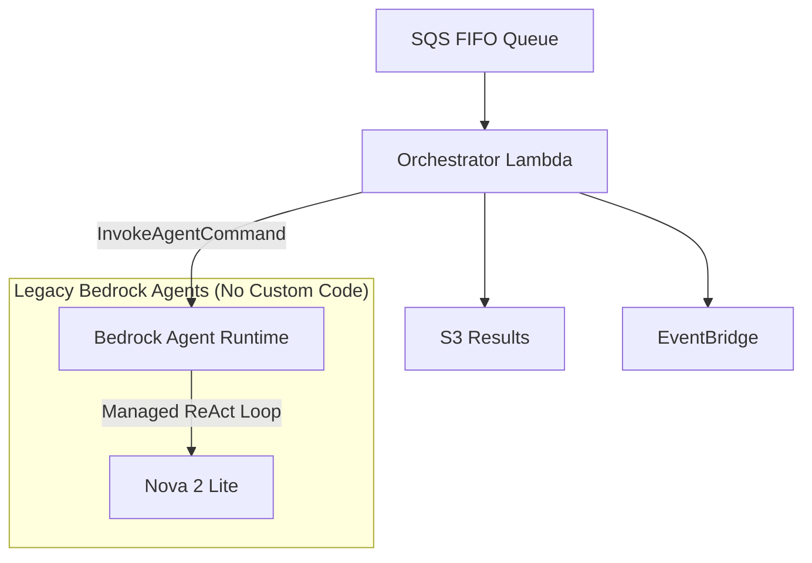
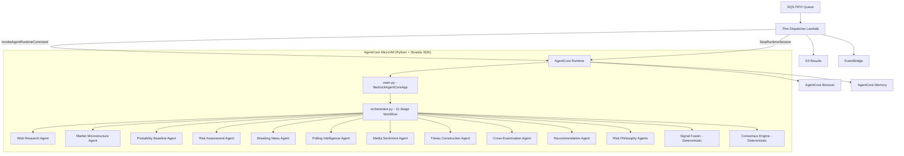
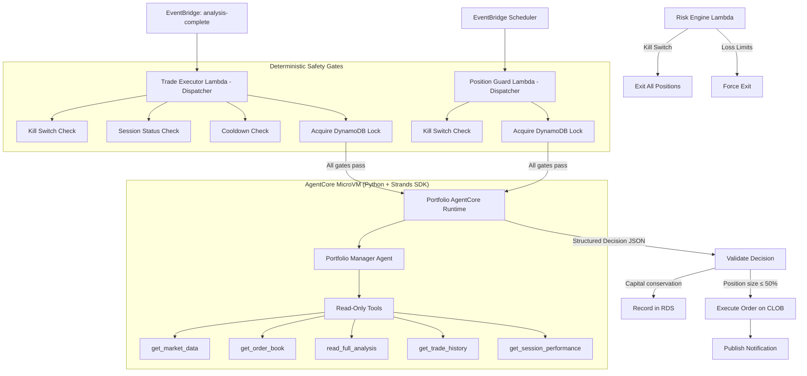
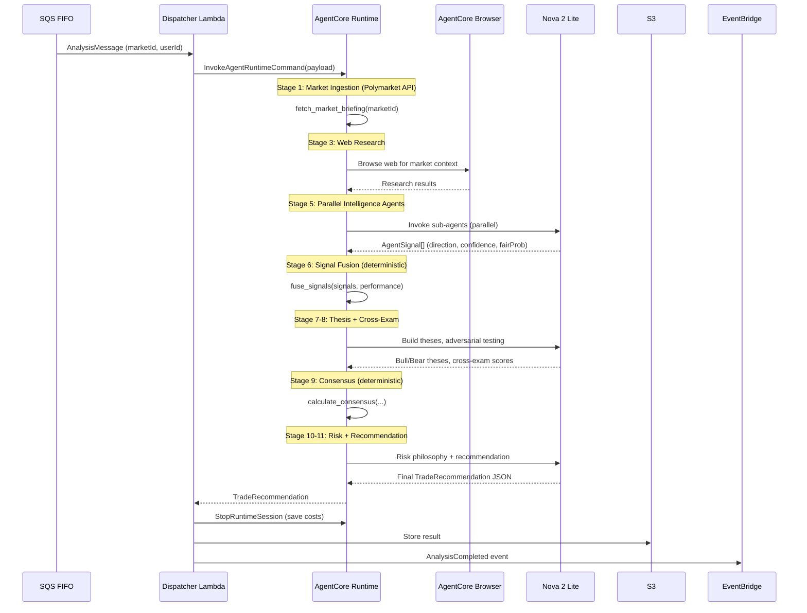
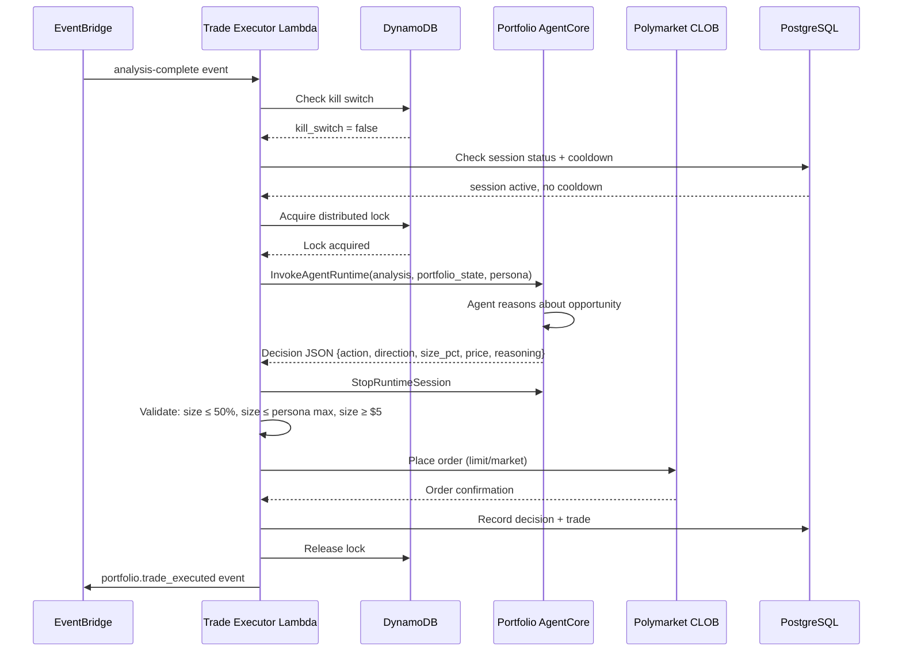

# Design Document: Bedrock AgentCore Migration

## Overview

Migrate TradeWizard from the legacy Amazon Bedrock Agents API (`CreateAgent`/`InvokeAgent` via `@aws-sdk/client-bedrock-agent`) to Amazon Bedrock AgentCore - a serverless hosting platform for custom agent code using Strands SDK (Python). The migration replaces managed instruction-string agents with full Python agent applications deployed to isolated microVMs, enabling autonomous web browsing, custom tool integration, and complete control over the agent execution loop.

The migration spans 5 phases: (1) scrap legacy infrastructure, (2) build Python AgentCore application for the analysis orchestrator, (3) deploy to AgentCore Runtime, (4) integrate AgentCore primitives (Browser, Memory), and (5) build a separate Portfolio Manager agent with hybrid architecture (agent brain + deterministic guardrails).

## Architecture

### Current Architecture (Legacy - To Be Replaced)



### Target Architecture (AgentCore - Option A: Single Orchestrator Runtime)



### Portfolio Manager Architecture (Hybrid: Agent + Deterministic Guardrails)



## Sequence Diagrams

### Analysis Workflow (Post-Migration)



### Portfolio Trade Execution (Post-Migration)



## Components and Interfaces

### Component 1: AgentCore Analysis Runtime (`infra/agentcore/`)

**Purpose**: Python application deployed to AgentCore Runtime that executes the full 11-stage analysis workflow using Strands SDK agents.

**Interface**:
```python
# main.py entrypoint
@app.entrypoint
def handle_analysis(payload: dict, context: dict) -> dict:
    """
    Input payload:
      - marketId: str (Polymarket condition ID)
      - userId: str (Cognito sub)
      - prompt: str (optional override)
    
    Returns:
      - TradeRecommendation dict with action, zones, explanation, metadata
    """
```

**Responsibilities**:
- Execute 11-stage analysis workflow end-to-end
- Manage Strands sub-agents (web research, intelligence, thesis, etc.)
- Run deterministic signal fusion and consensus engine
- Use AgentCore Browser for autonomous web research
- Return structured TradeRecommendation JSON

### Component 2: AgentCore Portfolio Manager Runtime (`infra/agentcore-portfolio/`)

**Purpose**: Python application deployed to AgentCore Runtime that makes trading decisions based on persona-specific reasoning. Read-only - never executes orders directly.

**Interface**:
```python
# main.py entrypoint
@app.entrypoint
def handle_trade_decision(payload: dict, context: dict) -> dict:
    """
    Input payload:
      - persona: str (sniper|scalper|contrarian|catalyst_hunter|hedge_architect|momentum_rider)
      - analysis_result: dict (full analysis from S3)
      - portfolio_state: dict (session, positions, capital breakdown)
      - market_data: dict (current price, spread, volume)
      - decision_type: str (entry|exit_evaluation)
    
    Returns:
      - Decision dict: {action, direction, size_pct, price, order_type, reasoning, conviction}
    """
```

**Responsibilities**:
- Apply persona-specific reasoning to trading decisions
- Use read-only tools to gather market context
- Return structured decision JSON (never execute orders)
- Generate natural language reasoning (500+ chars)

### Component 3: Rewritten Bedrock Stack (`infra/lib/bedrock-stack.ts`)

**Purpose**: CDK stack providing IAM roles for AgentCore (replaces legacy Bedrock Agents IAM).

**Interface**:
```typescript
export class BedrockStack extends cdk.Stack {
  public readonly agentExecutionRole: iam.Role;  // Trusts bedrock-agentcore.amazonaws.com
  public readonly orchestratorRole: iam.Role;    // Lambda role with InvokeAgentRuntime permission
}
```

**Responsibilities**:
- Create execution role trusting `bedrock-agentcore.amazonaws.com`
- Grant `bedrock:InvokeModel` to execution role
- Grant `bedrock-agentcore:InvokeAgentRuntime` and `StopRuntimeSession` to orchestrator Lambda
- Grant CloudWatch Logs permissions for AgentCore

### Component 4: Rewritten Analysis Orchestrator Lambda (`infra/services/analysis-orchestrator/handler.ts`)

**Purpose**: Thin dispatcher Lambda that invokes AgentCore Runtime and handles result storage/delivery.

**Interface**:
```typescript
// SQS-triggered handler
export async function handler(event: SQSEvent): Promise<void>

// Core invocation
async function invokeOrchestrator(marketId: string, userId: string): Promise<TradeRecommendation>
```

**Responsibilities**:
- Receive analysis requests from SQS
- Invoke AgentCore Runtime with `InvokeAgentRuntimeCommand`
- Stop runtime session after completion (cost optimization)
- Store results in S3
- Update dedup cache in DynamoDB
- Publish completion event to EventBridge
- Send WebSocket progress updates
- Refund credits on failure

### Component 5: Rewritten Portfolio Trade Executor (`infra/services/portfolio-trade-executor/handler.ts`)

**Purpose**: Thin dispatcher that enforces deterministic safety gates, invokes Portfolio AgentCore for reasoning, validates the decision, and executes orders.

**Interface**:
```typescript
export async function handler(event: EventBridgeEvent): Promise<void>
```

**Responsibilities**:
- Check kill switch (DynamoDB)
- Check session status and cooldown
- Acquire distributed lock
- Invoke Portfolio AgentCore Runtime
- Validate agent decision against hard limits (position size ≤ 50%, capital conservation)
- Execute validated order on Polymarket CLOB
- Record decision and trade in RDS
- Release lock, stop AgentCore session

### Component 6: Rewritten Portfolio Position Guard (`infra/services/portfolio-position-guard/handler.ts`)

**Purpose**: Thin dispatcher that monitors positions via scheduled invocations, invokes Portfolio AgentCore for exit reasoning, validates and executes exit decisions.

**Interface**:
```typescript
export async function handler(event: ScheduledEvent): Promise<void>
```

**Responsibilities**:
- Check kill switch
- Acquire distributed lock
- Invoke Portfolio AgentCore with exit evaluation context
- Validate exit decision
- Execute exit order on CLOB if warranted
- Release lock, stop AgentCore session

## Data Models

### TradeRecommendation (returned by AgentCore Analysis Runtime)

```typescript
interface TradeRecommendation {
  marketId: string;
  action: 'LONG_YES' | 'LONG_NO' | 'NO_TRADE';
  entryZone: [number, number];
  targetZone: [number, number];
  stopLoss: number;
  expectedValue: number;
  winProbability: number;
  liquidityRisk: 'low' | 'medium' | 'high';
  explanation: {
    summary: string;
    coreThesis: string;
    keyCatalysts: string[];
    failureScenarios: string[];
    uncertaintyNote: string;
    riskPerspectives: string;
  };
  metadata: {
    consensusProbability: number;
    marketProbability: number;
    edge: number;
    confidenceBand: [number, number];
    totalLlmCalls: number;
    executionDurationMs: number;
    agentsUsed: string[];
    marketQuestion: string;
  };
}
```

### AgentSignal (produced by each intelligence agent)

```python
@dataclass
class AgentSignal:
    agent_name: str
    direction: Literal["YES", "NO", "NEUTRAL"]
    confidence: float        # 0.0-1.0
    fair_probability: float  # 0.0-1.0
    key_drivers: list[str]
    risk_factors: list[str]
    timestamp: str
```

### Portfolio Decision (returned by Portfolio AgentCore)

```python
@dataclass
class PortfolioDecision:
    action: Literal["enter", "hold", "exit", "scale", "skip"]
    direction: Optional[Literal["YES", "NO"]]  # for enter/scale
    size_pct: float          # 0.0-1.0, % of available capital
    price: Optional[float]   # target price for limit, None for market
    order_type: Literal["limit", "market"]
    reasoning: str           # 500+ chars natural language
    conviction: float        # 0.0-1.0
    exit_reason: Optional[str]  # regime_shift | stale_market | contradicting_analysis | target_reached
    is_pyramid: bool         # for Momentum Rider
```

**Validation Rules (enforced by dispatcher, NOT agent)**:
- `size_pct * available_capital` ≤ 50% of total session capital
- `size_pct * available_capital` ≤ persona max allocation
- `size_pct * available_capital` ≥ $5 minimum
- Capital conservation: positions + pending + available ≤ investment_amount

### Persona Configuration

```python
PERSONA_CONFIGS = {
    "sniper": {
        "min_edge": 0.10,
        "min_alignment": 0.8,
        "max_allocation_pct": 0.50,
        "monitoring_interval_min": 30,
        "patience_window_hours": 4,
        "preferred_order_type": "limit",
    },
    "scalper": {
        "min_edge": 0.03,
        "min_alignment": 0.5,
        "max_allocation_pct": 0.15,
        "monitoring_interval_min": 5,
        "patience_window_hours": 0.25,
        "preferred_order_type": "market",
        "max_spread": 0.02,
    },
    "contrarian": {
        "min_divergence": 0.20,
        "max_allocation_pct": 0.35,
        "monitoring_interval_min": 15,
        "patience_window_hours": 2,
        "preferred_order_type": "limit",
    },
    "catalyst_hunter": {
        "max_allocation_pct": 0.40,
        "monitoring_interval_min": 15,
        "patience_window_hours": 1,
        "preferred_order_type": "limit",
        "requires_catalyst": True,
    },
    "hedge_architect": {
        "max_allocation_pct": 0.20,
        "monitoring_interval_min": 15,
        "patience_window_hours": 2,
        "preferred_order_type": "limit",
    },
    "momentum_rider": {
        "min_consecutive_moves": 3,
        "initial_allocation_pct": 0.25,
        "max_total_allocation_pct": 0.60,
        "monitoring_interval_min": 15,
        "patience_window_hours": 1,
        "preferred_order_type": "market",
        "allows_pyramiding": True,
    },
}
```

## Key Functions with Formal Specifications

### Function 1: `fuse_signals()` (Deterministic - ported from TypeScript)

```python
def fuse_signals(signals: list[AgentSignal], agent_performance: dict[str, float]) -> FusedSignal:
```

**Preconditions:**
- `signals` is non-empty list of valid AgentSignal objects
- Each signal has `confidence` in [0, 1] and `fair_probability` in [0, 1]
- `agent_performance` values are positive floats (default 1.0)

**Postconditions:**
- Returns FusedSignal with `weighted_fair_probability` in [0, 1]
- `fusion_confidence` in [0, 1]
- `signal_alignment` in [0, 1] (1.0 = perfect agreement)
- If max divergence > 0.7, confidence is penalized by 50%
- `conflict_map` contains all pairs with divergence > 0.2

**Loop Invariants:**
- Running weighted sum maintains valid probability range

### Function 2: `calculate_consensus()` (Deterministic - ported from TypeScript)

```python
def calculate_consensus(
    bull_thesis: Thesis,
    bear_thesis: Thesis,
    cross_exam: CrossExamResult,
    fused_signal: FusedSignal
) -> ConsensusResult:
```

**Preconditions:**
- Both theses have `fair_probability` in [0, 1]
- `cross_exam` has `bull_score` and `bear_score` in [-5, 5]
- `fused_signal` is valid output from `fuse_signals()`

**Postconditions:**
- Returns `probability` in [0, 1]
- `failed = True` if `disagreement_index > 0.3`
- Probability is 60% thesis-weighted + 40% signal fusion
- `confidence` decreases with disagreement

### Function 3: `determine_action()` (Deterministic)

```python
def determine_action(
    consensus_probability: float,
    market_probability: float,
    consensus_failed: bool,
    liquidity_risk: str
) -> str:
```

**Preconditions:**
- Both probabilities in [0, 1]
- `liquidity_risk` is one of "low", "medium", "high"

**Postconditions:**
- Returns "NO_TRADE" if `consensus_failed`
- Returns "LONG_YES" if edge > min_edge (5%, adjusted for liquidity)
- Returns "LONG_NO" if edge < -min_edge
- Returns "NO_TRADE" otherwise
- High liquidity risk increases min_edge by 50%

### Function 4: `validate_agent_decision()` (Deterministic dispatcher validation)

```typescript
function validateAgentDecision(
  decision: PortfolioDecision,
  sessionState: SessionState,
  personaConfig: PersonaConfig
): { valid: boolean; reason?: string }
```

**Preconditions:**
- `decision` is parsed JSON from AgentCore response
- `sessionState` contains current capital breakdown
- `personaConfig` contains persona-specific limits

**Postconditions:**
- Returns `valid: true` only if ALL of:
  - `decision.size_pct * available ≤ 0.5 * total_capital`
  - `decision.size_pct * available ≤ persona.max_allocation_pct * available`
  - `decision.size_pct * available ≥ 5.0` (minimum $5)
  - Capital conservation: `positions + pending + (available - order_amount) ≥ 0`
- Returns `valid: false` with descriptive reason otherwise

## Error Handling

### Error Scenario 1: AgentCore Runtime Invocation Failure

**Condition**: `InvokeAgentRuntimeCommand` throws (timeout, service error, throttling)
**Response**: Lambda catches error, refunds user credit, publishes AnalysisFailed event
**Recovery**: SQS retry (3 attempts with exponential backoff), then DLQ

### Error Scenario 2: Agent Returns Invalid/Unparseable Response

**Condition**: AgentCore returns response that doesn't parse as expected JSON
**Response**: Use fallback defaults (NEUTRAL signal with 0.3 confidence for intelligence agents, NO_TRADE for recommendation)
**Recovery**: Log warning, continue workflow with degraded signal quality

### Error Scenario 3: Portfolio Agent Decision Fails Validation

**Condition**: Agent returns decision that violates hard limits
**Response**: Dispatcher rejects decision, logs reasoning, returns "skip" action
**Recovery**: No order placed, lock released, session continues normally

### Error Scenario 4: AgentCore Session Idle Timeout

**Condition**: Session not stopped explicitly, idles for 15 minutes (costs money)
**Response**: Always call `StopRuntimeSession` in finally block after invocation
**Recovery**: CloudWatch alarm on session duration > 5 minutes

### Error Scenario 5: Kill Switch Activated During Agent Invocation

**Condition**: Kill switch set in DynamoDB while agent is reasoning
**Response**: Dispatcher checks kill switch AFTER receiving agent response, before executing
**Recovery**: Discard agent decision, release lock, exit all positions via Risk Engine

## Testing Strategy

### Unit Testing Approach

- Test deterministic functions (`fuse_signals`, `calculate_consensus`, `determine_action`) with known inputs
- Test decision validation logic with boundary cases
- Test market type detection and agent selection
- Test response parsing (handle malformed JSON gracefully)
- Framework: Vitest (TypeScript), pytest (Python)

### Property-Based Testing Approach

**Property Test Library**: fast-check (TypeScript), hypothesis (Python)

- Signal fusion always produces probabilities in [0, 1]
- Consensus probability is bounded by input thesis probabilities
- Decision validation rejects all oversized positions
- Capital conservation invariant holds after any valid trade sequence
- Round-trip: serialize/deserialize AgentSignal preserves all fields

### Integration Testing Approach

- Mock AgentCore Runtime responses to test dispatcher flow end-to-end
- Test SQS → Lambda → S3 → EventBridge pipeline with LocalStack
- Test DynamoDB lock acquisition and release under concurrent access
- Test kill switch interruption at various workflow stages

## Performance Considerations

- **Always call `StopRuntimeSession`** after each invocation to avoid idle billing
- Single orchestrator runtime (Option A) minimizes network hops between agents
- Parallel intelligence agent execution within the microVM (asyncio.gather)
- Lambda cold start mitigated by keeping `BedrockAgentCoreClient` at module level
- Agent ID resolution cached per Lambda container lifetime (no longer needed - single ARN)

## Security Considerations

- AgentCore execution role has minimal permissions (InvokeModel + CloudWatch Logs)
- Portfolio agent is **read-only** - cannot execute orders, only return decisions
- Dispatcher validates ALL agent decisions against hard limits before execution
- Kill switch check happens BEFORE and AFTER agent invocation
- Distributed locks prevent concurrent trade execution on same session
- API keys for Polymarket stored in Secrets Manager, not in agent code

## Dependencies

### Python (AgentCore Applications)
- `strands-agents` - Multi-agent framework
- `strands-agents-tools` - Built-in tools (http_request, etc.)
- `bedrock-agentcore` - AgentCore Runtime SDK (BedrockAgentCoreApp)
- `boto3` - AWS SDK for Python (S3, DynamoDB reads)
- `httpx` - Async HTTP client for Polymarket API

### TypeScript (CDK + Lambda)
- `@aws-sdk/client-bedrock-agentcore` - AgentCore client (InvokeAgentRuntime, StopRuntimeSession)
- `aws-cdk-lib` - CDK infrastructure
- `@aws/agentcore` (CLI) - Project management and deployment

### CLI Tools
- `@aws/agentcore` (npm global) - `agentcore dev`, `agentcore deploy`, `agentcore invoke`

## Correctness Properties

*A property is a characteristic or behavior that should hold true across all valid executions of a system - essentially, a formal statement about what the system should do. Properties serve as the bridge between human-readable specifications and machine-verifiable correctness guarantees.*

### Property 1: Signal Fusion Output Bounds

*For any* non-empty list of AgentSignals with valid confidence and fair_probability values in [0, 1], `fuse_signals()` SHALL return a `weighted_fair_probability` in [0, 1], a `fusion_confidence` in [0, 1], and a `signal_alignment` in [0, 1].

**Validates: Requirements 5.1, 5.2, 5.3**

### Property 2: Consensus Bounded by Inputs

*For any* valid bull thesis, bear thesis, cross-examination result, and fused signal, `calculate_consensus()` SHALL return a probability that is a weighted combination of the input probabilities, bounded within [0, 1].

**Validates: Requirements 6.1**

### Property 3: High Divergence Penalizes Confidence

*For any* set of signals where the maximum divergence between any two agents exceeds 0.7, the fusion confidence SHALL be reduced by at least 50% compared to the unpenalized value.

**Validates: Requirements 5.4**

### Property 4: Consensus Failure on High Disagreement

*For any* set of inputs where the disagreement index exceeds 0.3, `calculate_consensus()` SHALL return `failed = True`, and `determine_action()` SHALL return "NO_TRADE".

**Validates: Requirements 6.2, 6.3**

### Property 5: Decision Validation Rejects Oversized Positions

*For any* agent decision where `size_pct * available_capital` exceeds 50% of total session capital OR exceeds the persona's max allocation OR is below the $5 minimum, `validate_agent_decision()` SHALL return `valid: false`.

**Validates: Requirements 8.5, 8.6, 8.7**

### Property 6: Capital Conservation Invariant

*For any* sequence of validated trade decisions within a session, the sum of (open positions value + pending orders value + available capital) SHALL always equal the session's investment amount.

**Validates: Requirements 8.8**

### Property 7: Kill Switch Totality

*For any* state where the kill switch is active, ALL dispatcher invocations (trade executor and position guard) SHALL reject processing and return without invoking AgentCore or executing orders, even if the kill switch was activated during an in-flight agent invocation.

**Validates: Requirements 10.1, 10.2, 10.3**

### Property 8: AgentSignal Serialization Round-Trip

*For any* valid AgentSignal object, serializing to JSON and deserializing back SHALL produce an equivalent object with all fields preserved.

**Validates: Requirements 12.2**

### Property 9: Deterministic Action from Consensus

*For any* consensus probability and market probability, `determine_action()` SHALL be deterministic - the same inputs always produce the same output, with no randomness or LLM involvement. Additionally, when liquidity risk is high, the minimum edge threshold SHALL be 50% larger than the base threshold.

**Validates: Requirements 6.5, 6.6**

### Property 10: Session Stop Always Called

*For any* successful or failed AgentCore invocation, `StopRuntimeSession` SHALL be called in the finally block, ensuring no idle session billing.

**Validates: Requirements 3.3, 8.11, 9.6, 11.1, 11.2**

### Property 11: Confidence Clamping

*For any* AgentSignal with a confidence value outside the range [0, 1], the system SHALL clamp the value to [0, 1] before using it in signal fusion.

**Validates: Requirements 12.3**
