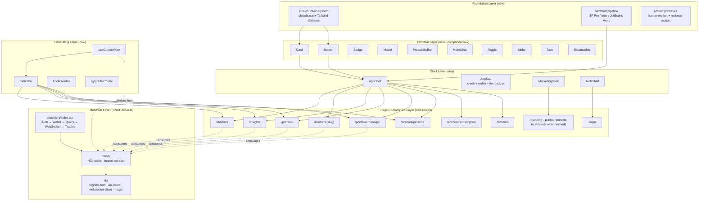
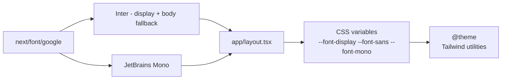
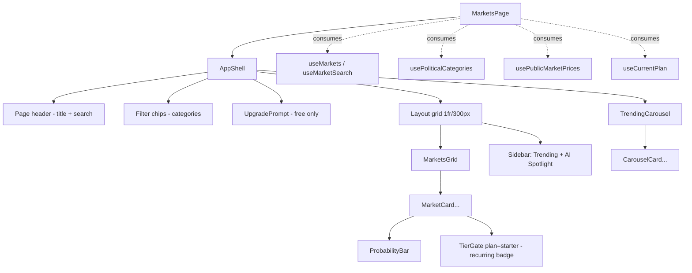

# Design Document: Frontend Design Migration

## Overview

This feature migrates the existing Next.js 16 frontend at `tradewizard-frontend/` to the new TradeWizard visual identity defined by the static HTML mock-ups in `docs/design/TradeWizard/`. The migration is a **visual + structural reorganization only** - every existing hook, provider, API client, and lib utility (auth, websocket, billing, CLOB trading, portfolio manager) keeps the same contract and the same behavior. We replace the markup, styling, layout, and component composition.

The strategy is a strangler migration. We first introduce the new design's foundational layer (OKLch tokens wired into Tailwind 4's `@theme`, shared UI primitives like `Card`/`Button`/`Badge`/`ProbabilityBar`/`TierGate`, and the unified app shell with the new header) without removing the old surfaces. Pages then swap one at a time, consuming existing hooks unchanged, until the old shell can be deleted.

The mock-ups separate marketing (`landing.html`, `tradewizard-platform.html`) from the product. The new route layout is:

- **`/`** - Landing page. Visible to unauthenticated users. **When the user is authenticated, server-side middleware redirects `/` to `/markets`** so authenticated users always land in the app.
- **`/login`** - Magic Link auth flow (unchanged path).
- **`/markets`** - Markets feed (the product home).
- **`/markets/[slug]`** - Individual market detail. Replaces the existing `/market/[slug]` (singular) route.
- **`/insights`**, **`/portfolio`**, **`/portfolio-manager`**, **`/account/persona`**, **`/account/subscription`**, **`/account`** - added or renamed in line with the mock-up.

Auth-aware redirection lives in `middleware.ts` (Next.js App Router middleware). It reads the `tw_idToken` cookie/localStorage, and:
- On `/` for an authenticated user → 307 redirect to `/markets`.
- On any protected route (`/markets`, `/markets/[slug]`, `/insights`, `/portfolio`, `/portfolio-manager`, `/account/*`) for an unauthenticated user → 307 redirect to `/login?next=<original-path>`.
- `/`, `/login` are public.

## Architecture

### Layered Architecture



### Strangler Migration Sequence

```mermaid
graph LR
  A["Phase 0<br/>Tokens + Fonts"] --> B["Phase 1<br/>UI primitives + TierGate"]
  B --> C["Phase 2<br/>AppShell + new Header + middleware"]
  C --> F["Phase 3a<br/>Markets at /markets<br/>(new route)"]
  F --> G["Phase 3b<br/>Market detail<br/>at /markets/[slug]"]
  G --> D["Phase 3c<br/>Landing takes over /<br/>(auth redirect to /markets)"]
  D --> E["Phase 3d<br/>Auth /login"]
  E --> H["Phase 3e<br/>Insights"]
  H --> I["Phase 3f<br/>Portfolio"]
  I --> J["Phase 3g<br/>PM dashboard"]
  J --> K["Phase 3h<br/>Persona selection"]
  K --> L["Phase 3i<br/>Subscription"]
  L --> M["Phase 3j<br/>Settings"]
  M --> N["Phase 4<br/>Tier-aware variants"]
  N --> O["Phase 5<br/>Polish + cleanup"]
```



Each phase is independently shippable. Phase 0–2 add the new system without breaking anything. **Phase 3a is the critical sequencing step**: we ship the new markets feed at `/markets` first (a brand-new route, no collision), then in Phase 3c we move the landing page to `/` and add the middleware redirect for authed users. This avoids any window where authenticated users hit the unfinished landing page at `/` (because by Phase 3c, the redirect is in place).

Pre-existing redundant routes (`/history`, `/orders`, `/positions`, `/wallet`, `/performance`) are folded into the new `/portfolio` page (which has Active Positions / Analysis History / Closed Trades tabs in the mock-up); we keep redirect stubs for one release before deletion. The legacy `/market/[slug]` route (singular) gets a permanent 308 redirect to `/markets/[slug]` (plural) added in Phase 3a so existing links and bookmarks keep working.

### Page Mapping

| Mock-up file | Target Next.js route | Existing route(s) it replaces | Notes |
|---|---|---|---|
| `landing.html` | `/` (public) | (currently the markets feed lives at `/`) | Marketing. Visible to unauthenticated users. **Authenticated users hitting `/` are redirected by middleware to `/markets`.** Top nav links to `/login`. |
| `tradewizard-platform.html` | (not migrated) | - | Internal-only project index. Skip. |
| `index.html` | (not migrated) | - | Dev tier index. Replaced by Tier Switcher dev tool (Phase 5). |
| `auth.html` | `/login` | `/login` | Magic Link form + sent state. After successful auth, redirect to `?next=` param if present, else to `/markets`. |
| `markets.html` | `/markets` (new) | `/` (current markets feed) | Markets feed with trending carousel + sidebar. |
| `market-detail.html` | `/markets/[slug]` | `/market/[slug]` (singular) | Chart, order book, AI panel, trade exec, PM activation. The legacy `/market/[slug]` keeps a 308 permanent redirect to `/markets/[slug]`. |
| `insights.html` | `/insights` | (new route - `/analysis*` is currently empty) | Recurring + recent analyses, agent perf, credit usage. Today the analysis modal lives only on the market-detail page; `/insights` is the new dedicated browse-all view. |
| `portfolio.html` | `/portfolio` | `/portfolio`, `/positions`, `/orders`, `/history`, `/wallet`, `/performance` | Tabs: Active Positions, Analysis History, Closed Trades, Performance. |
| `portfolio-manager.html` | `/portfolio-manager` | (currently embedded) | PM session dashboard with kill switch. Pro+/Elite gated. |
| `persona-selection.html` | `/account/persona` | `/account/portfolio` | 6-persona picker + Elite slider customization. Add a redirect from `/account/portfolio` → `/account/persona` for one release. |
| `subscription.html` | `/account/subscription` | `/account/subscription` | Plan grid + credit packs + billing history. |
| `settings.html` | `/account` | `/account` | Notifications + delivery + persona summary. |
| `free/*.html`, `starter/*.html`, `pro/*.html`, `elite/*.html` | (CSS variants of the same routes) | - | Drive UI affordances via `data-tier` attribute on `<html>` matched by the mock-up's tier-aware CSS. |

Routes `/history`, `/orders`, `/positions`, `/wallet`, `/performance` get redirect stubs to `/portfolio?tab=...` in Phase 3f, then are deleted in Phase 5.

### Authentication-aware Routing

Routing decisions are made in `middleware.ts` (Next.js App Router middleware) before any page renders. The middleware uses the existing id-token value (read from a session cookie that mirrors localStorage; see Auth Cookie Bridge below) to decide:

```
isAuthed = boolean (presence of valid tw_id_token cookie)
path     = request URL path

if path == '/' && isAuthed:           redirect 307 → /markets
if path is a protected route && !isAuthed:  redirect 307 → /login?next=<path>
otherwise:                            continue
```

**Public routes** (no auth required): `/`, `/login`, `/api/*`, static assets.
**Protected routes**: `/markets`, `/markets/[slug]`, `/insights`, `/portfolio`, `/portfolio-manager`, `/account`, `/account/*`. Plus the legacy redirects (`/history`, `/orders`, etc.) which redirect first; the destination still requires auth.

#### Auth Cookie Bridge

The existing auth code stores tokens only in `localStorage` with the `tw_` prefix (the id token is at `tw_id_token`). Edge middleware cannot read `localStorage`. The bridge is a small additive change to `providers/AuthProvider.tsx`: whenever `setTokens` or `clearTokens` runs on the provider, it also writes/clears a non-HttpOnly cookie `tw_id_token` mirroring the localStorage value, with `Secure; SameSite=Lax; Path=/; Max-Age=<token TTL>`. This keeps `lib/cognito-auth.ts` itself unchanged - the cookie writes happen in the provider that already orchestrates token lifecycle.

The cookie carries the same JWT already in localStorage - it is not a new credential. Because the JWT is already exposed to JavaScript via localStorage, mirroring it into a non-HttpOnly cookie does not change the security posture (an attacker with XSS could already read either store). The cookie is `SameSite=Lax` to prevent CSRF, and is read only by edge middleware for routing decisions; backend Lambdas continue to authenticate via the `Authorization: Bearer` header that `lib/api-client.ts` injects. **No backend change.**

The middleware does not validate the JWT cryptographically - it only checks for presence and unexpired `exp` claim (a cheap Base64-decode of the payload). This is intentional: middleware runs on every request and needs to be fast. A user with an invalid token will get past middleware but the backend will reject the request with 401, and the existing `lib/api-client.ts` 401 handler clears tokens and redirects to `/login`. So validation happens exactly once per request, in one place (the backend), rather than twice.

Alternative considered: pass auth state via a query parameter or a sync cookie set by a `'use client'` effect. Both reintroduce a flash of the wrong page (because the redirect would be in the page body, not in middleware). The middleware approach is the only way to redirect authed users away from `/` before any HTML is sent.

After successful auth on `/login`:
- The auth flow reads the `?next=<path>` query parameter.
- If `next` is a relative path under the protected set, redirect there.
- Otherwise, redirect to `/markets`.

## Components and Interfaces

### Token System

The brand spec defines OKLch tokens with semantic names. We wire them through Tailwind 4's `@theme` directive so utilities like `bg-bg`, `bg-surface`, `text-fg`, `border-border`, `text-yes`, `text-no`, `text-ai`, `text-accent`, `text-warning` are available everywhere. Both light and dark modes are scoped to `[data-theme="dark"]` / `[data-theme="light"]` on `<html>`, with the dark theme as default.

**File: `app/globals.css`** (replaces existing file)

```css
@import "tailwindcss";

:root,
[data-theme="dark"] {
  --bg:        oklch(14% 0.015 260);
  --surface:   oklch(19% 0.012 260);
  --surface-2: oklch(24% 0.010 260);
  --fg:        oklch(97% 0.005 260);
  --muted:     oklch(62% 0.012 260);
  --border:    oklch(30% 0.010 260);
  --accent:    oklch(62% 0.20 260);
  --ai:        oklch(58% 0.18 295);
  --yes:       oklch(72% 0.16 155);
  --no:        oklch(65% 0.18 25);
  --warning:   oklch(78% 0.14 85);
  --nav-bg:    oklch(14% 0.015 260 / .85);
  --radius:    12px;
  --max-w:     1200px;
}

[data-theme="light"] {
  --bg:        oklch(98% 0.003 260);
  --surface:   oklch(100% 0 0);
  --surface-2: oklch(95% 0.004 260);
  --fg:        oklch(18% 0.015 260);
  --muted:     oklch(45% 0.012 260);
  --border:    oklch(88% 0.006 260);
  --accent:    oklch(52% 0.20 260);
  --ai:        oklch(48% 0.18 295);
  --yes:       oklch(45% 0.14 155);
  --no:        oklch(55% 0.18 25);
  --warning:   oklch(55% 0.14 85);
  --nav-bg:    oklch(98% 0.003 260 / .85);
}

@theme inline {
  --color-bg:        var(--bg);
  --color-surface:   var(--surface);
  --color-surface-2: var(--surface-2);
  --color-fg:        var(--fg);
  --color-muted:     var(--muted);
  --color-border:    var(--border);
  --color-accent:    var(--accent);
  --color-ai:        var(--ai);
  --color-yes:       var(--yes);
  --color-no:        var(--no);
  --color-warning:   var(--warning);
  --font-display: var(--font-display), -apple-system, BlinkMacSystemFont, 'SF Pro Display', system-ui, sans-serif;
  --font-sans:    var(--font-sans),    -apple-system, BlinkMacSystemFont, 'SF Pro Text',    system-ui, sans-serif;
  --font-mono:    var(--font-mono),    'SF Mono', ui-monospace, Menlo, monospace;
  --radius-card: 12px;
}

html {
  background: var(--bg);
  color: var(--fg);
  -webkit-font-smoothing: antialiased;
  font-family: var(--font-sans);
}

@media (prefers-reduced-motion: reduce) {
  * { animation-duration: 0.01ms !important; transition-duration: 0.01ms !important; }
}
```

**Tailwind utility surface (post-`@theme`):** `bg-bg`, `bg-surface`, `bg-surface-2`, `text-fg`, `text-muted`, `border-border`, `text-yes`, `text-no`, `text-ai`, `text-accent`, `text-warning`, `font-display`, `font-mono`, `font-sans`, `rounded-card`. The existing background mesh gradients in `globals.css` are removed - the brand spec calls out "no heavy shadows, hairline borders".

### Typography Pipeline



**Rationale**: SF Pro is licensed only for Apple platforms and isn't a Google Font; the brand spec lists it as the first preference and Inter as fallback. We load Inter and JetBrains Mono via `next/font/google` (cached, self-hosted, no FOUT) and rely on the system font stack to surface SF Pro on Apple devices automatically. The existing Geist fonts from the original layout are removed.

### UI Primitives Library

A new `components/ui/` directory hosts the shared primitives that the mock-ups reuse repeatedly. Each is a typed React component with a single responsibility, designed to be composed.

```typescript
// components/ui/index.ts (re-export barrel)

// components/ui/Card.tsx
interface CardProps {
  children: ReactNode
  className?: string
  variant?: 'default' | 'elevated' | 'ai'   // 'ai' = violet gradient surface
  asChild?: boolean
}

// components/ui/Button.tsx
interface ButtonProps extends ButtonHTMLAttributes<HTMLButtonElement> {
  variant?: 'primary' | 'secondary' | 'ai' | 'yes' | 'no' | 'ghost' | 'danger'
  size?: 'sm' | 'md' | 'lg'
  loading?: boolean
}

// components/ui/Badge.tsx
interface BadgeProps {
  children: ReactNode
  tone?: 'neutral' | 'accent' | 'ai' | 'yes' | 'no' | 'warning' | 'muted'
  size?: 'sm' | 'md'
}

// components/ui/ProbabilityBar.tsx
interface ProbabilityBarProps {
  /** Value in cents 0–100 (display unit on Polymarket). */
  cents: number
  /** Optional second marker for AI consensus probability. */
  aiCents?: number
  variant?: 'thin' | 'thick'   // 4px or 6px
  className?: string
}

// components/ui/MetricStat.tsx
interface MetricStatProps {
  label: string
  value: string
  /** Optional 1-line context below the value. */
  sub?: string
  tone?: 'default' | 'profit' | 'loss' | 'ai' | 'warning'
}

// components/ui/Modal.tsx
interface ModalProps {
  open: boolean
  onClose(): void
  title?: string
  children: ReactNode
  size?: 'sm' | 'md' | 'lg'
}
// Renders into a Portal; traps focus; closes on Escape and overlay click.

// components/ui/Toggle.tsx
interface ToggleProps {
  checked: boolean
  onChange(next: boolean): void
  label?: string
  description?: string
  disabled?: boolean
  children?: ReactNode  // for nested lock overlays
}

// components/ui/Tabs.tsx
interface TabsProps<T extends string> {
  tabs: { id: T; label: string; lockReason?: string }[]
  active: T
  onChange(id: T): void
}

// components/ui/Expandable.tsx
interface ExpandableProps {
  summary: ReactNode
  meta?: ReactNode
  defaultOpen?: boolean
  children: ReactNode
}
// Wraps native <details>/<summary> for accessibility.

// components/ui/Slider.tsx
interface SliderProps {
  min: number
  max: number
  step?: number
  value: number
  onChange(next: number): void
  label?: string
  format?: (v: number) => string
}
```

**Responsibilities**:
- Provide consistent styling tied to OKLch tokens (no inline colors in pages).
- Enforce posture rules: 12px card radius, hairline borders, no heavy shadows, focus rings via `focus-visible`.
- Export TypeScript types so consuming pages stay strict-mode compliant.

### Tier-Gating System

The mock-ups gate specific UI affordances per plan (Free / Starter / Pro / Elite) with three patterns: **lock overlays** on disabled controls, **upgrade prompts** at the top of pages, and **disabled chips** for unavailable intervals/channels. We expose this through a single hook plus three components.

```typescript
// hooks/useCurrentPlan.ts
type Plan = 'free' | 'starter' | 'pro' | 'elite'

interface CurrentPlan {
  plan: Plan
  isLoading: boolean
  /** True when the user is at or above the required plan. */
  has(requiredPlan: Plan): boolean
  /** Available recurring analysis intervals for this plan. */
  intervals: ReadonlyArray<'once' | '1h' | '4h' | '12h' | '1d'>
  /** Available notification channels for this plan. */
  channels: ReadonlyArray<'in_app' | 'email' | 'push' | 'webhook'>
  /** PM concurrent session limit for this plan (0 if not entitled). */
  pmSessionLimit: number
  /** Whether persona customization sliders are unlocked. */
  canCustomizePersona: boolean
}

function useCurrentPlan(): CurrentPlan
// Wraps the existing useSubscription() hook. Adds no network call.
// Implementation derives `plan`, `intervals`, `channels`, `pmSessionLimit`,
// `canCustomizePersona` from existing subscription state without modifying
// the underlying hook contract.
```

```typescript
// components/ui/TierGate.tsx
interface TierGateProps {
  plan: Plan                          // minimum plan required
  feature: string                     // human-readable label, e.g. "Webhook delivery"
  /** When true, render children behind a lock overlay; when false, hide entirely. */
  showLocked?: boolean                // default true
  upgradeHref?: string                // default '/account/subscription'
  children: ReactNode
}
// Resolution order:
//   1. If the current plan satisfies `plan`, render children with no overlay.
//   2. Else if showLocked, render children inside a relative wrapper with
//      a backdrop-blurred lock overlay anchored absolutely.
//   3. Else, render nothing.
```

```typescript
// components/ui/LockOverlay.tsx
interface LockOverlayProps {
  feature: string
  upgradeHref?: string
}
// The visual element used by TierGate when locked.

// components/ui/UpgradePrompt.tsx
interface UpgradePromptProps {
  variant: 'free-to-starter' | 'starter-to-pro' | 'pro-to-elite'
  message: ReactNode
  ctaHref?: string
}
// Banner at the top of pages; matches mock-up's .upgrade-prompt / .upgrade-prompt-pro.
```

**Plan capability matrix (single source of truth, lives in `constants/plans.ts`)**:

| Capability | Free | Starter | Pro | Elite |
|---|:-:|:-:|:-:|:-:|
| One-time analysis | ✓ | ✓ | ✓ | ✓ |
| Recurring `1d` | ✗ | ✓ | ✓ | ✓ |
| Recurring `12h` / `4h` / `1h` | ✗ | ✗ | ✓ | ✓ |
| In-app notifications | ✓ | ✓ | ✓ | ✓ |
| Email + push | ✗ | ✓ | ✓ | ✓ |
| Webhook | ✗ | ✗ | ✓ | ✓ |
| Portfolio Manager (concurrent sessions) | 0 | 0 | 3 | 10 |
| Persona customization sliders | ✗ | ✗ | ✗ (defaults only) | ✓ |
| Priority queue badge | ✗ | ✗ | ✗ | ✓ |

**Backend source-of-truth alignment**:
- Recurring intervals - `infra/services/shared/credits.ts::PLAN_LIMITS.allowedIntervals` is the live gate (validated in `analysis-request/handler.ts` via `validateInterval`). Frontend matrix mirrors it exactly: free=`[]`, starter=`[86400]`, pro/elite=`[3600, 14400, 43200, 86400]`.
- Notification channels - the live gate is `infra/services/notification-preferences/handler.ts::PLAN_CHANNEL_RESTRICTIONS`, which allows starter `{in_app, email, push}`, pro/elite `{+webhook}`. (Note: `credits.ts::PLAN_LIMITS.allowedChannels` lists only `{in_app, email}` for starter - this constant is not consulted by the live preferences API. The frontend follows the live gate.)
- PM concurrent sessions - `infra/services/shared/portfolio-types.ts::SESSION_LIMITS = { pro: 3, elite: 10 }`. Free/starter are 0 (not entitled).
- Plans + monthly credits - `infra/services/shared/plans.ts::PLANS` (Elite uses `creditsPerMonth: 999999` as the unlimited sentinel; the UI displays "∞").
- Credit packs - `infra/services/shared/plans.ts::CREDIT_PACKS` defines `pack_20` (20 cr / $9) and `pack_50` (50 cr / $19) - the only packs available.

**Drift detection**: A test in Phase 5 reads each backend constant and asserts the frontend `PLAN_CAPABILITIES` matches. If the backend changes, the test fails. The frontend table is for UI affordance only - backend authorization remains the single source of truth and is not bypassed by frontend gates.

### App Shell & Navigation

The mock-up has three shell variants: marketing (landing, public), auth (centered card, no nav), and product (sticky nav with credit + wallet badges + tier indicator). Each is a layout primitive that wraps the page tree.

```typescript
// components/shell/AppShell.tsx
interface AppShellProps {
  children: ReactNode
  /** Optional banner slot above the nav (Beta, Geoblock). */
  banner?: ReactNode
}
// Composes <AppNav /> + <main> + footer (if any).

// components/shell/AppNav.tsx
// Sticky top nav, max-w 1200px. Children:
//   - Brand (logo dot + name → /)
//   - Primary links: Markets · Portfolio · PM · Insights · Plan · Settings
//   - Right cluster: WalletBadge · CreditBadge · ThemeToggle · Avatar
// Active link uses .active class derived from usePathname().
// Mobile (<768px): hamburger reveals slide-down menu (matches existing pattern but restyled).

// components/shell/MarketingShell.tsx
// Top nav (transparent, blurs on scroll), hero centered, footer with legal.

// components/shell/AuthShell.tsx
// Centered 400px card, logo + tagline above, footer note below.
```

**Navigation links** (one source of truth in `constants/navigation.ts`):

```typescript
const APP_NAV_ITEMS = [
  { label: 'Markets',   href: '/markets' },
  { label: 'Portfolio', href: '/portfolio' },
  { label: 'PM',        href: '/portfolio-manager', requires: 'pro' },
  { label: 'Insights',  href: '/insights' },
  { label: 'Plan',      href: '/account/subscription' },
  { label: 'Settings',  href: '/account' },
] as const
```

Items with `requires` render as `<TierGate plan={requires} showLocked={false}>` so they disappear for users who don't qualify.

The brand mark in the nav (logo + "TradeWizard") links to `/markets` for authenticated users (the same destination as the brand link in the mock-up - clicking the logo never throws an authed user back to the marketing page).

### Header Sub-components

```typescript
// components/shell/CreditBadge.tsx
// Reuses the existing CreditBalance hook surface unchanged. Renders the new
// styling (font-mono, accent-tinted, hover topup tooltip).
//   - Elite shows "∞ credits"
//   - Free/Starter/Pro show "X / N credits" where X is balance, N is monthly cap
//   - .pulse animation when balance decrements (driven by existing optimistic updates)

// components/shell/WalletBadge.tsx
// Reads existing WalletProvider context. Hover reveals a detail panel
// (Wallet · Committed · Available). Committed = sum of active PM session
// invested amounts; computed from existing usePortfolioSessions().

// components/shell/ThemeToggle.tsx
// Toggles [data-theme] on <html>; persists choice in localStorage('tw-theme').
// Defaults to dark unless prefers-color-scheme: light.
```

### Page-Specific Composition

Each page is a thin React component that composes primitives and shell. Hooks remain unchanged; pages only care about layout. The most consequential pages:

#### Landing (`app/page.tsx`)

Public marketing surface. Composes `<MarketingShell>` with hero, pipeline (4 steps), features, autonomous-trading section, pricing grid, CTA, footer. **No data hooks.** Static (server-rendered) content. The plan capability matrix surfaces the same prices/credits as the subscription page (single source of truth in `constants/plans.ts`). The `Get Started` button links to `/login`. Authenticated users never reach this page (middleware redirects to `/markets`).

#### Markets feed (`app/markets/page.tsx`)



`useMarkets`, `useMarketSearch`, `usePoliticalCategories`, `usePublicMarketPrices` - all unchanged. Filter chips use existing categorization.

#### Market detail (`app/markets/[slug]/page.tsx`)

```mermaid
graph TD
  Page[MarketDetailPage] --> Shell[AppShell]
  Shell --> Crumb[Breadcrumb]
  Shell --> Hero["MarketHeader - image + title + stats"]
  Shell --> Layout["detail-layout 1fr/360px"]
  Layout --> Left[Left column]
  Layout --> Right["AIPanel - sticky"]
  Left --> Chart[ChartPanel]
  Left --> OB[OrderBook]
  Left --> Desc[MarketDescription]
  Left --> History["AnalysisHistoryPanel - tabs"]
  History --> Timeline[Timeline of past analyses]
  History --> Perf[PerformanceChart]
  Right --> Rec[RecommendationBadge]
  Right --> QuickBuy[QuickBuyButtons]
  Right --> Conf[ConfidenceMeter]
  Right --> Thesis[ThesisSection]
  Right --> Edge[EdgeViz]
  Right --> Agents["Expandable: AgentSignals"]
  Right --> Debate["Expandable: BullVsBear"]
  Right --> Consensus["Expandable: Consensus"]
  Right --> Sizing["Expandable: PositionSizing"]
  Right --> Risk["Expandable: RiskFactors"]
  Right --> Catalysts["Expandable: KeyCatalysts"]
  Right --> Trade["TradePanel - tabs Buy/Sell · Market/Limit"]
  Right --> GetAnalysis["GetAnalysisButton → AnalysisModal"]
  Right --> PMActivation["TierGate plan=pro: PMActivationCard"]
  Page -.consumes.-> H1[useMarketAnalysis]
  Page -.consumes.-> H2[useAgentSignals]
  Page -.consumes.-> H3[useTradeRecommendation]
  Page -.consumes.-> H4[useHistoricalRecommendations]
  Page -.consumes.-> H5[useMarketPerformance]
  Page -.consumes.-> H6["useClobOrder / useQuickTrade"]
  Page -.consumes.-> H7[useUserPositions]
  Page -.consumes.-> H8[usePortfolioActivation]
  Page -.consumes.-> H9[usePersonaSettings]
  Page -.consumes.-> H10[usePolygonBalances]
  Page -.consumes.-> H11["useAnalysisProgress - for the modal"]
```



#### Portfolio (`app/portfolio/page.tsx`)

Tabs: **Active Positions**, **Analysis History**, **Closed Trades**. Top summary row of `MetricStat` cards (Total Value, Unrealized P&L, Win Rate, AI Accuracy). Sub-section: **PM Summary** card (TierGate plan=pro). Performance chart bar visualization at the bottom. Hooks: `useUserPositions`, `useActiveOrders`, `useAnalysisResults`, `usePortfolioStats`, `usePerformanceData`, `usePolygonBalances`, `usePublicMarketPrices`.

#### Portfolio Manager (`app/portfolio-manager/page.tsx`)

Page header includes persona badge + **Kill Switch** button. Stats bar with 4 `MetricStat`s (Committed Capital, Unrealized P&L, Realized P&L, Active Sessions). Sessions list with status badges (Watching/Positioned/Cooldown/Completed/Terminated). Each `SessionCard` toggles a detail panel with Capital / Decision Log / Trade History tabs. Kill Switch opens confirmation modal then renders the kill-active banner. Hooks: `usePortfolioSessions`, `usePortfolioSession`, `usePortfolioTrades`, `usePortfolioStats`, `usePortfolioActions`, `usePortfolioWebSocket`, `usePersonaSettings`. `<TierGate plan="pro">` wraps the page; users without entitlement see the lock state.

#### Subscription (`app/account/subscription/page.tsx`)

Current plan summary card + 4 plan cards in a grid (Free/Starter/Pro/Elite, current highlighted). **Credit packs section renders the production packs from `infra/services/shared/plans.ts` - currently `pack_20` (20 credits for $9) and `pack_50` (50 credits for $19). The mock-up shows four fictional packs (10/25/50/100); we ignore those and source from the backend definitions.** Billing history table. Cancel subscription button → confirmation modal. Hooks: `useSubscription`, `useWalletSubscription`, `useSubscriptionAllowance`, `useUsdcTransfer`, `usePurchaseCredits`. **Backend invariant**: tx hash verification, on-chain USDC.e transfer, ERC-20 allowance for auto-renewal - all unchanged.

### Animation & Motion

Framer Motion is already a dependency. We define motion guidelines in a single module and use them consistently across pages.

```typescript
// utils/motion.ts
export const motionTokens = {
  // Durations align with brand "no heavy shadows, hairline borders" - quick, not theatrical.
  duration: { fast: 0.15, base: 0.2, slow: 0.4 },
  ease: { standard: [0.4, 0, 0.2, 1], emphasized: [0.4, 0, 0, 1] },
  // Common variants
  fadeIn: {
    initial: { opacity: 0 },
    animate: { opacity: 1 },
    transition: { duration: 0.2, ease: [0.4, 0, 0.2, 1] },
  },
  slideUp: {
    initial: { opacity: 0, y: 8 },
    animate: { opacity: 1, y: 0 },
    transition: { duration: 0.2, ease: [0.4, 0, 0.2, 1] },
  },
  pulseAi: { /* the .ai-dot violet glow */ },
} as const

// hooks/useReducedMotion.ts already exists in the framer-motion package; we
// honor its return value by rendering a static fallback for any decorative motion.
```

**Rules**:
- All decorative animation must check `useReducedMotion()` and skip if true.
- No animation longer than 400ms.
- Keep motion functional: focus indicators, status transitions, layout shifts. Avoid bouncy or theatrical motion.
- Live indicators (websocket-driven) use a 2s pulse - these are functional, not decorative, but still respect reduced-motion (they simply hold steady at full opacity).

### Iconography

The mock-ups use inline SVG (often emoji for prototype thumbnails) and the current codebase uses `lucide-react`. We standardize on **Lucide** for all UI icons (chevrons, checks, locks, trending arrows, kill-switch icon). Inline SVG is reserved for two cases: the brand AI dot (custom shape) and the per-market thumbnail placeholder gradients (mock-up uses emoji over a gradient - production will pass these through to real Polymarket market images via `next/image`). Decorative emoji like 🏛️ 🗳️ that appear in the mock-up's prototype HTML are not migrated literally; markets render their `image_url` from the existing data hook.

## Data Models

The migration introduces no new data models on the wire. UI-only types are added in `components/ui/types.ts` and `constants/plans.ts`.

```typescript
// constants/plans.ts
export type Plan = 'free' | 'starter' | 'pro' | 'elite'

export type Interval = 'once' | '1h' | '4h' | '12h' | '1d'

export type Channel = 'in_app' | 'email' | 'push' | 'webhook'

export interface PlanCapabilities {
  intervals: ReadonlyArray<Interval>
  channels:  ReadonlyArray<Channel>
  pmSessionLimit: number
  canCustomizePersona: boolean
}

export const PLAN_CAPABILITIES: Record<Plan, PlanCapabilities> = {
  free:    { intervals: ['once'],                          channels: ['in_app'],                                pmSessionLimit: 0,  canCustomizePersona: false },
  starter: { intervals: ['once','1d'],                     channels: ['in_app','email','push'],                pmSessionLimit: 0,  canCustomizePersona: false },
  pro:     { intervals: ['once','1h','4h','12h','1d'],     channels: ['in_app','email','push','webhook'],     pmSessionLimit: 3,  canCustomizePersona: false },
  elite:   { intervals: ['once','1h','4h','12h','1d'],     channels: ['in_app','email','push','webhook'],     pmSessionLimit: 10, canCustomizePersona: true  },
} as const

export const PLAN_RANK: Record<Plan, number> = { free: 0, starter: 1, pro: 2, elite: 3 } as const
export function planAtLeast(actual: Plan, required: Plan): boolean {
  return PLAN_RANK[actual] >= PLAN_RANK[required]
}
```

**Validation rules**:
- `PLAN_CAPABILITIES` must match `infra/services/shared/plans.ts` exactly. A test (Phase 5) loads both and asserts equality of the capability shape.
- `useCurrentPlan` returns this struct directly so consumers get strict types.

## Correctness Properties

(Will be filled in after requirements phase.)

## Error Handling

### Migration risks and mitigations

| Risk | Detection | Response | Recovery |
|---|---|---|---|
| Token regression: a Tailwind class breaks because `@theme` reshapes utility names | TypeScript strict mode + smoke test on a known component | Block merge until utility map is corrected | Roll back the token change; introduce one phase at a time |
| Hook contract drift: a page accidentally changes the shape of the data it needs | TypeScript compile fails when a page consumes a hook field that doesn't exist | Block merge | Restore the page's component to consume the hook's exact return type |
| Provider order regression: someone reorders the provider tree in `providers/index.tsx` | Existing integration tests + lint rule reading `providers/index.tsx` against a frozen string | Block merge | Restore the canonical order: Auth → Wallet → Query → WebSocket → Trading |
| Auth or websocket re-implementation: someone replaces `lib/cognito-auth.ts` or `lib/websocket-client.ts` | File-level CODEOWNERS or task-level review | Reject change | Keep the lib unchanged for the entire migration |
| Tier-gate bypass: a user manipulates client-side `data-tier` to access a locked feature | Backend authorization on every endpoint (already enforced) | Backend rejects with `PlanRestrictionError` (403) | Frontend continues to honor backend errors via the existing typed error surface |
| Theme flash on initial load (FOUC) | Visible flicker during dev | Set `data-theme` attribute synchronously in a tiny inline script in `<head>` based on `localStorage.getItem('tw-theme')` and `prefers-color-scheme` before any React hydration | Same as detection - fix is preventative |
| Reduced-motion violation: a decorative animation runs against the user's OS preference | Accessibility audit + manual testing with the OS toggle | Block merge until the component honors `useReducedMotion()` | Wrap the animation in a guard |
| Polymarket image hotlinking blocked | Errors in browser console / failed `` events | Render a deterministic gradient placeholder generated from the market `condition_id` | The fallback is permanent - no manual intervention needed |

### Per-page error states

Every page must surface three states explicitly:

1. **Loading** - Skeleton cards using the `Card` primitive's neutral surface (no spinning indicators on cards; data is the focus).
2. **Empty** - A short message + a single CTA. e.g., on `/portfolio` with no positions: "No positions yet. Browse markets →".
3. **Error** - Read from existing typed errors (`InsufficientCreditsError`, `PlanRestrictionError`, `NotFoundError`). Each error class maps to a specific UI:
   - `PlanRestrictionError` → render an `<UpgradePrompt>` matching the locked feature.
   - `InsufficientCreditsError` → render a "Top up credits" CTA linking to `/account/subscription#packs`.
   - `NotFoundError` → render a 404 card with a link back to the parent page.
   - Other errors → render an `Alert` primitive with the error message and a "Retry" button that re-runs the underlying mutation/query.

WebSocket disconnect / reconnect is invisible to the user - the existing `lib/websocket-client.ts` exponential-backoff handles it. We add no new UI for transient disconnects.

## Testing Strategy

### Unit Testing Approach

- **UI primitives** (`components/ui/`) are tested with Vitest + React Testing Library:
  - `Card`, `Button`, `Badge`, `MetricStat`, `Modal`, `Toggle`, `Tabs`, `Expandable` get render tests covering each variant.
  - `ProbabilityBar` gets a property-based test (see below).
  - `Modal` gets a focus-trap test (Tab cycles within the modal; Escape closes).
- **TierGate** gets unit tests covering the three resolution branches (above plan / below + showLocked / below + hidden) for each plan rank.
- **Hooks**:
  - `useCurrentPlan` is a pure derivation; unit-tested by mocking the underlying `useSubscription` return value across all four plans.
  - Existing hooks are not retested - their contract is frozen.

Test files colocate as `Component.test.tsx` next to the component, matching existing conventions in `hooks/__tests__/`.

### Property-Based Testing Approach

Property tests use **fast-check** (already a backend dep; will be added to frontend devDependencies). Properties focus on the parts of the migration where universal correctness matters:

1. **TierGate resolution monotonicity**: For all `actual ∈ Plan` and `required ∈ Plan`, if `planAtLeast(actual, required)` is true then `<TierGate plan={required}>{X}</TierGate>` renders `X` without an overlay; if false then with an overlay (or nothing if `showLocked={false}`).
2. **Capability monotonicity**: For all `actual ∈ Plan` and `required ∈ Plan` with `actual ≥ required`, every interval/channel available at `required` is also available at `actual`. (Sanity check that `PLAN_CAPABILITIES` is monotonic.)
3. **`ProbabilityBar` rendering**: For all `cents ∈ [0, 100]`, the rendered fill width is `cents%` (allowing ±0.5% rounding); for all `aiCents ∈ [0, 100]`, the AI marker is positioned at `aiCents%`.
4. **Plan capability equivalence**: A static test loads `constants/plans.ts` and asserts that for each plan, the frontend `PLAN_CAPABILITIES` matches the backend constants:
   - Intervals from `infra/services/shared/credits.ts::PLAN_LIMITS[plan].allowedIntervals`
   - Channels from `infra/services/notification-preferences/handler.ts::PLAN_CHANNEL_RESTRICTIONS[plan]`
   - PM session limits from `infra/services/shared/portfolio-types.ts::SESSION_LIMITS[plan]` (0 for free/starter)
   - Credit packs from `infra/services/shared/plans.ts::CREDIT_PACKS`
   This catches drift between frontend and backend.
5. **Theme-toggle round-trip**: For all theme values `t ∈ {'dark','light'}`, `setTheme(t)` then reading `document.documentElement.dataset.theme` returns `t`, and `localStorage.getItem('tw-theme')` returns `t`.

Iterations: 100 per property (fast-check default). All complete in <1s - these are pure logic tests, not browser-driven.

**Property test library**: fast-check (consistent with the backend; works in Vitest).

### Integration Testing Approach

Three classes of integration tests, each scoped narrowly:

1. **Provider composition** - A test renders `<Providers>` and asserts the order is Auth → Wallet → Query → WebSocket → Trading by introspecting context boundaries. Catches accidental reordering.
2. **Page smoke tests** - For each migrated page, a single test renders the page with mocked hooks and asserts (a) the new shell is present, (b) the page-specific primary CTA is in the document, (c) tier-gated regions render the expected variant for a known plan. Not a full visual test; structural only.
3. **Hook surface freeze** - A type-level test imports each of the existing hooks and asserts the return type signature matches a snapshot. Any change to a hook's external shape causes a test failure; this is intentional, since the spec freezes the hook contract.

Routes under migration that previously had end-to-end test scripts (`scripts/`) are kept compatible - we don't touch their test data shape.

## Performance Considerations

- **Bundle size**: Removing the existing background gradient mesh + Geist font + custom scrollbar styles cuts roughly 4–6 KB of CSS. Adding `next/font/google` for Inter + JetBrains Mono is a wash (similar to Geist). Tailwind 4 tree-shakes unused utilities.
- **Hydration**: Setting `data-theme` synchronously in a tiny inline script in `<head>` avoids a flash and avoids re-render after hydration.
- **Sticky panels**: The market detail right column uses `position: sticky` with `top: 72px`. On low-end mobile this can stutter; we cap the sticky behavior at viewport widths ≥1024px and let it scroll naturally below.
- **Carousel**: Trending carousel uses CSS scroll-snap and native horizontal scroll - no JS layout thrash, no virtualization needed for the current data volume.
- **Image strategy**: Market thumbnails go through `next/image` with `priority={false}` (lazy) for off-screen cards, `priority` for the hero on market detail.
- **WebSocket**: Behavior unchanged. The new pulse-dot indicator on live elements respects reduced-motion and is otherwise CSS-only.
- **Analysis modal pipeline animation**: Eleven stages animate sequentially during a real analysis; the timing is data-driven (we listen to `useAnalysisProgress`) and the prototype's `setTimeout(2000)` is replaced by real progress events.

## Security Considerations

- **Backend authorization is the only source of truth.** The frontend tier-gate is a UX affordance; backend Lambdas validate the user's plan on every entitled endpoint and return `PlanRestrictionError` (403) on violations. The migration introduces no client-side bypass.
- **Token storage**: localStorage with `tw_` prefix and 5-minute auto-refresh remain unchanged. The new app shell does not touch these keys.
- **Theme persistence**: `localStorage.getItem('tw-theme')` is non-sensitive, plain text. No PII in localStorage from the new code.
- **No secret values rendered**: Wallet addresses are displayed truncated. Magic Link emails are echoed back from the user's input only after sending - no sensitive token shown.
- **Webhook URL input**: The settings page gates webhook config behind `<TierGate plan="pro">`. The existing `useNotificationPreferences` hook validates the URL on the backend (HTTPS-only) - frontend renders the validation result, doesn't bypass it.
- **Content Security Policy**: No new external scripts. Inline SVG is safe; the only inline script is the synchronous theme-set bootstrap in `<head>`, which is a one-line literal with no user input.
- **CLOB integration & PM safety invariants**: Trade execution and PM session controls remain on existing hooks (`useClobOrder`, `useQuickTrade`, `usePortfolioActions`). The migration does not change SL/TP enforcement, kill-switch behavior, capital conservation, or session limits. UI surfaces these through the existing hook contracts only.

## Preservation Invariants

These are non-negotiable across the entire migration. Any task that violates one is rejected.

1. **Provider composition order**: `AuthProvider → WalletProvider → QueryProvider → WebSocketProvider → TradingProvider` in `providers/index.tsx`. No reorder, no addition above Auth.
2. **Hook contract freeze**: All ~52 hooks under `hooks/` retain their exact public TypeScript shape. New components consume existing hooks; we do not add new hooks except `useCurrentPlan` (which derives purely from `useSubscription` without new network calls) and any thin UI-state hooks (`useTheme`, a re-export of framer-motion's `useReducedMotion`).
3. **Auth mechanism**: Cognito Custom Auth (Magic Link), `tw_`-prefixed localStorage tokens, 5-minute auto-refresh, redirect to `/login` on refresh failure. `lib/cognito-auth.ts` is not modified. `providers/AuthProvider.tsx` gets one additive change: a side-effect that mirrors the id token into a non-HttpOnly `tw_id_token` cookie for the new middleware to read; the public AuthProvider context shape is unchanged.
4. **WebSocket behavior**: Exponential backoff (1s → 30s max), 5-minute ping keepalive, connect on auth / disconnect on logout, query-cache invalidation on new messages. `lib/websocket-client.ts` is not modified.
5. **Billing**: On-chain USDC.e transfers on Polygon, tx hash verification via viem, ERC-20 `transferFrom` allowance for auto-renewal. `lib/api-client.ts` and the wallet/subscription hooks are not modified.
6. **Polymarket CLOB trading**: Order placement, position management, redemption, tick size, allowance flow - all via existing hooks (`useClobOrder`, `useQuickTrade`, `useTokenApprovals`, `useUsdcTransfer`, `useRelayClient`, `useSafeDeployment`). Not modified.
7. **Portfolio Manager safety**: Mandatory SL/TP, kill switch, persona settings, capital conservation, session limits. UI surfaces these via existing hooks; the migration adds no UI control that bypasses or weakens these enforcement paths.
8. **Tier gating is UX-only**: Backend remains the authoritative gate.
9. **No API changes**: API client `lib/api-client.ts`, WebSocket client `lib/websocket-client.ts`, Magic SDK wrapper `lib/magic.ts` are not modified beyond, at most, additive helper functions (no behavior change).
10. **Backend is frozen**: No changes to Lambda handlers, AgentCore code, SQL schemas, CDK stacks, or any backend dependency.

## Accessibility (WCAG-AA)

The OKLch palette was chosen for AA contrast in dark mode. We validate and codify the rules:

- **Contrast**: All `--fg` on `--bg`, `--fg` on `--surface`, `--muted` on `--bg`, `--accent` on `--bg`, `--ai` on `--bg` combinations are ≥4.5:1 for normal text and ≥3:1 for large text and UI components. We add a Vitest test that loads each combination through a contrast-checker library (e.g., `wcag-contrast`) and asserts the rule. (Light mode gets the same treatment.)
- **Focus visible**: Every interactive primitive (`Button`, `Toggle`, `Slider`, link, `Tabs` trigger, `Expandable` summary, modal close) renders a visible focus ring using `focus-visible:outline outline-2 outline-offset-2 outline-ai`. No `outline: none` without a replacement.
- **Keyboard navigation**:
  - All interactive elements are reachable by Tab.
  - `Modal` traps focus and returns it to the trigger on close.
  - `Tabs` supports Left/Right arrow keys when focus is on a tab.
  - `Expandable` summary toggles on Enter/Space (native `<details>` does this).
  - **Trade actions** are keyboardable: Buy YES / Buy NO buttons are `<button>` elements with explicit labels (`aria-label="Buy YES at 62 cents"`).
  - PM **Kill Switch** and **Stop Session** are buttons with `aria-label` and require confirmation modal - no accidental Enter on focus.
- **Reduced motion**: All Framer Motion variants check `useReducedMotion()`. Pure-CSS animations (`pulse`, `creditPulse`, `livePulse`, `stagePulse`) respect `@media (prefers-reduced-motion: reduce)` via the global rule in `globals.css`.
- **Color is not the only signal**: YES/NO directional buttons include the labels "Buy YES" / "Buy NO". Status badges include text alongside color (e.g., "Positioned", "Watching", "Cooldown"). Probability bars include the percentage label adjacent to the bar.
- **Screen reader hints**: Live regions for analysis progress (`role="status" aria-live="polite"`). The pulse dot for "Live" is decorative (`aria-hidden="true"`).
- **Semantic HTML**: `<nav>`, `<main>`, `<aside>`, `<section>` used correctly. Headings nest properly (h1 per page, h2/h3 for sections).

## Responsive Strategy

The mock-ups are desktop-first (1200px max width). Breakpoints standardize on:

| Breakpoint | Behavior |
|---|---|
| `≥1024px` (lg) | Full grid: markets feed has 1fr/300px sidebar; market detail has 1fr/360px AI panel sticky; PM dashboard has detail panel side-by-side. |
| `768–1023px` (md) | Sidebar drops below or to two columns; AI panel un-sticks and flows below chart; primary nav links remain visible. |
| `<768px` (sm) | Hamburger menu replaces nav links; cards stack to single column; market-detail right panel flows full-width below; sticky behavior disabled; tabs become horizontally scrollable. |
| `<430px` (xs) | Tighter padding (1rem), trim badges to single-line, larger tap targets (44px min for buttons). |

For trading-dense surfaces (order book, agent grid, decision log), small viewports get:
- Order book: collapses to top-3 YES + top-3 NO with a "View all" expander.
- Agent grid: collapses from 2-col to 1-col grid; agent chips remain readable at 12px font.
- Decision log: rows wrap to two lines; the conviction column becomes inline with the action label.

Trade execution panel on mobile pins to the bottom of the viewport when an order is being composed (sticky bottom + safe-area inset for iOS), so the Buy YES/NO action isn't lost off-screen.

## Tier-Switcher Dev Tool

The mock-ups ship with a `tier-switcher.js` debug overlay that toggles `data-tier` on `<html>` between Free/Starter/Pro/Elite for visual QA. We port it as a development-only component:

```typescript
// components/Debug/TierSwitcher.tsx
// Renders only when process.env.NODE_ENV !== 'production'
// AND localStorage.getItem('tw-debug') === '1'
// Floating bottom-center pill that overrides useCurrentPlan() via a context
// for the duration of the session. Persists choice in localStorage('tw-tier-override').
// Not bundled into production builds (tree-shaken via the env check).
```

The dev override does **not** make backend calls succeed - it only changes UI affordances locally. A user on Free who flips the override to Elite still gets `PlanRestrictionError` from the backend. This is intentional: the tool is for visual QA, not feature unlock.

## Dependencies

**No new dependencies added by this spec for production**, except:

- `clsx` or `tailwind-merge` (already-implied utility) - confirm presence; if absent, add `clsx@^2` to `dependencies` for the `cn()` utility (already used in current code as `utils/classNames.ts`, so this is likely already present).

**New devDependencies**:

- `fast-check@^3` - for property-based tests on UI primitives and tier-gate logic.
- `wcag-contrast@^3` - for the contrast-ratio test against the OKLch palette.
- `@testing-library/react@^16` and `@testing-library/jest-dom` - if not already present, for component unit tests.
- `vitest@^4` and `@vitejs/plugin-react` - to align with backend testing stack.
- `jsdom@^25` - Vitest DOM environment.

The existing dependencies remain unchanged: Next.js 16, React 19, Tailwind 4, Framer Motion, Lucide, TanStack Query, ethers v5, viem, Magic SDK, @polymarket/clob-client, etc.

## Open Questions Resolved by Decisions in This Design

1. **Marketing vs app at `/`**: Marketing lives at `/`. Authenticated users hitting `/` are redirected by Next.js middleware to `/markets`. The product home is `/markets`; market detail is `/markets/[slug]`.
2. **Auth-aware routing**: Implemented in `middleware.ts` reading a non-HttpOnly `tw_id_token` cookie that mirrors the existing localStorage token. No backend change. After successful login, redirect to `?next=` if present, else `/markets`.
3. **Legacy `/market/[slug]` (singular)**: Permanent 308 redirect to `/markets/[slug]` (plural). Existing bookmarks keep working.
4. **Page routing for redundant pages**: `/history`, `/orders`, `/positions`, `/wallet`, `/performance` redirect to `/portfolio?tab=...` for one release, then are deleted.
5. **Icon strategy**: Lucide for UI; inline SVG only for the brand AI dot and gradient market thumbnails. Mock-up emoji are not migrated; market images come from existing data via `next/image`.
6. **Persona route**: `/account/persona` (renamed from `/account/portfolio` to match the mock-up's "Persona Selection" naming). One-release redirect from the legacy path.
7. **Tier-switcher**: Ported as a dev-only floating overlay; not in production builds.
8. **Components/ui directory**: Confirmed at `components/ui/` (recommended in the brief) - distinct from the existing `components/shared/` which may be re-folded into `components/ui/` over time but is not deleted in this migration.
