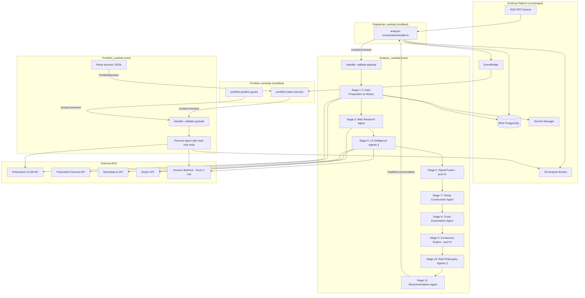

# Design Document: Lambda Strands Migration

## Overview

This design describes migrating TradeWizard's two AI agent runtimes - the Analysis Orchestrator (11-stage workflow with 14 intelligence agents) and the Portfolio Manager (persona-based trade decisions) - from Amazon Bedrock AgentCore (Python) to self-hosted AWS Lambda functions using the Strands Agents SDK for TypeScript (`@strands-agents/sdk`).

The migration consolidates the entire platform on TypeScript, eliminates AgentCore as a dependency, and gives the team direct control over agent execution, tool availability, and runtime behavior. The existing dispatcher Lambda and portfolio executor/guard Lambdas switch from `@aws-sdk/client-bedrock-agentcore` to `@aws-sdk/client-lambda` for direct invocation of the new functions.

### Key Design Decisions

1. **Single language (TypeScript)**: Eliminates Python from the runtime, reducing cognitive overhead and simplifying CI/CD.
2. **Direct Lambda invocation**: The dispatcher calls Analysis_Lambda synchronously via `InvokeCommand` (RequestResponse), removing session management complexity.
3. **Strands SDK for agent logic**: Each intelligence agent is a `new Agent({ model, systemPrompt, tools })` invocation. The SDK handles tool calling loops, streaming, and model interaction.
4. **Deterministic stages as pure functions**: Signal fusion and consensus engine remain pure TypeScript functions (no LLM), ported directly from the existing Python implementations.
5. **Proven V1 tools reused**: NewsData.io and Serper tool implementations from `tradewizard-agents/src/tools/` are adapted as Strands `tool()` definitions with Zod schemas.
6. **Strands community bash tool**: Used for shell-based data analysis on /tmp CSV/JSON files (replaces AgentCore Code Interpreter).

## Architecture



### Invocation Flow

1. **Analysis**: SQS → Dispatcher → `lambda.invoke(Analysis_Lambda)` → TradeRecommendation JSON returned synchronously
2. **Portfolio Entry**: EventBridge → Trade Executor → `lambda.invoke(Portfolio_Lambda, {decision_type: "entry"})` → PortfolioDecision
3. **Portfolio Exit**: Scheduler → Position Guard → `lambda.invoke(Portfolio_Lambda, {decision_type: "exit_evaluation"})` → PortfolioDecision

## Components and Interfaces

### Analysis_Lambda

**Location**: `infra/services/analysis-lambda/handler.ts`

**Entry Point**: `export async function handler(event: LambdaEvent): Promise<TradeRecommendation>`

| Component | Responsibility |
|-----------|---------------|
| `handler.ts` | Payload validation, workflow orchestration, /tmp cleanup, error fallback |
| `stages/data-preparation.ts` | Fetch market briefing, price history CSV, related markets JSON → /tmp |
| `stages/historical-context.ts` | Query RDS agent_memory table for past signals |
| `stages/web-research.ts` | Strands Agent with Serper search + scrape tools |
| `stages/intelligence-agents.ts` | Parallel invocation of 14 agents via Promise.all |
| `stages/signal-fusion.ts` | Pure deterministic weighted aggregation |
| `stages/thesis-construction.ts` | Strands Agent producing bull/bear theses |
| `stages/cross-examination.ts` | Strands Agent applying 5 adversarial tests |
| `stages/consensus-engine.ts` | Pure deterministic consensus + action determination |
| `stages/risk-philosophy.ts` | 3 parallel Strands Agents (aggressive/conservative/neutral) |
| `stages/recommendation.ts` | Strands Agent synthesizing final TradeRecommendation |
| `tools/news-tool.ts` | Strands tool wrapping NewsData.io |
| `tools/search-tool.ts` | Strands tool wrapping Serper API |
| `tools/shell-tool.ts` | Strands community bash tool for /tmp analysis |
| `lib/model.ts` | BedrockModel factory (reads env vars) |
| `lib/json-extractor.ts` | Robust JSON extraction from LLM responses |
| `lib/types.ts` | Shared TypeScript interfaces |

### Portfolio_Lambda

**Location**: `infra/services/portfolio-lambda/handler.ts`

| Component | Responsibility |
|-----------|---------------|
| `handler.ts` | Payload validation, agent creation, response parsing, error fallback |
| `personas.ts` | 6 persona system prompts + exit evaluation prompt |
| `tools/market-data.ts` | get_market_data Strands tool (Polymarket CLOB) |
| `tools/order-book.ts` | get_order_book Strands tool |
| `tools/analysis-reader.ts` | read_full_analysis Strands tool (S3) |
| `tools/trade-history.ts` | get_trade_history Strands tool (RDS) |
| `tools/session-performance.ts` | get_session_performance Strands tool (RDS) |
| `lib/model.ts` | Shared BedrockModel factory |
| `lib/json-extractor.ts` | Shared JSON extraction |
| `lib/types.ts` | PortfolioDecision, payload schemas |

### Dispatcher Lambda (Modified)

**Location**: `infra/services/analysis-orchestrator/handler.ts` (existing, modified in-place)

**Changes**:
- Remove `@aws-sdk/client-bedrock-agentcore` imports
- Remove `BedrockAgentCoreClient`, `InvokeAgentRuntimeCommand`, `StopRuntimeSessionCommand`
- Remove cold-start retry loop and `runtimeSessionId` tracking
- Remove `stopSession()` helper
- Add `@aws-sdk/client-lambda` `LambdaClient` + `InvokeCommand`
- Read `ANALYSIS_LAMBDA_ARN` env var
- Invoke with `InvocationType: 'RequestResponse'`
- Parse response payload directly as `TradeRecommendation` (no snake_case normalization needed)
- On `FunctionError` in response: treat as failure (refund, publish AnalysisFailed, re-throw)

### Portfolio Executor / Position Guard (Modified)

**Location**: `infra/services/portfolio-trade-executor/handler.ts`, `infra/services/portfolio-position-guard/handler.ts`

**Changes**:
- Remove `@aws-sdk/client-bedrock-agentcore` imports and client
- Remove `InvokeAgentRuntimeCommand`, `StopRuntimeSessionCommand`, session management
- Add `@aws-sdk/client-lambda` invocation using `PORTFOLIO_LAMBDA_ARN` env var
- Parse response as `PortfolioDecision` with field validation (action, size_pct, reasoning must be present)
- Trade executor: return `null` on invocation failure (existing skip-decision logic handles it)
- Position guard: default to hold decision with conviction 0 on failure

### CDK Changes (compute-stack.ts)

| Resource | Change |
|----------|--------|
| Analysis_Lambda | New `NodejsFunction`: 1024MB, 900s timeout, Bedrock + S3 + DDB + SM + EventBridge permissions |
| Portfolio_Lambda | New `NodejsFunction`: 512MB, 120s timeout, Bedrock + SM + EventBridge permissions |
| Orchestrator Lambda | Add `lambda:InvokeFunction` for Analysis_Lambda ARN, remove AgentCore IAM |
| Trade Executor | Add `lambda:InvokeFunction` for Portfolio_Lambda ARN, remove AgentCore IAM |
| Position Guard | Add `lambda:InvokeFunction` for Portfolio_Lambda ARN, remove AgentCore IAM |
| All Lambdas | Remove `AGENTCORE_RUNTIME_ARN` / `PORTFOLIO_AGENTCORE_RUNTIME_ARN` env vars |

### Strands SDK Agent Configuration

All agents use a shared model factory:

```typescript
import { Agent, BedrockModel } from '@strands-agents/sdk';
import { tool } from '@strands-agents/sdk';

// lib/model.ts
export function createModel(): BedrockModel {
  return new BedrockModel({
    modelId: process.env.BEDROCK_MODEL_ID || 'amazon.nova-2-lite-v1:0',
    region: process.env.AWS_REGION || 'us-east-1',
    maxTokens: parseInt(process.env.BEDROCK_MAX_TOKENS || '5120', 10),
  });
}
```

Intelligence agent instantiation pattern:

```typescript
const agent = new Agent({
  model: createModel(),
  systemPrompt: AGENT_SYSTEM_PROMPTS[agentName],
  tools: getToolsForAgent(agentName, context),
  printer: false, // Lambda - no console streaming
});

const result = await agent.invoke(buildAgentPrompt(agentName, briefing, webResearch, memory));
const signal = parseAgentSignal(agentName, result.message);
```

## Data Models

### TradeRecommendation (Analysis_Lambda output)

```typescript
interface TradeRecommendation {
  marketId: string;
  action: 'LONG_YES' | 'LONG_NO' | 'NO_TRADE';
  entryZone: [number, number];
  targetZone: [number, number];
  stopLoss: number;
  expectedValue: number;
  winProbability: number;
  liquidityRisk: 'low' | 'medium' | 'high';
  explanation: {
    summary: string;
    coreThesis: string;
    keyCatalysts: string[];
    failureScenarios: string[];
    uncertaintyNote: string;
    riskPerspectives: string;
  };
  metadata: {
    consensusProbability: number;
    marketProbability: number;
    edge: number;
    confidenceBand: [number, number];
    totalLlmCalls: number;
    executionDurationMs: number;
    agentsUsed: string[];
    marketQuestion: string;
    disagreementIndex?: number;
  };
  _analysisDetail?: AnalysisDetail;
}
```

### AgentSignal (per-agent output)

```typescript
interface AgentSignal {
  agentName: string;
  direction: 'YES' | 'NO' | 'NEUTRAL';
  confidence: number;       // 0.0–1.0
  fairProbability: number;  // 0.0–1.0
  keyDrivers: string[];
  riskFactors: string[];
  timestamp: string;        // ISO 8601
}
```

### FusedSignal (signal fusion output)

```typescript
interface FusedSignal {
  weightedFairProbability: number;
  fusionConfidence: number;
  signalAlignment: number;
  conflictMap: Array<{ agent1: string; agent2: string; divergence: number }>;
}
```

### ConsensusResult (consensus engine output)

```typescript
interface ConsensusResult {
  probability: number;
  confidence: number;
  disagreementIndex: number;
  failed: boolean;
}
```

### Thesis

```typescript
interface Thesis {
  direction: 'bull' | 'bear';
  fairProbability: number;
  keyArguments: string[];
  confidence: number;
}
```

### CrossExamResult

```typescript
interface CrossExamResult {
  bullScore: number;  // -5.0 to +5.0
  bearScore: number;  // -5.0 to +5.0
}
```

### PortfolioDecision (Portfolio_Lambda output)

```typescript
interface PortfolioDecision {
  action: 'enter' | 'hold' | 'exit' | 'scale' | 'skip';
  direction: 'YES' | 'NO' | null;
  sizePct: number;          // 0.0–1.0
  price: number | null;
  stopLossPrice: number | null;
  takeProfitPrice: number | null;
  orderType: 'limit' | 'market';
  reasoning: string;         // max 500 chars
  conviction: number;        // 0.0–1.0
  exitReason: 'regime_shift' | 'stale_market' | 'contradicting_analysis' | 'target_reached' | null;
  isPyramid: boolean;
}
```

### Analysis_Lambda Input Payload

```typescript
interface AnalysisPayload {
  marketId: string;   // non-empty
  userId: string;     // non-empty
  requestId: string;  // non-empty
}
```

### Portfolio_Lambda Input Payload

```typescript
interface PortfolioPayload {
  persona: 'sniper' | 'scalper' | 'contrarian' | 'catalyst_hunter' | 'hedge_architect' | 'momentum_rider';
  analysisResult: {
    analysisResultId: string;
    marketId: string;
    action: string;
    entryZone: [number, number];
    targetZone: [number, number];
    stopLoss: number;
    liquidityRisk: string;
    signalAlignment: number;
    confidence: number;
    explanation: Record<string, unknown>;
  };
  portfolioState: {
    session: Record<string, unknown>;
    positions: Array<Record<string, unknown>>;
    capitalBreakdown: Record<string, unknown>;
  };
  marketData: {
    marketId: string;
    currentPrice: number;
    edge: number;
    signalAlignment: number;
  };
  decisionType: 'entry' | 'exit_evaluation';
}
```

### Environment Variable Configuration

| Variable | Lambda | Default | Description |
|----------|--------|---------|-------------|
| BEDROCK_MODEL_ID | Both | amazon.nova-2-lite-v1:0 | Bedrock model identifier |
| BEDROCK_MAX_TOKENS | Both | 5120 | Max tokens per LLM call |
| AWS_REGION | Both | us-east-1 | AWS region for Bedrock |
| NEWSDATA_API_KEY | Analysis | - | Comma-separated NewsData.io keys |
| SERPER_API_KEY | Analysis | - | Comma-separated Serper keys |
| DB_SECRET_ARN | Both | - | Secrets Manager ARN for DB creds |
| DB_HOST | Both | - | RDS endpoint |
| ANALYSIS_HISTORY_DEPTH | Analysis | 5 | Past analyses to fetch (1–20) |
| ANALYSIS_BUCKET | Analysis | - | S3 bucket for results |
| EVENT_BUS_NAME | Both | - | EventBridge bus name |
| ENVIRONMENT | Both | development | Deployment environment |
| BYPASS_TOOL_CONSENT | Analysis | - | Skip Strands tool consent prompts |
| ANALYSIS_LAMBDA_ARN | Dispatcher | - | Analysis_Lambda function ARN |
| PORTFOLIO_LAMBDA_ARN | Executor/Guard | - | Portfolio_Lambda function ARN |


## Correctness Properties

*A property is a characteristic or behavior that should hold true across all valid executions of a system - essentially, a formal statement about what the system should do. Properties serve as the bridge between human-readable specifications and machine-verifiable correctness guarantees.*

### Property 1: Analysis payload validation produces correct fallback

*For any* payload object where one or more of `marketId`, `userId`, or `requestId` is missing or is an empty string, the Analysis_Lambda handler SHALL return a TradeRecommendation with `action` equal to `"NO_TRADE"`, `liquidityRisk` equal to `"high"`, and `explanation.summary` containing the name of at least one invalid field.

**Validates: Requirements 1.2, 1.3**

### Property 2: Analysis output structure invariant

*For any* execution of the Analysis_Lambda (whether the workflow succeeds, partially fails, or encounters an unrecoverable error), the returned object SHALL be a valid TradeRecommendation containing all required fields: `marketId` (string), `action` (one of LONG_YES, LONG_NO, NO_TRADE), `entryZone` (2-element number array), `targetZone` (2-element number array), `stopLoss` (number), `expectedValue` (number), `winProbability` (number), `liquidityRisk` (one of low, medium, high), `explanation` (object with summary, coreThesis, keyCatalysts, failureScenarios, uncertaintyNote, riskPerspectives), and `metadata` (object with consensusProbability, marketProbability, edge, confidenceBand, totalLlmCalls, executionDurationMs, agentsUsed, marketQuestion).

**Validates: Requirements 1.4, 1.8**

### Property 3: Portfolio payload validation produces skip fallback

*For any* payload object that fails the Portfolio_Lambda schema validation (missing persona, invalid persona identifier, missing analysis_result subfields, missing portfolio_state, missing market_data, or invalid decision_type), the returned PortfolioDecision SHALL have `action` equal to `"skip"`, `sizePct` equal to `0.0`, `conviction` equal to `0.0`, and `reasoning` containing an indication of which fields are missing or malformed.

**Validates: Requirements 2.2, 2.7, 3.7**

### Property 4: Portfolio decision parsing invariant

*For any* raw text response from the Strands Agent (including valid JSON, markdown-wrapped JSON, malformed text, and empty strings), the Portfolio_Lambda decision parser SHALL produce a PortfolioDecision where: `action` is one of (enter, hold, exit, scale, skip), `sizePct` is in [0.0, 1.0], `conviction` is in [0.0, 1.0], `orderType` is one of (limit, market), `direction` is one of (YES, NO, null), and `isPyramid` is a boolean. If parsing fails completely, the output SHALL be the default skip decision.

**Validates: Requirements 2.3, 2.6**

### Property 5: Price history CSV structure

*For any* non-empty array of price data points (each having a timestamp and price value), the generated CSV SHALL contain: a header row with columns `timestamp,datetime_utc,price`, one data row per input point, and metadata comment lines (prefixed with `#`) including market question, token ID, data point count, date range, and price range.

**Validates: Requirements 4.2**

### Property 6: Related markets aggregate metric calculation

*For any* non-empty array of related market objects (each having a probability and volume), the aggregate metrics SHALL satisfy: `average_probability` equals the arithmetic mean of all probabilities, `volume_weighted_probability` equals the sum of (probability × volume) divided by total volume, `sentiment_direction` equals "bullish" when weighted_prob > 0.55 or "bearish" when weighted_prob < 0.45 or "neutral" otherwise, and `total_volume` equals the sum of all volumes.

**Validates: Requirements 4.4**

### Property 7: API key rotation on rate limit

*For any* tool (News_Tool or Search_Tool) configured with N comma-separated API keys (N ≥ 2), when the current key receives an HTTP 429 response, the tool SHALL rotate to the next key in the list and retry the request. The rotation SHALL cycle through all N keys before repeating, and SHALL not count a rotation as a retry attempt toward the maximum retry limit.

**Validates: Requirements 6.9, 7.8**

### Property 8: News article transformation preserves fields

*For any* valid NewsData.io API article object containing article_id, title, link, source_id, source_name, pubDate, language, description, and content fields, the `transformArticle` function SHALL produce a NewsArticle where: `id` equals the original article_id, `title` equals the original title, `url` equals the original link, `source.name` equals the original source_name, `metadata.publishedAt` equals the original pubDate, and `metadata.language` equals the original language.

**Validates: Requirements 6.5**

### Property 9: Tool error handling returns structured error

*For any* HTTP error response (4xx or 5xx status code) or network timeout from the NewsData.io or Serper APIs, the respective tool SHALL return an object with `error` set to `true`, `toolName` set to the name of the tool, and `message` containing a non-empty description of the failure - without throwing an exception that would crash the agent.

**Validates: Requirements 6.6, 7.6**

### Property 10: Intelligence agent fallback signal on failure

*For any* intelligence agent that raises an exception, exceeds the 120-second timeout, or returns a response from which a valid AgentSignal cannot be parsed, the orchestrator SHALL produce a fallback AgentSignal with `direction` equal to `"NEUTRAL"`, `confidence` equal to `0.3`, and `fairProbability` equal to `0.5`.

**Validates: Requirements 8.2, 8.6**

### Property 11: Agent failure threshold determines workflow continuation

*For any* set of 14 agent results where K agents failed (0 ≤ K ≤ 14): if K ≤ 10, the workflow SHALL continue to signal fusion using (14 - K) real signals and K fallback NEUTRAL signals; if K > 10, the workflow SHALL abort and return a NO_TRADE recommendation with explanation indicating insufficient intelligence coverage.

**Validates: Requirements 8.3, 8.4**

### Property 12: Signal fusion produces valid output with divergence penalty

*For any* array of 1 to 14 valid AgentSignals (each with confidence in [0,1] and fairProbability in [0,1]) and any agent performance map (values > 0), the signal fusion function SHALL produce a FusedSignal where: `weightedFairProbability` is in [0, 1], `fusionConfidence` is in [0, 1], `signalAlignment` is in [0, 1]. Furthermore, if the maximum divergence between any two agent fair probabilities exceeds 0.70, then `fusionConfidence` SHALL be exactly 50% of what it would be without the penalty.

**Validates: Requirements 9.1, 9.2, 9.3**

### Property 13: Consensus engine action determination

*For any* valid inputs (consensus_probability in [0,1], market_probability in [0,1], consensus_failed boolean, liquidity_risk in {low, medium, high}): if `consensus_failed` is true, the action SHALL be `"NO_TRADE"` regardless of other inputs; if `consensus_failed` is false, the effective threshold SHALL be 0.05 for low/medium liquidity or 0.075 for high liquidity, and the action SHALL be `"LONG_YES"` when edge > threshold, `"LONG_NO"` when edge < -threshold, and `"NO_TRADE"` otherwise, where edge = consensus_probability - market_probability.

**Validates: Requirements 9.5, 9.6, 9.7, 9.8**

### Property 14: Memory filtering returns only matching agent signals

*For any* array of historical memory entries (each containing a list of per-agent signals) and a target agent name, the filter function SHALL return only entries where the signal's `agentName` matches the target, and the returned count SHALL be less than or equal to the input count.

**Validates: Requirements 13.3**

### Property 15: Analysis history depth clamping

*For any* integer value N read from the ANALYSIS_HISTORY_DEPTH environment variable (including negative numbers, zero, and values exceeding 20), the clamped depth SHALL equal `Math.max(1, Math.min(20, N))`, producing a value in the inclusive range [1, 20].

**Validates: Requirements 13.4**

### Property 16: JSON extraction robustness

*For any* string input (including valid JSON, markdown code-fenced JSON, text with embedded JSON objects, strings with no JSON, and empty strings), the JSON extraction function SHALL either return a valid parsed object (when JSON is present) or return null (when no valid JSON can be found) - without throwing an exception. When JSON is wrapped in ``` ```json ... ``` ``` fences, extraction SHALL prefer the fenced content.

**Validates: Requirements 10.5, 10.6**

## Error Handling

### Analysis_Lambda Error Strategy

| Error Scenario | Behavior |
|----------------|----------|
| Payload validation failure | Return NO_TRADE with field-level error in explanation |
| Data preparation fails (price history) | Continue with empty CSV path, log warning |
| Data preparation fails (related markets) | Continue with empty list, log warning |
| DB connection fails (historical context) | Continue with empty history, log warning |
| Web research agent fails | Continue with "Web research unavailable." brief |
| Individual intelligence agent fails | Produce NEUTRAL fallback signal (confidence 0.3) |
| >10 intelligence agents fail | Abort → NO_TRADE with "insufficient coverage" explanation |
| Thesis/cross-exam agent fails | Use stage-specific defaults and continue |
| Consensus fails (disagreement > 0.30) | Return NO_TRADE with disagreement explanation |
| Unhandled exception in workflow | Catch at handler level → NO_TRADE fallback |
| /tmp cleanup fails | Log error, do not affect response |

### Portfolio_Lambda Error Strategy

| Error Scenario | Behavior |
|----------------|----------|
| Payload validation failure | Return skip decision with reasoning |
| Unknown persona | Return skip decision with "invalid persona" reasoning |
| Agent invocation throws | Return default skip decision (conviction 0.0) |
| Agent response unparseable | Return default skip decision with parse failure reasoning |
| Model timeout (120s) | Return skip decision with timeout reasoning |

### Tool Error Strategy

All tools (News, Search, Shell) follow the same pattern:
1. HTTP errors → return `{ error: true, toolName, message }` to the agent (never throw)
2. Timeouts → return structured error with timeout message
3. Rate limits (429) → rotate API key, retry (up to 3 attempts)
4. The agent continues reasoning with the error context and may try alternative approaches

### Dispatcher Error Strategy

| Error Scenario | Behavior |
|----------------|----------|
| Analysis_Lambda returns FunctionError | Refund credits, publish AnalysisFailed, re-throw for SQS retry |
| Analysis_Lambda returns valid NO_TRADE | Process as normal success (store, deliver, publish AnalysisCompleted) |
| Portfolio_Lambda returns FunctionError | Trade executor returns null (skip-decision path); Position guard defaults to hold |
| Lambda invocation timeout | Same as FunctionError |

## Testing Strategy

### Dual Testing Approach

This feature uses both property-based tests and example-based unit tests for comprehensive coverage.

**Property-Based Testing Library**: [fast-check](https://fast-check.dev/) (already used in the project)

**Configuration**:
- Minimum 100 iterations per property test
- Each property test references its design document property via tag comment
- Tag format: `// Feature: lambda-strands-migration, Property N: <title>`

### Property Tests (fast-check)

Target the pure deterministic functions that form the core correctness guarantees:

| Property | Target Function | Test File |
|----------|----------------|-----------|
| P12: Signal fusion validity | `fuseSignals()` | `signal-fusion.property.test.ts` |
| P13: Consensus action determination | `calculateConsensus()`, `determineAction()` | `consensus-engine.property.test.ts` |
| P4: Decision parsing invariant | `parseDecision()` | `decision-parser.property.test.ts` |
| P16: JSON extraction robustness | `extractJson()` | `json-extractor.property.test.ts` |
| P1 + P2: Analysis payload validation/output | `validatePayload()`, handler | `analysis-handler.property.test.ts` |
| P3: Portfolio payload validation | `validatePortfolioPayload()` | `portfolio-handler.property.test.ts` |
| P5: CSV generation | `writePriceHistoryCsv()` | `data-preparation.property.test.ts` |
| P6: Related markets aggregation | `calculateAggregateMetrics()` | `data-preparation.property.test.ts` |
| P7: API key rotation | `ApiKeyRotator` class | `api-key-rotation.property.test.ts` |
| P8: Article transformation | `transformArticle()` | `news-tool.property.test.ts` |
| P10 + P11: Failure threshold | `runIntelligenceAgents()` | `intelligence-agents.property.test.ts` |
| P14: Memory filtering | `filterMemoryForAgent()` | `historical-context.property.test.ts` |
| P15: History depth clamping | `clampHistoryDepth()` | `historical-context.property.test.ts` |

### Unit Tests (example-based)

| Area | Scope | Test File |
|------|-------|-----------|
| Tool wiring | Verify correct tools assigned to each agent type | `tool-wiring.test.ts` |
| Persona prompts | Verify each of 6 personas has non-empty system prompt | `personas.test.ts` |
| Model factory | Verify env var reading and defaults | `model.test.ts` |
| Prompt building | Verify prompt includes expected context sections | `prompt-builder.test.ts` |
| Dispatcher integration | Verify InvokeCommand construction and response parsing | `dispatcher.test.ts` |
| Portfolio executor integration | Verify InvokeCommand and PortfolioDecision validation | `portfolio-executor.test.ts` |
| CDK resources | Verify Lambda memory, timeout, permissions via synth | `compute-stack.test.ts` |

### Integration Tests

| Area | Scope |
|------|-------|
| News tool | Mock NewsData.io API, verify request construction and response mapping |
| Search tool | Mock Serper API, verify request construction and response mapping |
| Shell tool | Execute simple shell commands in /tmp, verify output |
| Data preparation | Mock CLOB/Gamma APIs, verify CSV/JSON file creation |
| Historical context | Mock RDS, verify query construction and result filtering |
| End-to-end handler | Mock all externals, verify full workflow produces valid recommendation |

### Test Execution

```bash
# Run all tests (from infra/ directory)
npx vitest --run

# Run only property tests
npx vitest --run --testPathPattern=property

# Run specific property test
npx vitest --run services/analysis-lambda/__tests__/signal-fusion.property.test.ts
```
