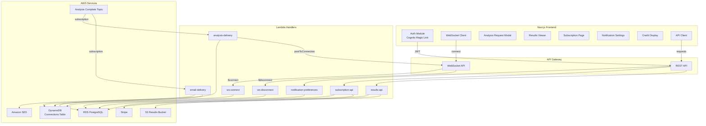
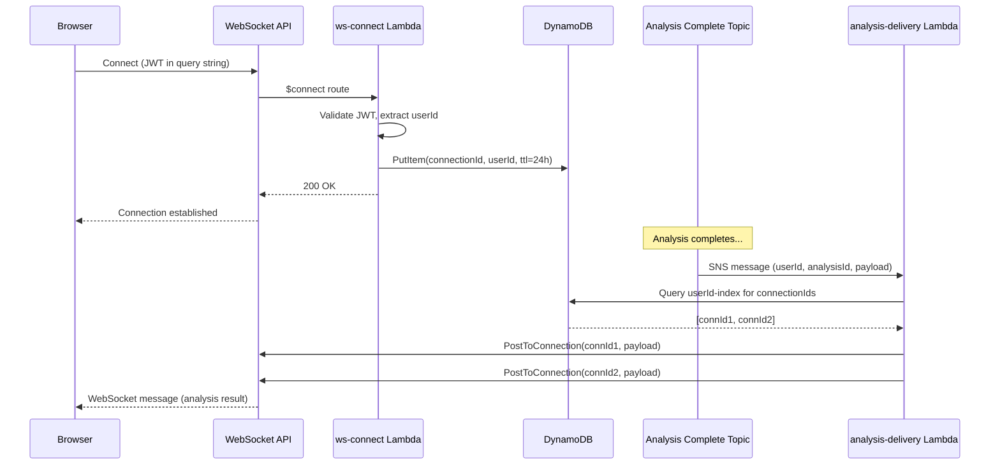
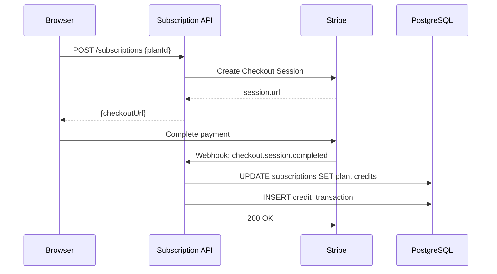
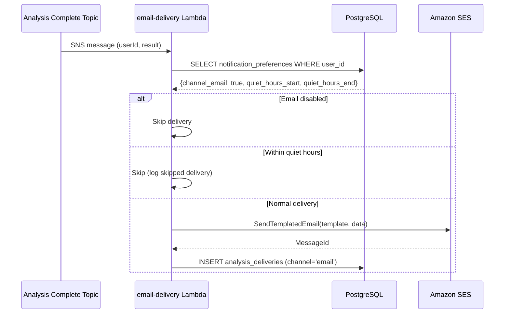

# Design Document: Phase 3 - Delivery Layer & Frontend Integration

## Overview

Phase 3 connects the TradeWizard V2 backend analysis pipeline to end users through three pillars: (1) real-time WebSocket delivery and email notifications triggered by SNS, (2) REST API endpoints for subscriptions, notification preferences, and analysis history, and (3) a complete Next.js frontend that replaces Supabase auth with Cognito, adds a WebSocket client for live updates, and provides UI for analysis requests, results viewing, subscription management, and notification settings.

The design follows the existing patterns: Lambda handlers in `infra/services/`, CDK infrastructure in `infra/lib/compute-stack.ts`, shared utilities in `infra/services/shared/`, and frontend hooks/components organized by feature in `tradewizard-frontend/`.

## Architecture



## Sequence Diagrams

### WebSocket Connection & Real-Time Delivery



### Stripe Subscription Flow



### Email Delivery with Quiet Hours




## Components and Interfaces

### Component 1: WebSocket Connect/Disconnect Handlers

**Purpose**: Manage WebSocket connection lifecycle - store and remove connection IDs in DynamoDB.

**Location**: `infra/services/ws-connect/handler.ts`, `infra/services/ws-disconnect/handler.ts`

**Interface**:
```typescript
// infra/services/ws-connect/handler.ts
import { APIGatewayProxyWebsocketHandlerV2 } from 'aws-lambda';

export const handler: APIGatewayProxyWebsocketHandlerV2 = async (event) => {
  // Extract userId from authorizer context (JWT validated at API Gateway)
  // Store connectionId + userId in DynamoDB with 24h TTL
  // Return { statusCode: 200 }
};
```

```typescript
// infra/services/ws-disconnect/handler.ts
import { APIGatewayProxyWebsocketHandlerV2 } from 'aws-lambda';

export const handler: APIGatewayProxyWebsocketHandlerV2 = async (event) => {
  // Delete connectionId from DynamoDB
  // Return { statusCode: 200 }
};
```

**Responsibilities**:
- Validate JWT token from query string parameter on connect
- Store `connectionId`, `userId`, `connectedAt`, and `ttl` (24h) in Connections_Table
- Remove connection entry on disconnect
- Support multiple connections per user (multi-tab/device)

---

### Component 2: Analysis Delivery Lambda

**Purpose**: Receive SNS notifications when analysis completes and push results to connected WebSocket clients.

**Location**: `infra/services/analysis-delivery/handler.ts`

**Interface**:
```typescript
import { SNSHandler } from 'aws-lambda';
import { ApiGatewayManagementApiClient, PostToConnectionCommand } from '@aws-sdk/client-apigatewaymanagementapi';
import { DeleteItemCommand } from '@aws-sdk/client-dynamodb';

interface AnalysisCompleteEvent {
  userId: string;
  analysisId: string;
  marketId: string;
  recommendation: string;
  consensusProbability: number;
  confidence: number;
  resultPayloadS3Key: string;
}

export const handler: SNSHandler = async (event) => {
  // Parse SNS message → AnalysisCompleteEvent
  // Query DynamoDB userId-index for all connectionIds
  // For each connectionId: PostToConnection with payload
  // If 410 Gone → delete stale connection from DynamoDB
  // If no connections → skip silently
};
```

**Responsibilities**:
- Parse SNS message payload into typed event
- Query all active connections for the target user
- Post WebSocket message with `analysisId`, `marketId`, `recommendation`, `consensusProbability`, `confidence`
- Clean up stale connections (410 Gone responses)
- Gracefully handle zero-connection case (no error)

---

### Component 3: Email Delivery Lambda

**Purpose**: Send templated email notifications via SES when analysis completes, respecting user preferences and quiet hours.

**Location**: `infra/services/email-delivery/handler.ts`

**Interface**:
```typescript
import { SNSHandler } from 'aws-lambda';
import { SESv2Client, SendEmailCommand } from '@aws-sdk/client-sesv2';

interface NotificationPreferences {
  channelEmail: boolean;
  quietHoursStart: string | null; // HH:MM format
  quietHoursEnd: string | null;
  minProbabilityShift: number | null;
}

export const handler: SNSHandler = async (event) => {
  // Parse SNS message
  // Query notification_preferences for user
  // If email disabled → skip
  // If within quiet hours → skip (log skipped delivery)
  // Send templated email via SES
  // Record delivery in analysis_deliveries table
};
```

**Responsibilities**:
- Check user's notification preferences before sending
- Respect quiet hours configuration
- Use SES templates with market question, recommendation, probability, and result link
- Record delivery attempts (success/failure) in `analysis_deliveries`
- Log failures without throwing (graceful degradation)

---

### Component 4: Notification Preferences API

**Purpose**: CRUD endpoints for user notification channel settings, quiet hours, and thresholds.

**Location**: `infra/services/notification-preferences/handler.ts`

**Interface**:
```typescript
import { APIGatewayProxyHandler } from 'aws-lambda';

interface NotificationPreferencesPayload {
  channelInApp: boolean;
  channelEmail: boolean;
  channelPush: boolean;
  channelWebhook: boolean;
  webhookUrl?: string;
  quietHoursStart?: string; // HH:MM
  quietHoursEnd?: string;   // HH:MM
  minProbabilityShift?: number; // 0.01 - 1.00
}

export const handler: APIGatewayProxyHandler = async (event) => {
  // Route: GET /user/notifications → return current preferences
  // Route: PUT /user/notifications → validate & persist updated preferences
};
```

**Responsibilities**:
- GET: Return current notification preferences for authenticated user
- PUT: Validate payload (webhook URL must be HTTPS, shift threshold 0.01-1.00)
- Enforce plan-based channel restrictions (free=in_app only, starter=in_app+email+push, pro/elite=all)
- Return 403 with upgrade message if user enables a channel above their plan tier

---

### Component 5: Subscription & Billing API

**Purpose**: Manage Stripe subscriptions, plan changes, credit purchases, and webhook processing.

**Location**: `infra/services/subscription-api/handler.ts`

**Interface**:
```typescript
import { APIGatewayProxyHandler } from 'aws-lambda';
import Stripe from 'stripe';

export const handler: APIGatewayProxyHandler = async (event) => {
  // Route: GET /subscriptions → return current plan, credits, billing dates
  // Route: POST /subscriptions → create Stripe Checkout session for plan change
  // Route: DELETE /subscriptions/{subscriptionId} → cancel at period end
  // Route: POST /credits/purchase → create Stripe Checkout for credit pack
  // Route: POST /webhooks/stripe → process Stripe webhook events
};
```

**Responsibilities**:
- Return subscription details (plan, status, credits, billing cycle)
- Create Stripe Checkout sessions for plan upgrades/downgrades
- Create Stripe Checkout sessions for credit pack purchases
- Process Stripe webhooks: `checkout.session.completed`, `customer.subscription.updated`, `invoice.paid`
- Cancel subscriptions at period end via Stripe API
- Reset credits on billing cycle renewal
- Record all credit changes in `credit_transactions`

---

### Component 6: Analysis Results API

**Purpose**: Serve paginated analysis history and full result detail from S3.

**Location**: `infra/services/results-api/handler.ts`

**Interface**:
```typescript
import { APIGatewayProxyHandler } from 'aws-lambda';
import { S3Client, GetObjectCommand } from '@aws-sdk/client-s3';

interface AnalysisHistoryItem {
  analysisId: string;
  marketId: string;
  marketQuestion: string;
  recommendation: string;
  consensusProbability: number;
  confidence: number;
  executedAt: string;
  wasCachedDelivery: boolean;
}

interface PaginatedResponse {
  items: AnalysisHistoryItem[];
  nextCursor: string | null;
  totalCount: number;
}

export const handler: APIGatewayProxyHandler = async (event) => {
  // Route: GET /analysis/history?cursor=X&limit=20 → paginated list
  // Route: GET /analysis/{analysisId} → full result from S3
};
```

**Responsibilities**:
- Return paginated analysis deliveries for the authenticated user, ordered by `delivered_at DESC`
- Include market question (joined from markets table or embedded in delivery)
- Fetch full result payload from S3 using `result_payload_s3_key`
- Enforce ownership: only return results belonging to the requesting user
- Return 404 for non-existent or unauthorized analysis IDs


---

### Component 7: Frontend Auth Module (Cognito)

**Purpose**: Replace Supabase auth with Amazon Cognito custom auth flow (Magic Link), manage JWT tokens, and attach them to all API requests.

**Location**: `tradewizard-frontend/lib/cognito-auth.ts`, `tradewizard-frontend/providers/AuthProvider.tsx`, `tradewizard-frontend/hooks/useAuth.ts`

**Interface**:
```typescript
// lib/cognito-auth.ts
import { CognitoIdentityProviderClient } from '@aws-sdk/client-cognito-identity-provider';

export interface AuthTokens {
  idToken: string;
  accessToken: string;
  refreshToken: string;
  expiresAt: number;
}

export interface CognitoAuthClient {
  initiateAuth(email: string): Promise<{ session: string }>;
  respondToChallenge(email: string, code: string, session: string): Promise<AuthTokens>;
  refreshTokens(refreshToken: string): Promise<AuthTokens>;
  signOut(): void;
  getAccessToken(): string | null;
  isAuthenticated(): boolean;
}

export function createCognitoAuthClient(config: {
  userPoolId: string;
  clientId: string;
  region: string;
}): CognitoAuthClient;
```

```typescript
// hooks/useAuth.ts
export interface UseAuthReturn {
  user: { email: string; sub: string } | null;
  isAuthenticated: boolean;
  isLoading: boolean;
  signIn: (email: string) => Promise<void>;
  verifyCode: (code: string) => Promise<void>;
  signOut: () => void;
  getAccessToken: () => string | null;
}

export function useAuth(): UseAuthReturn;
```

**Responsibilities**:
- Initiate Cognito CUSTOM_AUTH flow (triggers Magic Link Lambda)
- Store JWT tokens (id, access, refresh) in secure storage (httpOnly cookie or encrypted localStorage)
- Auto-refresh access token before expiry using refresh token
- Redirect to login when refresh token expires
- Provide `getAccessToken()` for API client to attach Bearer token
- Expose auth state via React context for all components

---

### Component 8: WebSocket Client Service

**Purpose**: Maintain a persistent WebSocket connection for real-time analysis delivery with automatic reconnection and TanStack Query cache integration.

**Location**: `tradewizard-frontend/lib/websocket-client.ts`, `tradewizard-frontend/hooks/useWebSocket.ts`

**Interface**:
```typescript
// lib/websocket-client.ts
export interface WebSocketMessage {
  type: 'analysis_complete';
  payload: {
    analysisId: string;
    marketId: string;
    marketQuestion: string;
    recommendation: string;
    consensusProbability: number;
    confidence: number;
    executedAt: string;
  };
}

export interface WebSocketClientOptions {
  url: string;
  token: string;
  onMessage: (message: WebSocketMessage) => void;
  onConnectionChange: (connected: boolean) => void;
}

export class WebSocketClient {
  connect(): void;
  disconnect(): void;
  isConnected(): boolean;
}

export function createWebSocketClient(options: WebSocketClientOptions): WebSocketClient;
```

```typescript
// hooks/useWebSocket.ts
export function useWebSocket(): {
  isConnected: boolean;
  lastMessage: WebSocketMessage | null;
};
```

**Responsibilities**:
- Connect to API Gateway WebSocket endpoint with JWT token as query parameter
- Exponential backoff reconnection: 1s, 2s, 4s, 8s, max 30s
- Send ping every 5 minutes to keep connection alive
- Parse incoming messages and update TanStack Query cache (invalidate/prepend analysis results)
- Clean disconnect on user logout
- Expose connection status for UI indicators

---

### Component 9: Analysis Request Modal

**Purpose**: Modal UI for requesting one-time or recurring analysis on a market, with credit balance display and plan-aware interval options.

**Location**: `tradewizard-frontend/components/analysis/AnalysisRequestModal.tsx`

**Interface**:
```typescript
interface AnalysisRequestModalProps {
  marketId: string;
  marketName: string;
  isOpen: boolean;
  onClose: () => void;
}

// Internal state
interface AnalysisRequestForm {
  requestType: 'one_time' | 'recurring';
  intervalSeconds: number | null; // 3600, 14400, 43200, 86400
}
```

**Responsibilities**:
- Display market name, current credit balance, and request type toggle
- Show interval options filtered by user's plan tier
- Call `POST /v2/analysis` on confirm
- Handle 402 (insufficient credits) with upgrade prompt
- Handle 200 with `cached: true` → navigate to result detail
- Handle 202 (queued) → close modal, show toast notification
- Optimistically decrement credit display on success

---

### Component 10: Results Viewer Page

**Purpose**: Paginated history of past analyses with full detail view, real-time updates via WebSocket, and infinite scroll.

**Location**: `tradewizard-frontend/app/analysis/page.tsx`, `tradewizard-frontend/components/analysis/AnalysisResultCard.tsx`, `tradewizard-frontend/components/analysis/AnalysisDetail.tsx`

**Interface**:
```typescript
// hooks/useAnalysisResults.ts
export function useAnalysisHistory(options?: { limit?: number }): {
  data: AnalysisHistoryItem[] | undefined;
  fetchNextPage: () => void;
  hasNextPage: boolean;
  isFetchingNextPage: boolean;
  isLoading: boolean;
};

export function useAnalysisDetail(analysisId: string): {
  data: AnalysisFullResult | undefined;
  isLoading: boolean;
  error: Error | null;
};
```

**Responsibilities**:
- Fetch paginated history from `GET /analysis/history`
- Infinite scroll using `useInfiniteQuery`
- Display: market name, recommendation, probability, confidence, date, cached indicator
- Click to view full detail (agent signals, thesis, cross-examination, position sizing)
- Prepend new results from WebSocket without page refresh
- Visual distinction between cached and fresh analyses

---

### Component 11: Subscription Management Page

**Purpose**: Display current plan, available plans, credit packs, and handle Stripe Checkout redirects.

**Location**: `tradewizard-frontend/app/account/subscription/page.tsx`, `tradewizard-frontend/components/subscription/PlanCard.tsx`

**Interface**:
```typescript
// hooks/useSubscription.ts
export function useSubscription(): {
  data: SubscriptionData | undefined;
  isLoading: boolean;
};

export function useChangePlan(): {
  mutate: (planId: string) => void;
  isPending: boolean;
};

export function usePurchaseCredits(): {
  mutate: (packId: string) => void;
  isPending: boolean;
};

export function useCancelSubscription(): {
  mutate: (subscriptionId: string) => void;
  isPending: boolean;
};

interface SubscriptionData {
  plan: 'free' | 'starter' | 'pro' | 'elite';
  status: 'active' | 'cancelled' | 'past_due';
  creditsRemaining: number;
  creditsMonthlyLimit: number;
  billingCycleEnd: string;
  stripeSubscriptionId: string | null;
}
```

**Responsibilities**:
- Display current plan with credits remaining and billing cycle end
- Show all plans with pricing, credit limits, and interval access
- Redirect to Stripe Checkout for plan changes and credit purchases
- Handle return from Stripe with success/cancel status
- Confirm and execute subscription cancellation
- Refresh data after successful Stripe operations

---

### Component 12: Notification Settings UI

**Purpose**: Configure notification channel preferences, quiet hours, and probability shift threshold.

**Location**: `tradewizard-frontend/components/account/NotificationSettings.tsx`

**Interface**:
```typescript
// hooks/useNotificationPreferences.ts
export function useNotificationPreferences(): {
  data: NotificationPreferences | undefined;
  isLoading: boolean;
};

export function useUpdateNotificationPreferences(): {
  mutate: (prefs: Partial<NotificationPreferences>) => void;
  isPending: boolean;
};

interface NotificationPreferences {
  channelInApp: boolean;
  channelEmail: boolean;
  channelPush: boolean;
  channelWebhook: boolean;
  webhookUrl: string | null;
  quietHoursStart: string | null;
  quietHoursEnd: string | null;
  minProbabilityShift: number | null;
}
```

**Responsibilities**:
- Display toggle switches for each channel (disabled/grayed for plan-restricted channels)
- Time pickers for quiet hours start/end
- Numeric input for minimum probability shift (0.01-1.00)
- Save via `PUT /user/notifications`
- Handle 403 (plan restriction) with upgrade message
- Show success confirmation on save

---

### Component 13: Credit Balance Display

**Purpose**: Show current credit balance in the header, with optimistic updates and warning states.

**Location**: `tradewizard-frontend/components/Header/CreditBalance.tsx`

**Interface**:
```typescript
interface CreditBalanceProps {
  className?: string;
}

// Uses useSubscription() hook internally
// Renders: "{credits} credits" with icon
// Warning state when credits === 0
```

**Responsibilities**:
- Display credits remaining from subscription data (visible on all pages)
- Optimistic decrement when analysis request succeeds
- Refresh on subscription data changes (purchase, plan change, billing reset)
- Visual warning (red/amber) when credits reach zero
- Link to subscription page for purchasing more

---

### Component 14: API Client

**Purpose**: Centralized HTTP client for all V2 API Gateway endpoints with auth token injection and error handling.

**Location**: `tradewizard-frontend/lib/api-client.ts`

**Interface**:
```typescript
export interface ApiClient {
  get<T>(path: string, params?: Record<string, string>): Promise<T>;
  post<T>(path: string, body?: unknown): Promise<T>;
  put<T>(path: string, body?: unknown): Promise<T>;
  delete<T>(path: string): Promise<T>;
}

export function createApiClient(config: {
  baseUrl: string;
  getToken: () => string | null;
}): ApiClient;

// Singleton instance
export const apiClient: ApiClient;
```

**Responsibilities**:
- Attach Bearer token from auth module to all requests
- Base URL configuration for API Gateway endpoint
- Typed error handling (parse API error responses)
- Automatic retry with exponential backoff for 5xx errors
- Throw typed errors for 4xx responses (402, 403, 404)


## Data Models

### WebSocket Connection Entry (DynamoDB)

```typescript
interface ConnectionEntry {
  connectionId: string;  // Partition key
  userId: string;        // GSI partition key
  connectedAt: string;   // ISO timestamp
  ttl: number;           // Unix epoch + 86400 (24h)
}
```

### SNS Analysis Complete Message

```typescript
interface AnalysisCompleteMessage {
  userId: string;
  analysisId: string;
  marketId: string;
  marketQuestion: string;
  recommendation: 'LONG_YES' | 'LONG_NO' | 'NO_TRADE';
  consensusProbability: number;
  confidence: number;
  resultPayloadS3Key: string;
  executedAt: string;
  wasCached: boolean;
}
```

### WebSocket Delivery Payload

```typescript
interface WebSocketDeliveryPayload {
  type: 'analysis_complete';
  data: {
    analysisId: string;
    marketId: string;
    marketQuestion: string;
    recommendation: string;
    consensusProbability: number;
    confidence: number;
    executedAt: string;
  };
}
```

### Notification Preferences (RDS)

```typescript
interface NotificationPreferencesRow {
  id: string;
  userId: string;
  marketId: string | null;       // null = global preferences
  channelInApp: boolean;
  channelEmail: boolean;
  channelPush: boolean;
  channelWebhook: boolean;
  webhookUrl: string | null;
  quietHoursStart: string | null; // HH:MM
  quietHoursEnd: string | null;   // HH:MM
  minProbabilityShift: number | null;
  createdAt: string;
  updatedAt: string;
}
```

**Validation Rules**:
- `webhookUrl` must be a valid HTTPS URL when `channelWebhook` is true
- `minProbabilityShift` must be between 0.01 and 1.00
- `quietHoursStart` and `quietHoursEnd` must both be set or both be null
- Channel enablement restricted by plan (enforced at API level)

### Subscription Response

```typescript
interface SubscriptionResponse {
  id: string;
  plan: 'free' | 'starter' | 'pro' | 'elite';
  status: 'active' | 'cancelled' | 'past_due' | 'trialing';
  creditsRemaining: number;
  creditsMonthlyLimit: number;
  billingCycleStart: string;
  billingCycleEnd: string;
  stripeCustomerId: string | null;
  stripeSubscriptionId: string | null;
}
```

### Analysis History Item

```typescript
interface AnalysisHistoryItem {
  analysisId: string;
  marketId: string;
  marketQuestion: string;
  recommendation: 'LONG_YES' | 'LONG_NO' | 'NO_TRADE';
  consensusProbability: number;
  confidence: number;
  executedAt: string;
  wasCachedDelivery: boolean;
}
```

### Analysis Full Result (from S3)

```typescript
interface AnalysisFullResult {
  analysisId: string;
  marketId: string;
  marketQuestion: string;
  executedAt: string;
  executionDurationMs: number;

  // Agent signals
  agentSignals: Array<{
    agentName: string;
    direction: 'YES' | 'NO' | 'NEUTRAL';
    confidence: number;
    fairProbability: number;
    keyDrivers: string[];
    riskFactors: string[];
  }>;

  // Thesis
  bullThesis: {
    fairProbability: number;
    edge: number;
    coreArgument: string;
    catalysts: string[];
    failureConditions: string[];
  };
  bearThesis: {
    fairProbability: number;
    edge: number;
    coreArgument: string;
    catalysts: string[];
    failureConditions: string[];
  };

  // Cross-examination
  crossExamination: {
    bullScore: number;
    bearScore: number;
    tests: Array<{
      name: string;
      bullOutcome: 'survived' | 'weakened' | 'refuted';
      bearOutcome: 'survived' | 'weakened' | 'refuted';
    }>;
  };

  // Consensus
  consensusProbability: number;
  confidence: number;
  disagreementIndex: number;

  // Recommendation
  recommendation: 'LONG_YES' | 'LONG_NO' | 'NO_TRADE';
  positionSizing: {
    aggressive: { size: number; reasoning: string };
    conservative: { size: number; reasoning: string };
    neutral: { size: number; reasoning: string };
  };
}
```

### Stripe Plan Configuration

```typescript
const STRIPE_PLANS = {
  starter: {
    priceId: string; // Stripe Price ID
    name: 'Starter',
    price: 1900, // cents
    creditsPerMonth: 50,
    intervals: [86400],
    channels: ['in_app', 'email', 'push'],
  },
  pro: {
    priceId: string;
    name: 'Pro',
    price: 4900,
    creditsPerMonth: 200,
    intervals: [3600, 14400, 43200, 86400],
    channels: ['in_app', 'email', 'push', 'webhook'],
  },
  elite: {
    priceId: string;
    name: 'Elite',
    price: 14900,
    creditsPerMonth: Infinity,
    intervals: [3600, 14400, 43200, 86400],
    channels: ['in_app', 'email', 'push', 'webhook'],
  },
} as const;

const CREDIT_PACKS = [
  { id: 'pack_20', credits: 20, price: 900, priceId: string },
  { id: 'pack_50', credits: 50, price: 1900, priceId: string },
] as const;
```


## CDK Infrastructure Updates

### New Lambda Functions (compute-stack.ts additions)

```typescript
// WebSocket connect handler
const wsConnectHandler = new lambdaNode.NodejsFunction(this, 'WsConnectHandler', {
  functionName: resourceName(config.envName, 'ws-connect'),
  entry: 'services/ws-connect/handler.ts',
  handler: 'handler',
  timeout: cdk.Duration.seconds(10),
  memorySize: 128,
  environment: { CONNECTIONS_TABLE: connectionsTable.tableName },
});

// WebSocket disconnect handler
const wsDisconnectHandler = new lambdaNode.NodejsFunction(this, 'WsDisconnectHandler', {
  functionName: resourceName(config.envName, 'ws-disconnect'),
  entry: 'services/ws-disconnect/handler.ts',
  handler: 'handler',
  timeout: cdk.Duration.seconds(10),
  memorySize: 128,
  environment: { CONNECTIONS_TABLE: connectionsTable.tableName },
});

// Analysis delivery (SNS → WebSocket push)
const analysisDeliveryHandler = new lambdaNode.NodejsFunction(this, 'AnalysisDeliveryHandler', {
  functionName: resourceName(config.envName, 'analysis-delivery'),
  entry: 'services/analysis-delivery/handler.ts',
  handler: 'handler',
  timeout: cdk.Duration.seconds(30),
  memorySize: 256,
  environment: {
    CONNECTIONS_TABLE: connectionsTable.tableName,
    WEBSOCKET_ENDPOINT: `https://${webSocketApi.ref}.execute-api.${config.region}.amazonaws.com/${wsStage}`,
  },
});

// Email delivery (SNS → SES)
const emailDeliveryHandler = new lambdaNode.NodejsFunction(this, 'EmailDeliveryHandler', {
  functionName: resourceName(config.envName, 'email-delivery'),
  entry: 'services/email-delivery/handler.ts',
  handler: 'handler',
  timeout: cdk.Duration.seconds(30),
  memorySize: 256,
  environment: {
    DB_SECRET_ARN: dbSecret.secretArn,
    DB_HOST: dbEndpoint,
    SES_FROM_EMAIL: 'notifications@tradewizard.io',
    APP_URL: isProd ? 'https://tradewizard.io' : 'http://localhost:3000',
  },
});

// Notification preferences API
const notificationPrefsHandler = new lambdaNode.NodejsFunction(this, 'NotificationPrefsHandler', {
  functionName: resourceName(config.envName, 'notification-preferences'),
  entry: 'services/notification-preferences/handler.ts',
  handler: 'handler',
  timeout: cdk.Duration.seconds(10),
  memorySize: 256,
  environment: { DB_SECRET_ARN: dbSecret.secretArn, DB_HOST: dbEndpoint },
});

// Subscription API
const subscriptionApiHandler = new lambdaNode.NodejsFunction(this, 'SubscriptionApiHandler', {
  functionName: resourceName(config.envName, 'subscription-api'),
  entry: 'services/subscription-api/handler.ts',
  handler: 'handler',
  timeout: cdk.Duration.seconds(30),
  memorySize: 256,
  environment: {
    DB_SECRET_ARN: dbSecret.secretArn,
    DB_HOST: dbEndpoint,
    STRIPE_SECRET_KEY_ARN: stripeSecretArn,
    STRIPE_WEBHOOK_SECRET_ARN: stripeWebhookSecretArn,
    APP_URL: isProd ? 'https://tradewizard.io' : 'http://localhost:3000',
  },
});

// Results API
const resultsApiHandler = new lambdaNode.NodejsFunction(this, 'ResultsApiHandler', {
  functionName: resourceName(config.envName, 'results-api'),
  entry: 'services/results-api/handler.ts',
  handler: 'handler',
  timeout: cdk.Duration.seconds(15),
  memorySize: 256,
  environment: {
    DB_SECRET_ARN: dbSecret.secretArn,
    DB_HOST: dbEndpoint,
    ANALYSIS_BUCKET: analysisBucket.bucketName,
  },
});
```

### SNS Subscriptions

```typescript
import * as snsSubscriptions from 'aws-cdk-lib/aws-sns-subscriptions';

// Subscribe delivery Lambda to Analysis Complete topic
analysisCompleteTopic.addSubscription(
  new snsSubscriptions.LambdaSubscription(analysisDeliveryHandler)
);

// Subscribe email Lambda to Analysis Complete topic
analysisCompleteTopic.addSubscription(
  new snsSubscriptions.LambdaSubscription(emailDeliveryHandler)
);
```

### WebSocket Route Integrations

```typescript
// $connect route integration
const connectIntegration = new apigatewayv2.CfnIntegration(this, 'WsConnectIntegration', {
  apiId: webSocketApi.ref,
  integrationType: 'AWS_PROXY',
  integrationUri: `arn:aws:apigateway:${config.region}:lambda:path/2015-03-31/functions/${wsConnectHandler.functionArn}/invocations`,
});

const connectRoute = new apigatewayv2.CfnRoute(this, 'WsConnectRoute', {
  apiId: webSocketApi.ref,
  routeKey: '$connect',
  authorizationType: 'NONE', // JWT validated in Lambda
  target: `integrations/${connectIntegration.ref}`,
});

// $disconnect route integration
const disconnectIntegration = new apigatewayv2.CfnIntegration(this, 'WsDisconnectIntegration', {
  apiId: webSocketApi.ref,
  integrationType: 'AWS_PROXY',
  integrationUri: `arn:aws:apigateway:${config.region}:lambda:path/2015-03-31/functions/${wsDisconnectHandler.functionArn}/invocations`,
});

const disconnectRoute = new apigatewayv2.CfnRoute(this, 'WsDisconnectRoute', {
  apiId: webSocketApi.ref,
  routeKey: '$disconnect',
  target: `integrations/${disconnectIntegration.ref}`,
});
```

### REST API Route Integrations

```typescript
// Replace mock integrations with Lambda integrations
const notificationsResource = restApi.root.getResource('user')?.getResource('notifications');
notificationsResource?.addMethod('GET', new apigateway.LambdaIntegration(notificationPrefsHandler), methodOptions);
notificationsResource?.addMethod('PUT', new apigateway.LambdaIntegration(notificationPrefsHandler), methodOptions);

const subscriptionsResource = restApi.root.getResource('subscriptions');
subscriptionsResource?.addMethod('GET', new apigateway.LambdaIntegration(subscriptionApiHandler), methodOptions);
subscriptionsResource?.addMethod('POST', new apigateway.LambdaIntegration(subscriptionApiHandler), methodOptions);

// DELETE /subscriptions/{subscriptionId}
const subscriptionIdResource = subscriptionsResource?.addResource('{subscriptionId}');
subscriptionIdResource?.addMethod('DELETE', new apigateway.LambdaIntegration(subscriptionApiHandler), methodOptions);

// POST /credits/purchase
const creditsResource = restApi.root.addResource('credits');
creditsResource.addResource('purchase').addMethod('POST', new apigateway.LambdaIntegration(subscriptionApiHandler), methodOptions);

// GET /analysis/history
const analysisResource = restApi.root.getResource('analysis') ?? restApi.root.addResource('analysis');
const analysisHistoryResource = analysisResource.addResource('history');
analysisHistoryResource.addMethod('GET', new apigateway.LambdaIntegration(resultsApiHandler), methodOptions);

// GET /analysis/{analysisId}
const analysisIdResource = analysisResource.addResource('{analysisId}');
analysisIdResource.addMethod('GET', new apigateway.LambdaIntegration(resultsApiHandler), methodOptions);

// Stripe webhook (no auth - verified by signature)
const webhooks = restApi.root.addResource('webhooks');
webhooks.addResource('stripe').addMethod('POST', new apigateway.LambdaIntegration(subscriptionApiHandler));
```

### IAM Permissions

```typescript
// WebSocket handlers → DynamoDB
connectionsTable.grantReadWriteData(wsConnectHandler);
connectionsTable.grantReadWriteData(wsDisconnectHandler);
connectionsTable.grantReadData(analysisDeliveryHandler);
connectionsTable.grantWriteData(analysisDeliveryHandler); // For stale connection cleanup

// Delivery handler → API Gateway Management API
analysisDeliveryHandler.addToRolePolicy(new iam.PolicyStatement({
  actions: ['execute-api:ManageConnections'],
  resources: [`arn:aws:execute-api:${config.region}:${cdk.Aws.ACCOUNT_ID}:${webSocketApi.ref}/*`],
}));

// Email handler → SES + RDS
emailDeliveryHandler.addToRolePolicy(new iam.PolicyStatement({
  actions: ['ses:SendEmail', 'ses:SendTemplatedEmail'],
  resources: ['*'],
}));
dbSecret.grantRead(emailDeliveryHandler);

// Notification prefs → RDS
dbSecret.grantRead(notificationPrefsHandler);

// Subscription API → RDS + Secrets (Stripe keys)
dbSecret.grantRead(subscriptionApiHandler);
// Stripe secret granted separately

// Results API → RDS + S3
dbSecret.grantRead(resultsApiHandler);
analysisBucket.grantRead(resultsApiHandler);
```


## Key Functions with Formal Specifications

### Function: storeConnection()

```typescript
async function storeConnection(connectionId: string, userId: string): Promise<void>
```

**Preconditions:**
- `connectionId` is a non-empty string (provided by API Gateway)
- `userId` is a valid UUID extracted from JWT claims

**Postconditions:**
- DynamoDB Connections_Table contains an entry with the given `connectionId` and `userId`
- Entry has `ttl` set to current time + 86400 seconds (24 hours)
- Entry has `connectedAt` set to current ISO timestamp
- If entry already exists for this `connectionId`, it is overwritten

---

### Function: deliverToWebSocket()

```typescript
async function deliverToWebSocket(userId: string, payload: WebSocketDeliveryPayload): Promise<void>
```

**Preconditions:**
- `userId` is a valid UUID
- `payload` conforms to `WebSocketDeliveryPayload` schema

**Postconditions:**
- All active connections for `userId` receive the payload via PostToConnection
- Any connection returning 410 Gone is deleted from Connections_Table
- If no connections exist, function completes without error
- Function never throws - delivery failures are logged but not propagated

---

### Function: validateNotificationPreferences()

```typescript
function validateNotificationPreferences(
  prefs: NotificationPreferencesPayload,
  userPlan: 'free' | 'starter' | 'pro' | 'elite'
): { valid: boolean; errors: string[] }
```

**Preconditions:**
- `prefs` is a non-null object
- `userPlan` is one of the four valid plan types

**Postconditions:**
- Returns `{ valid: true, errors: [] }` if all validations pass
- Returns `{ valid: false, errors: [...] }` with specific error messages if:
  - `channelWebhook` is true but `webhookUrl` is not a valid HTTPS URL
  - `minProbabilityShift` is outside range [0.01, 1.00]
  - `quietHoursStart` is set without `quietHoursEnd` (or vice versa)
  - Any enabled channel is not permitted by `userPlan`
- No side effects

---

### Function: createStripeCheckoutSession()

```typescript
async function createStripeCheckoutSession(
  userId: string,
  type: 'subscription' | 'credit_pack',
  itemId: string
): Promise<{ sessionUrl: string }>
```

**Preconditions:**
- `userId` exists in the users table
- `type` is either 'subscription' or 'credit_pack'
- `itemId` maps to a valid Stripe Price ID

**Postconditions:**
- A Stripe Checkout Session is created with the correct line items
- Session includes `client_reference_id` set to `userId`
- Session `success_url` and `cancel_url` point to the frontend
- Returns the session URL for redirect
- No database changes until webhook confirms payment

---

### Function: processStripeWebhook()

```typescript
async function processStripeWebhook(
  rawBody: string,
  signature: string
): Promise<{ statusCode: number }>
```

**Preconditions:**
- `rawBody` is the raw request body from Stripe
- `signature` is the Stripe-Signature header value

**Postconditions:**
- Webhook signature is verified against the webhook secret
- For `checkout.session.completed` with subscription mode:
  - `subscriptions` table updated with new plan, stripe IDs, and reset credits
  - `credit_transactions` entry recorded for the plan change
- For `checkout.session.completed` with payment mode (credit pack):
  - `credits_remaining` incremented by pack amount
  - `credit_transactions` entry recorded
- For `customer.subscription.deleted`:
  - Subscription status set to 'cancelled'
- Returns 200 on success, 400 on signature failure

---

### Function: fetchAnalysisHistory()

```typescript
async function fetchAnalysisHistory(
  userId: string,
  cursor: string | null,
  limit: number
): Promise<PaginatedResponse>
```

**Preconditions:**
- `userId` is a valid UUID
- `limit` is between 1 and 100
- `cursor` is either null (first page) or a valid cursor from a previous response

**Postconditions:**
- Returns only analysis deliveries where `user_id = userId`
- Results ordered by `delivered_at DESC`
- Returns at most `limit` items
- `nextCursor` is non-null if more results exist
- Each item includes joined market question from analysis_results

---

### Function: refreshAccessToken()

```typescript
async function refreshAccessToken(refreshToken: string): Promise<AuthTokens | null>
```

**Preconditions:**
- `refreshToken` is a non-empty string previously issued by Cognito

**Postconditions:**
- If refresh token is valid: returns new `AuthTokens` with fresh access/id tokens
- If refresh token is expired or revoked: returns `null`
- New tokens are stored in secure storage, replacing old ones
- No network errors are thrown - returns null on failure

---

### Function: connectWebSocket()

```typescript
function connectWebSocket(url: string, token: string): WebSocket
```

**Preconditions:**
- `url` is a valid WSS URL (API Gateway WebSocket endpoint)
- `token` is a valid JWT access token

**Postconditions:**
- WebSocket connection initiated with token as query parameter
- On successful connection: `onConnectionChange(true)` called
- On connection failure: exponential backoff retry initiated (1s, 2s, 4s, 8s, max 30s)
- Ping interval (5 min) started on successful connection
- Returns the WebSocket instance


## Error Handling

### Error Scenario 1: WebSocket Connection Rejected (Invalid Token)

**Condition**: Client attempts WebSocket connection with expired, malformed, or missing JWT token
**Response**: `ws-connect` Lambda returns `{ statusCode: 401 }`, API Gateway closes connection
**Recovery**: Frontend WebSocket client detects close, triggers token refresh via auth module, then retries connection

### Error Scenario 2: Stale WebSocket Connection (410 Gone)

**Condition**: Delivery Lambda posts to a connectionId that no longer exists (client disconnected without clean close)
**Response**: API Gateway returns 410 Gone to PostToConnection call
**Recovery**: Delivery Lambda deletes the stale connectionId from DynamoDB, continues delivering to remaining connections

### Error Scenario 3: SES Email Delivery Failure

**Condition**: SES rejects email (bounce, complaint, throttle, or invalid address)
**Response**: Email Lambda logs the failure, records delivery attempt with `status: 'failed'` in `analysis_deliveries`
**Recovery**: No retry for bounces/complaints. Throttle errors can be retried by SNS (built-in retry policy). User can check delivery status in their history.

### Error Scenario 4: Stripe Webhook Signature Verification Failure

**Condition**: Incoming webhook request has invalid or missing Stripe signature
**Response**: Subscription API returns 400 without processing the event
**Recovery**: Stripe will retry the webhook with exponential backoff for up to 72 hours

### Error Scenario 5: Insufficient Credits (402)

**Condition**: User attempts analysis request but has 0 credits remaining
**Response**: Analysis Request Modal displays upgrade prompt with links to credit packs and plan upgrades
**Recovery**: User purchases credits or upgrades plan, then retries the analysis request

### Error Scenario 6: WebSocket Reconnection Exhaustion

**Condition**: WebSocket client fails to reconnect after multiple exponential backoff attempts (network down)
**Response**: UI shows "Connection lost" indicator, stops retry at 30s max interval
**Recovery**: Client continues retrying at 30s intervals. On successful reconnect, fetches any missed results via REST API history endpoint.

### Error Scenario 7: Plan Restriction on Notification Channel (403)

**Condition**: User on free/starter plan attempts to enable push or webhook notifications
**Response**: API returns 403 with message indicating required plan. UI shows upgrade prompt.
**Recovery**: User upgrades plan, then re-enables the desired channel.

## Testing Strategy

### Unit Testing Approach

- Test each Lambda handler in isolation with mocked AWS SDK clients
- Test validation functions (notification preferences, request body) with edge cases
- Test Stripe webhook signature verification with known test signatures
- Test WebSocket reconnection logic with simulated connection drops
- Test auth token refresh flow with expired/valid token scenarios

### Property-Based Testing Approach

**Property Test Library**: fast-check

Property-based tests validate correctness properties of the data transformation and validation logic:
- Notification preferences validation: any valid preferences for a plan should pass; any channel above plan tier should fail
- Pagination cursor encoding/decoding: round-trip property
- WebSocket message serialization: round-trip property
- Credit balance calculations: credits after operations should never go negative

### Integration Testing Approach

- Test SNS → Lambda → DynamoDB flow with LocalStack
- Test Stripe webhook → RDS update flow with Stripe test mode
- Test WebSocket connect → store → deliver → receive flow end-to-end
- Test API Gateway authorizer → Lambda → RDS query chain

## Performance Considerations

- WebSocket connections use DynamoDB with pay-per-request billing - scales automatically with connection count
- Analysis delivery Lambda queries by userId GSI - O(1) lookup regardless of total connections
- Results API uses cursor-based pagination to avoid expensive OFFSET queries
- S3 GetObject for full results avoids storing large payloads in RDS
- Frontend uses TanStack Query with staleTime to minimize redundant API calls
- WebSocket ping interval (5 min) keeps connections alive without excessive overhead
- Credit balance uses optimistic updates to avoid blocking UI on API response

## Security Considerations

- JWT tokens validated at API Gateway level (Cognito authorizer) for REST endpoints
- WebSocket JWT validated in Lambda (API Gateway WebSocket doesn't support Cognito authorizer natively)
- Stripe webhook verified by signature before processing any events
- Webhook URLs validated as HTTPS only (no HTTP)
- User can only access their own data (userId from JWT claims, never from request body)
- Stripe secret key stored in AWS Secrets Manager, never in environment variables directly
- Refresh tokens stored in httpOnly secure cookies (not localStorage)
- CORS restricted to known origins (localhost:3000 for dev, tradewizard.io for prod)

## Dependencies

### Backend (New)
- `@aws-sdk/client-apigatewaymanagementapi` - PostToConnection for WebSocket delivery
- `@aws-sdk/client-sesv2` - Send templated emails
- `stripe` - Stripe SDK for checkout sessions and webhook verification
- `@aws-sdk/client-cognito-identity-provider` - Token validation in WebSocket connect

### Frontend (New)
- `amazon-cognito-identity-js` - Cognito auth flows (custom auth, token refresh)
- No additional dependencies needed - WebSocket is native browser API, TanStack Query already installed

### Frontend (Removed)
- `@supabase/supabase-js` - Replaced by Cognito + API Gateway
- `magic-sdk` - Replaced by Cognito custom auth with Magic Link Lambda trigger

## Correctness Properties

*A property is a characteristic or behavior that should hold true across all valid executions of a system - essentially, a formal statement about what the system should do. Properties serve as the bridge between human-readable specifications and machine-verifiable correctness guarantees.*

### Property 1: WebSocket connection storage round-trip

*For any* valid userId and connectionId pair, storing a connection and then querying by userId should return a set containing that connectionId.

**Validates: Requirements 1.1, 1.5**

### Property 2: Stale connection cleanup on 410

*For any* connectionId that returns 410 Gone from PostToConnection, after delivery attempt completes, querying the Connections_Table for that connectionId should return no results.

**Validates: Requirements 2.3**

### Property 3: Notification preferences plan enforcement

*For any* notification preferences payload and user plan, enabling a channel not in `PLAN_LIMITS[plan].allowedChannels` should result in a validation failure with a 403-equivalent error.

**Validates: Requirements 4.4, 4.5**

### Property 4: Notification preferences validation round-trip

*For any* valid notification preferences object (channels within plan, valid webhook URL, valid shift threshold), saving via PUT and then reading via GET should return an equivalent object.

**Validates: Requirements 4.1, 4.2**

### Property 5: Credit balance non-negativity

*For any* sequence of credit operations (deductions, purchases, resets), the `credits_remaining` value should never become negative.

**Validates: Requirements 5.5, 5.7**

### Property 6: Analysis history ownership isolation

*For any* two distinct userIds, the set of analysisIds returned by `fetchAnalysisHistory(userA)` and `fetchAnalysisHistory(userB)` should be disjoint (no user can see another user's results).

**Validates: Requirements 6.4, 6.5**

### Property 7: Pagination cursor consistency

*For any* analysis history query, fetching all pages by following `nextCursor` should produce a complete list equal to fetching all results at once, with no duplicates and no missing items.

**Validates: Requirements 6.1**

### Property 8: WebSocket reconnection backoff bounds

*For any* sequence of failed reconnection attempts, the delay between attempts should follow exponential backoff (1s, 2s, 4s, 8s, ...) and never exceed 30 seconds.

**Validates: Requirements 9.2**

### Property 9: Token refresh maintains authentication

*For any* valid refresh token, calling `refreshAccessToken` should return new tokens where the `sub` claim matches the original user's `sub` claim.

**Validates: Requirements 7.5**

### Property 10: Optimistic credit decrement consistency

*For any* successful analysis request followed by a subscription data refresh, the displayed credit balance should equal `serverCredits - pendingOptimisticDecrements`.

**Validates: Requirements 12.2, 12.3**

