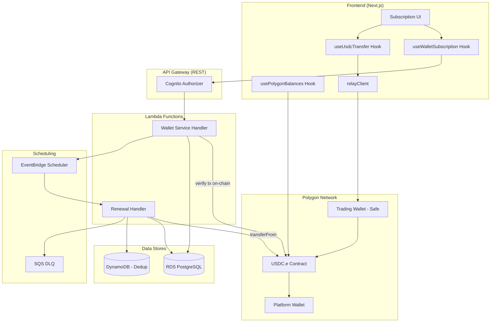
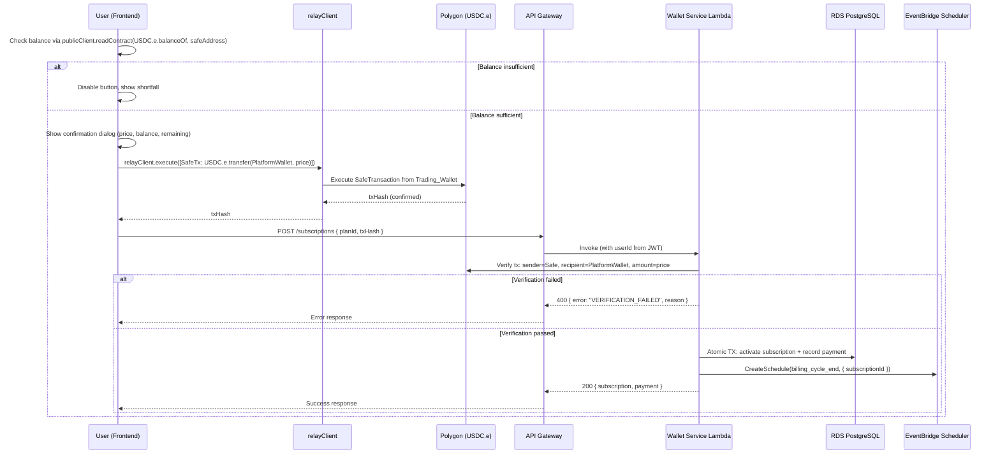
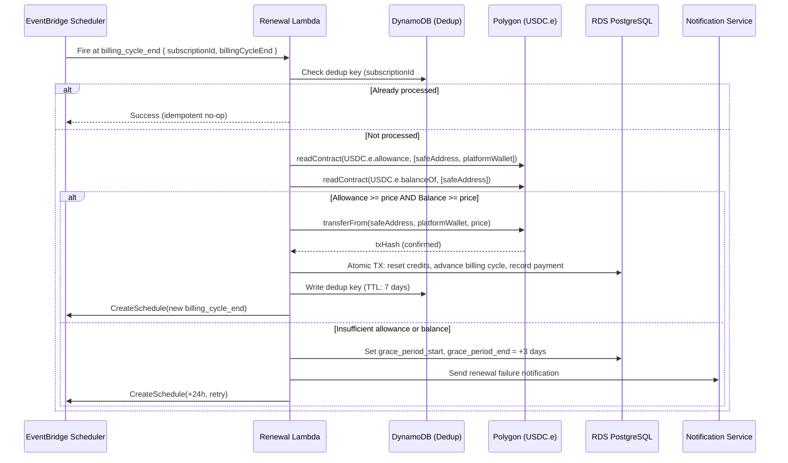

# Design Document: Wallet Subscription System

## Overview

This design replaces the existing Stripe-based subscription and billing system with a wallet-based payment model using on-chain USDC.e transfers on Polygon. Users pay for subscription plans and credit packs by initiating a USDC.e transfer from their Trading_Wallet (Safe/proxy wallet) to the TradeWizard Platform_Wallet via the frontend `relayClient.execute()`. The backend only verifies completed on-chain transactions - it never initiates transfers from user wallets.

### Key Design Decisions

1. **Frontend-initiated transfers via relayClient**: The frontend uses the existing `useUsdcTransfer.ts` pattern - creating a SafeTransaction with `USDC.e.transfer(Platform_Wallet, amount)` and executing via `relayClient.execute()`. The backend receives the resulting transaction hash and verifies it on-chain. This keeps the user in control of their funds at all times.
2. **Trading Wallet (Safe) as payment source**: Payments originate exclusively from the user's deterministically-derived Safe address (`deriveSafe(eoaAddress, SafeFactory)`), not the EOA. The backend derives the Safe address on-the-fly from the user's EOA (already stored from auth) and validates the transaction sender matches before accepting any payment.
3. **ERC-20 allowance for automatic renewals**: Users optionally approve a USDC.e allowance to the Platform_Wallet. At renewal time, the backend calls `transferFrom` to pull funds. If no allowance is set, the user must manually renew via the frontend.
4. **EventBridge Scheduler for renewals**: Each active subscription gets a one-shot EventBridge schedule targeting the billing_cycle_end. On renewal, a new schedule is created for the next cycle.
5. **Idempotency via composite deduplication key**: Renewal processing uses `(subscription_id, billing_cycle_end)` as a deduplication key stored in DynamoDB to prevent double-charges from duplicate event deliveries.
6. **Row-level locking for concurrency**: Credit pack purchases use PostgreSQL `SELECT ... FOR UPDATE` to serialize concurrent operations per user.
7. **No internal balance ledger**: The USDC.e balance is always read from the blockchain via viem's `publicClient.readContract`. The platform only tracks credits and subscription state.

## Architecture




### Request Flow: Plan Purchase (Frontend-Initiated)



### Request Flow: Automatic Renewal (Backend-Initiated transferFrom)



## Components and Interfaces

### 1. Wallet Service Lambda (`infra/services/subscription-api/handler.ts`)

Replaces the existing Stripe-based handler. Maintains a compatible API route structure but accepts transaction hashes instead of creating Stripe Checkout sessions.

**Routes:**
| Method | Path | Description |
|--------|------|-------------|
| GET | /subscriptions | Current subscription + credits |
| POST | /subscriptions | Verify tx hash and activate plan |
| DELETE | /subscriptions/{subscriptionId} | Cancel subscription |
| POST | /subscriptions/renew | Manual renewal (verify tx hash) |
| POST | /credits/purchase | Verify tx hash and add credits |
| GET | /wallet/balance | Read USDC.e balance from blockchain |
| GET | /payments/history | Paginated payment transaction history |

**Environment Variables:**
- `DB_SECRET_ARN` - Secrets Manager ARN for RDS credentials
- `DB_HOST` - RDS endpoint
- `PLATFORM_WALLET_ADDRESS` - The TradeWizard receiving wallet address
- `USDC_CONTRACT_ADDRESS` - USDC.e contract on Polygon (`0x2791Bca1f2de4661ED88A30C99A7a9449Aa84174`)
- `POLYGON_RPC_URL` - Polygon JSON-RPC endpoint
- `DEDUP_TABLE` - DynamoDB table for renewal deduplication
- `SAFE_FACTORY_ADDRESS` - Safe factory contract for deterministic address derivation

**Key Dependencies:**
- `viem` - For on-chain transaction verification and contract reads
- `pg` - PostgreSQL client
- `@aws-sdk/client-secrets-manager` - Secret retrieval
- `@aws-sdk/client-scheduler` - EventBridge Scheduler management
- `@aws-sdk/client-dynamodb` - Dedup table access


### 2. Renewal Handler Lambda (`infra/services/subscription-renewal/handler.ts`)

New Lambda triggered by EventBridge Scheduler at each billing_cycle_end. Unlike the Wallet Service, this handler CAN initiate on-chain transfers via `transferFrom` because the user has pre-approved an ERC-20 allowance.

**Trigger:** EventBridge Scheduler (one-shot per subscription cycle)
**DLQ:** SQS with 3 retries, exponential backoff (1m, 2m, 4m)

**Logic:**
1. Check DynamoDB dedup key (`subscription_id#billing_cycle_end`)
2. If already processed → return success (idempotent)
3. Read USDC.e allowance via `publicClient.readContract(allowance, [safeAddress, platformWallet])`
4. Read USDC.e balance via `publicClient.readContract(balanceOf, [safeAddress])`
5. If allowance >= price AND balance >= price → execute `transferFrom` via platform wallet's signer
6. If insufficient → enter grace period, schedule retry in 24h, notify user
7. Write dedup key to DynamoDB with 7-day TTL

**On-chain interaction for renewals:**
The Renewal Handler holds a private key for the Platform_Wallet (stored in Secrets Manager). It constructs and signs a `transferFrom(safeAddress, platformWallet, amount)` transaction, which succeeds only if the user's Safe has granted sufficient allowance.

### 3. On-Chain Verification Module (`infra/services/shared/chain-verification.ts`)

New module for verifying on-chain transactions and reading contract state.

```typescript
import { createPublicClient, http, parseAbi } from 'viem';
import { polygon } from 'viem/chains';

interface TransferVerification {
  txHash: string;
  expectedSender: string;   // User's Safe address
  expectedRecipient: string; // Platform Wallet
  expectedAmount: bigint;    // In USDC.e units (6 decimals)
}

interface VerificationResult {
  verified: boolean;
  error?: 'TX_NOT_FOUND' | 'TX_PENDING' | 'TX_REVERTED' | 'SENDER_MISMATCH' | 'RECIPIENT_MISMATCH' | 'AMOUNT_MISMATCH';
  actualSender?: string;
  actualRecipient?: string;
  actualAmount?: bigint;
  blockNumber?: bigint;
}

// Core verification function - pure logic, testable
function verifyTransferEvent(
  logs: TransferLog[],
  expected: TransferVerification
): VerificationResult;

// Read allowance granted by Safe to Platform Wallet
async function readAllowance(
  safeAddress: string,
  platformWallet: string
): Promise<bigint>;

// Read USDC.e balance of an address
async function readBalance(address: string): Promise<bigint>;

// Derive Safe address deterministically from EOA
function deriveSafeAddress(eoaAddress: string, factoryAddress: string): string;
```

### 4. Shared Utilities (`infra/services/shared/`)

**`credits.ts`** - Updated to remove Stripe references, add wallet-specific queries:
```typescript
const WALLET_QUERIES = {
  activateSubscription: `...`,
  processRenewal: `...`,
  addCreditPackCredits: `...`,
  getPurchasedCreditsBalance: `...`,
  recordPaymentTransaction: `...`,
  getPaymentHistory: `...`,
  getUserEoaAddress: `...`,
};
```

### 5. Frontend Components

**`hooks/useWalletSubscription.ts`** - Replaces `useSubscription.ts`:
```typescript
interface WalletSubscriptionData {
  plan: 'free' | 'starter' | 'pro' | 'elite';
  status: 'active' | 'cancelled' | 'grace_period';
  creditsRemaining: number;
  creditsMonthlyLimit: number;
  billingCycleEnd: string | null;
  renewalPrice: number | null;
  walletAddress: string;
  allowanceStatus: 'approved' | 'not_approved' | 'insufficient';
}

// Uses existing useUsdcTransfer + relayClient pattern for payments
function useSubscribePlan(): UseMutationResult<SubscribeResult, Error, { planId: string }>;
function usePurchaseCreditPack(): UseMutationResult<PurchaseResult, Error, { packId: string }>;
function useCancelSubscription(): UseMutationResult<CancelResult, Error, string>;
function useApproveAllowance(): UseMutationResult<ApproveResult, Error, { amount: bigint }>;
```

**`hooks/useSubscriptionAllowance.ts`** - Reads current USDC.e allowance:
```typescript
// Reads allowance(safeAddress, platformWallet) from USDC.e contract
function useSubscriptionAllowance(): {
  allowance: bigint;
  isAutoRenewalEnabled: boolean;
  isLoading: boolean;
};
```

**`components/subscription/PlanCard.tsx`** - Updated to show USDC.e prices and wallet balance comparison.

**`components/subscription/ConfirmPurchaseDialog.tsx`** - Confirmation dialog showing plan price, current Trading_Wallet balance, and remaining balance after purchase.

**`components/subscription/AllowanceApproval.tsx`** - UI for approving/revoking USDC.e allowance for auto-renewal.

### 6. CDK Infrastructure Changes (`infra/lib/compute-stack.ts`)

- Remove Stripe secret ARN environment variables from subscription Lambda
- Add Platform Wallet address, USDC contract address, Polygon RPC URL, Safe Factory address
- Add Platform Wallet private key ARN (Secrets Manager) for renewal `transferFrom`
- Add new `subscription-renewal` Lambda with EventBridge Scheduler permissions
- Add DynamoDB dedup table access for renewal handler
- Add `/subscriptions/renew`, `/wallet/balance`, and `/payments/history` routes to API Gateway
- Add SQS DLQ for renewal failures
- Grant renewal Lambda permission to create/delete EventBridge schedules


## Data Models

### Database Schema Changes (Migration)

```sql
-- Remove Stripe columns from subscriptions
ALTER TABLE subscriptions DROP COLUMN IF EXISTS stripe_customer_id;
ALTER TABLE subscriptions DROP COLUMN IF EXISTS stripe_subscription_id;

-- Add wallet-related columns to subscriptions
ALTER TABLE subscriptions ADD COLUMN wallet_address TEXT;
ALTER TABLE subscriptions ADD COLUMN grace_period_start TIMESTAMPTZ;
ALTER TABLE subscriptions ADD COLUMN grace_period_end TIMESTAMPTZ;
ALTER TABLE subscriptions ADD COLUMN eventbridge_schedule_arn TEXT;

-- Add payment_transactions table for on-chain payment history
CREATE TABLE payment_transactions (
  id UUID PRIMARY KEY DEFAULT gen_random_uuid(),
  user_id UUID NOT NULL REFERENCES users(id) ON DELETE CASCADE,
  transaction_type TEXT NOT NULL CHECK (
    transaction_type IN ('subscription_payment', 'credit_pack_purchase', 'renewal_payment', 'proration_credit')
  ),
  amount_usdc NUMERIC(10, 6) NOT NULL,
  tx_hash TEXT NOT NULL UNIQUE,
  source_address TEXT NOT NULL,
  plan TEXT,
  credit_pack_id TEXT,
  credits_added INTEGER,
  created_at TIMESTAMPTZ NOT NULL DEFAULT now()
);

CREATE INDEX idx_payment_transactions_user ON payment_transactions(user_id, created_at DESC);
CREATE INDEX idx_payment_transactions_type ON payment_transactions(user_id, transaction_type, created_at DESC);
CREATE INDEX idx_payment_transactions_tx_hash ON payment_transactions(tx_hash);

-- Add credit_source to credit_transactions to distinguish plan vs purchased credits
ALTER TABLE credit_transactions ADD COLUMN credit_source TEXT DEFAULT 'plan'
  CHECK (credit_source IN ('plan', 'credit_pack'));
```

### DynamoDB: Renewal Dedup Table

| Attribute | Type | Description |
|-----------|------|-------------|
| pk | String | `{subscription_id}#{billing_cycle_end_iso}` |
| processed_at | String | ISO timestamp of processing |
| tx_hash | String | On-chain transaction hash |
| status | String | `success` or `grace_period` |
| ttl | Number | Unix epoch + 7 days |

### Plan Configuration

```typescript
const PLANS = {
  free:    { price: 0,   creditsPerMonth: 5,      name: 'Free' },
  starter: { price: 19,  creditsPerMonth: 50,     name: 'Starter' },
  pro:     { price: 49,  creditsPerMonth: 200,    name: 'Pro' },
  elite:   { price: 149, creditsPerMonth: 999999, name: 'Elite' },
} as const;

const CREDIT_PACKS = {
  pack_20: { credits: 20, price: 9 },
  pack_50: { credits: 50, price: 19 },
} as const;

// USDC.e has 6 decimals - prices in contract units
function toUsdcUnits(usdAmount: number): bigint {
  return BigInt(Math.round(usdAmount * 1_000_000));
}
```

### API Request/Response Shapes

**POST /subscriptions (request):**
```json
{
  "planId": "pro",
  "txHash": "0xabc123..."
}
```

**POST /subscriptions (success response):**
```json
{
  "subscription": {
    "id": "uuid",
    "plan": "pro",
    "status": "active",
    "creditsRemaining": 200,
    "creditsMonthlyLimit": 200,
    "billingCycleStart": "2024-01-15T00:00:00Z",
    "billingCycleEnd": "2024-02-14T00:00:00Z"
  },
  "payment": {
    "txHash": "0xabc123...",
    "amount": 49,
    "type": "subscription_payment"
  }
}
```

**GET /subscriptions:**
```json
{
  "id": "uuid",
  "plan": "pro",
  "status": "active",
  "creditsRemaining": 150,
  "creditsMonthlyLimit": 200,
  "billingCycleStart": "2024-01-15T00:00:00Z",
  "billingCycleEnd": "2024-02-14T00:00:00Z",
  "walletAddress": "0x...",
  "renewalPrice": 49,
  "allowanceStatus": "approved"
}
```

**POST /credits/purchase (request):**
```json
{
  "packId": "pack_50",
  "txHash": "0xdef456..."
}
```

**GET /payments/history:**
```json
{
  "transactions": [
    {
      "id": "uuid",
      "transactionType": "subscription_payment",
      "amountUsdc": 49.000000,
      "txHash": "0xabc...",
      "sourceAddress": "0x...",
      "createdAt": "2024-01-15T10:30:00Z"
    }
  ],
  "nextCursor": "base64-encoded-cursor",
  "hasMore": true
}
```

**Error Response Format:**
```json
{
  "error": "VERIFICATION_FAILED",
  "message": "Transaction sender does not match registered Trading Wallet",
  "details": {
    "expectedSender": "0x...",
    "actualSender": "0x..."
  }
}
```


## Correctness Properties

*A property is a characteristic or behavior that should hold true across all valid executions of a system - essentially, a formal statement about what the system should do. Properties serve as the bridge between human-readable specifications and machine-verifiable correctness guarantees.*

### Property 1: SafeTransaction Encoding Round-Trip

*For any* valid recipient address and USDC.e amount, encoding a transfer via `createUsdcTransferTx({ recipient, amount })` SHALL produce a SafeTransaction whose `data` field, when decoded, yields the original recipient and amount.

**Validates: Requirements 1.2, 4.2**

### Property 2: Transfer Verification Correctness

*For any* on-chain transfer event with sender, recipient, and amount fields, the verification function SHALL return `verified: true` if and only if the sender matches the user's registered Safe address, the recipient matches the Platform_Wallet, and the amount matches the expected price. All other combinations SHALL return `verified: false` with the appropriate error code.

**Validates: Requirements 1.3, 1.7, 4.3, 4.7, 9.3, 9.4**

### Property 3: Proration Calculation

*For any* plan change with remaining_days (0–30), current_plan_price, and new_plan_price where new_plan_price > current_plan_price, the prorated credit SHALL equal `floor((remaining_days / 30) × current_plan_price × 100) / 100`, the charge amount SHALL equal `(new_plan_price - prorated_credit)`, the charge SHALL always be non-negative, and the prorated credit SHALL never exceed the current plan price.

**Validates: Requirements 1.10, 1.11**

### Property 4: Billing Cycle Initialization

*For any* subscription activation or renewal with a start date D and plan P, the billing_cycle_end SHALL equal D + 30 days, and credits_remaining SHALL equal P.creditsPerMonth.

**Validates: Requirements 1.8, 2.3**

### Property 5: Credit Reset on Plan Change

*For any* plan change from plan A to plan B, regardless of the previous credits_remaining value, the new credits_remaining SHALL equal plan B's monthly credit limit (creditsPerMonth).

**Validates: Requirements 1.13**

### Property 6: Renewal Decision Logic

*For any* subscription renewal attempt with allowance A, balance B, and plan price P, the renewal SHALL proceed with a `transferFrom` if and only if A >= P AND B >= P. When either condition is not met, the system SHALL enter the grace period.

**Validates: Requirements 2.2, 2.4, 8.2, 8.4**

### Property 7: Grace Period Downgrade Preserves Purchased Credits

*For any* subscription with plan-allocated credits and credit-pack-purchased credits, when the grace period expires and the user is downgraded to Free, the final credits_remaining SHALL equal 5 (free plan allocation) plus the sum of all unexpired credit-pack credits. Plan-allocated credits are forfeited.

**Validates: Requirements 2.7**

### Property 8: Renewal Idempotency

*For any* renewal event delivered K times (K >= 1) for the same (subscription_id, billing_cycle_end) pair, the system SHALL process the renewal exactly once: credits reset once, billing cycle advanced once, and exactly one `transferFrom` initiated.

**Validates: Requirements 2.10**

### Property 9: Cancelled Subscription Access Retention

*For any* cancelled subscription with a billing_cycle_end in the future, querying the subscription SHALL return the original plan and original credits_remaining (not reset to free plan values). When billing_cycle_end is reached, the subscription SHALL downgrade to Free with credits_remaining = 5.

**Validates: Requirements 3.2, 3.3**

### Property 10: Credit Pack Addition is Additive

*For any* current credits_remaining value C and credit pack with N credits, after a successful verified purchase the new credits_remaining SHALL equal (C + N), and a credit_transaction record SHALL exist with amount = N and credit_source = 'credit_pack'.

**Validates: Requirements 4.4**

### Property 11: Concurrent Purchases Serialize Correctly

*For any* set of N concurrent credit pack purchases for the same user with pack sizes [p1, p2, ..., pN], the final credits_remaining SHALL equal (initial_credits + p1 + p2 + ... + pN), with exactly N credit_transaction records created and no lost updates.

**Validates: Requirements 4.10**

### Property 12: Payment History Pagination

*For any* set of M payment transactions for a user, requesting history with page size P (default 20, max 100) SHALL return transactions ordered by created_at descending. The has_more flag SHALL be true if and only if more transactions exist beyond the current page. Following next_cursor through all pages SHALL yield exactly M transactions with no gaps or duplicates.

**Validates: Requirements 7.1, 7.3**

### Property 13: Transaction Type Filter Correctness

*For any* payment history request with a transaction_type filter F, all returned transactions SHALL have transaction_type = F, and no transactions with transaction_type ≠ F SHALL be included in the results.

**Validates: Requirements 7.5**

### Property 14: Deterministic Safe Address Derivation

*For any* EOA address and Safe factory address, `deriveSafeAddress(eoa, factory)` SHALL always produce the same Safe address. Additionally, for any two distinct EOA addresses, the derived Safe addresses SHALL be distinct.

**Validates: Requirements 9.1**


## Error Handling

### On-Chain Verification Failures

| Failure Mode | Error Code | Handling |
|-------------|-----------|----------|
| Transaction not found | `TX_NOT_FOUND` | Return 400; user may have submitted wrong hash |
| Transaction pending (not confirmed) | `TX_PENDING` | Return 202; frontend should poll or retry after delay |
| Transaction reverted | `TX_REVERTED` | Return 400; no state change, user informed of revert reason |
| Sender mismatch | `SENDER_MISMATCH` | Return 403; reject payment, log security event |
| Recipient mismatch | `RECIPIENT_MISMATCH` | Return 400; transaction went to wrong address |
| Amount mismatch | `AMOUNT_MISMATCH` | Return 400; transferred amount doesn't match plan/pack price |
| RPC timeout | `RPC_TIMEOUT` | Retry once with 10s timeout; if still fails, return 503 |
| Duplicate tx_hash | `DUPLICATE_TX` | Return 409; this transaction was already used for a payment |

### Renewal Failures

| Failure Mode | Handling |
|-------------|----------|
| Insufficient allowance | Enter grace period; notify user to re-approve allowance |
| Insufficient balance | Enter grace period; notify user to fund Trading Wallet |
| No allowance set | Send reminder 3 days before cycle end; require manual renewal |
| transferFrom reverted | Enter grace period; retry in 24h |
| Lambda timeout | SQS DLQ retry with exponential backoff (1m, 2m, 4m) |
| DB connection failure | SQS DLQ retry; alarm if DLQ depth > 0 |
| Grace period expired | Downgrade to Free; preserve purchased credits; notify user |

### Frontend Error Handling

| Scenario | UX |
|----------|-----|
| relayClient.execute() fails | Show inline error with failure reason; re-enable button |
| Transaction confirmed but verification fails | Show error from backend; no retry (user must investigate) |
| Network error during POST to backend | Retry up to 3 times with backoff; show "verifying..." state |
| Balance changed between check and execution | relayClient will revert; show "insufficient balance" error |

### Concurrency Control

- **Plan purchases**: Use `SELECT ... FOR UPDATE` on the subscriptions row to prevent concurrent plan changes for the same user.
- **Credit pack purchases**: Use `SELECT ... FOR UPDATE` on the subscriptions row to serialize credit additions.
- **Renewals**: DynamoDB conditional write (`PutItem` with `attribute_not_exists(pk)`) ensures exactly-once processing.
- **Duplicate tx_hash**: UNIQUE constraint on `payment_transactions.tx_hash` prevents the same on-chain transaction from being used twice.

### API Error Response Format

```typescript
interface ErrorResponse {
  error: string;           // Machine-readable error code
  message: string;         // Human-readable description
  shortfall?: number;      // USDC.e amount needed (for insufficient balance - frontend only)
  details?: Record<string, unknown>; // Additional context (addresses, amounts)
}
```

## Testing Strategy

### Property-Based Tests (fast-check)

Property-based testing is appropriate for this feature because it involves pure computational logic (proration, verification, pagination) with clear input/output behavior and universal properties that hold across a wide input space.

**Library:** fast-check (already in project)
**Configuration:** Minimum 100 iterations per property test
**Tag format:** `Feature: wallet-subscription-system, Property {N}: {description}`

Properties to implement:
1. **SafeTransaction encoding round-trip** - generate random addresses and amounts, encode then decode
2. **Transfer verification** - generate random (sender, recipient, amount) tuples with expected values, verify accept/reject
3. **Proration calculation** - generate random (remaining_days, current_price, new_price) tuples
4. **Billing cycle initialization** - generate random dates and plans
5. **Credit reset on plan change** - generate random credits and target plans
6. **Renewal decision logic** - generate random (allowance, balance, price) tuples
7. **Grace period downgrade credit preservation** - generate random credit compositions
8. **Renewal idempotency** - generate random duplicate event deliveries
9. **Cancelled subscription access retention** - generate random cancelled subscriptions with future/past dates
10. **Credit pack addition** - generate random current balances and pack sizes
11. **Concurrent purchase serialization** - generate random concurrent operation sequences
12. **Payment history pagination** - generate random transaction lists with varying sizes
13. **Transaction type filter** - generate random transaction lists with mixed types
14. **Deterministic Safe address derivation** - generate random EOA addresses, verify determinism and uniqueness

### Unit Tests (Vitest)

- Plan configuration validation (correct prices, credits, USDC.e unit conversion)
- Same-plan subscription rejection (error response)
- Invalid pack ID rejection
- Invalid/expired cursor handling
- Cancellation of already-cancelled subscription
- Cancellation of Free plan (error)
- Grace period cancellation → immediate downgrade
- EventBridge schedule creation/deletion parameter validation
- `toUsdcUnits` conversion for all plan prices
- Allowance approval SafeTransaction encoding

### Integration Tests

- Full plan purchase flow (mocked blockchain via viem test client, real DB)
- Renewal flow with grace period transitions
- Credit pack purchase with concurrent requests (row-level locking)
- Payment history pagination with cursor traversal
- Transfer verification against mocked transaction receipts
- Safe address derivation and validation during payment verification
- Manual renewal flow (same as initial purchase)

### Test File Locations

- Property tests: `infra/services/__tests__/wallet-subscription.property.test.ts`
- Unit tests: `infra/services/__tests__/wallet-subscription.test.ts`
- Integration tests: `infra/services/__tests__/wallet-subscription.integration.test.ts`
- Frontend hook tests: `tradewizard-frontend/hooks/__tests__/useWalletSubscription.test.ts`
